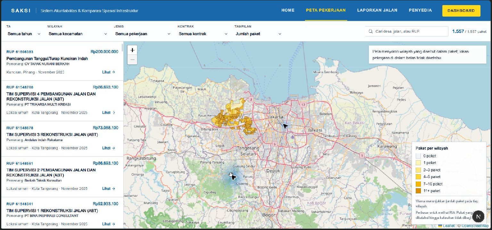

# SAKSI

**SAKSI** (*Sistem Akuntabilitas & Komparasi Spasial Infrastruktur*) membantu warga menelusuri paket pengadaan jalan di Kota Tangerang dan melihat wilayah administratif yang disebut dalam paket. SAKSI menghubungkan data RUP dengan rekam kontrak publik dan laporan kondisi jalan, dengan menampilkan batas presisi lokasi secara terbuka.

> Wilayah yang disorot menunjukkan area yang disebut dalam data paket, bukan titik lokasi pekerjaan. Data pengadaan dan laporan warga adalah sinyal untuk ditinjau, bukan bukti pelanggaran atau jaminan tindakan pemerintah.

**Repositori publik:** [github.com/repyh/saksi](https://github.com/repyh/saksi) · **Bahasa antarmuka:** Indonesia · **Cakupan:** jalan, jembatan, drainase, trotoar, dan turap di Kota Tangerang

## Cuplikan aplikasi



## Fitur yang tersedia

- **Peta audit dan register paket** di `/` dan `/peta-pekerjaan`, dengan filter tahun, kecamatan, jenis pekerjaan, rekam kontrak, dan pencarian teks.
- **Koroplet batas administratif:** poligon RW pada zoom 12 ke atas dan kelurahan pada zoom lebih rendah. Paket tanpa anchor tetap ada di register dengan label lokasi umum; peta tidak menampilkan pin per paket.
- **Detail penyedia dan kontrak** di `/penyedia`, dengan halaman ringkasan per penyedia. Rekam tender dan pengadaan langsung berasal dari LPSE/SPSE; transaksi e-purchasing/e-katalog dilengkapi Data INAPROC. Nama ditampilkan sebagai fakta kontrak, tanpa skor kinerja gabungan.
- **Alur laporan kerusakan jalan** di `/laporan` dan `/laporan/paket/[rup]`. Laporan mengumpulkan kategori dari pelapor; sistem tidak memakai computer vision atau mengukur luas kerusakan.
- **Fitur akun dan dashboard** untuk riwayat laporan, antrean review, detail terdeidentifikasi, serta pembacaan bukti foto dengan izin terpisah. Beberapa aksi moderasi masih dalam pengembangan.
- **PWA** dengan halaman offline dan cache aset statis. Tile peta dan respons API tidak disimpan oleh service worker.

## Data yang ditampilkan

Snapshot paket bertanggal **5 November 2026** (dirakit ulang 8 November 2026 setelah perbaikan awalan `Jl.`); detail rekam kontrak dan realisasi diperkaya **6 November 2026**.

| Cakupan snapshot | Nilai |
|---|---:|
| Paket jalan, jembatan, dan drainase | **2.552** |
| Pagu paket | **Rp813,13 Miliar** |
| Anchor RW | **1.612** |
| Anchor kelurahan | **517** |
| Anchor kecamatan | **79** |
| Tanpa lokus yang dapat dipetakan | **344** |
| Cakupan wilayah | **87/104 kelurahan · 585/1.020 RW · 13 kecamatan** |

**Rekam penyedia:** 2.334 dari 2.552 paket (91,5%) memiliki nama penyedia pada gabungan LPSE/SPSE dan Data INAPROC (731 dari LPSE/SPSE dan 1.603 dari Data INAPROC); 218 paket (Rp132,34 Miliar, 16,3% pagu) belum punya rekam publik, dan manifest mencatat 633 entri penyedia unik (630 setelah normalisasi nama gabungan). Ini menunjukkan cakupan rekam publik, bukan penilaian kualitas penyedia.

Sumber utama paket adalah ekspor RUP `data.inaproc.id` untuk `idKldi=D44`; batas administratif berasal dari ArcGIS Kota Tangerang. Data paket dibaca modul server-only: katalog Prisma/Supabase bila `DATABASE_URL` diisi, dan snapshot di `data/` sebagai cadangan tanpa database. Berkas paket tidak disajikan langsung sebagai aset publik. GeoJSON batas RW dan kelurahan tersedia di `public/data/` untuk kebutuhan peta.

### Batas interpretasi lokasi

Tidak ada paket dalam snapshot yang memiliki koordinat lokasi pekerjaan. Anchor diturunkan dari informasi RW, kelurahan, atau kecamatan pada nama/lokus paket. Warna koroplet menghitung paket pada batas wilayah tersebut; warna tidak menyatakan ruas atau titik pekerjaan di dalamnya. Paket yang tidak memiliki anchor tidak diberi titik atau poligon buatan.

## Status pengembangan

Status terakhir ditinjau **9 November 2026**. “Tersedia” berarti implementasinya ada di repo; bagian yang memerlukan layanan eksternal tetap perlu dikonfigurasi.

| Komponen | Status | Keterangan |
|---|---|---|
| Eksplorasi paket | **Tersedia** | Server Component, direktori `/paket`, detail `/paket/[rup]`, dan `GET /api/packages` memakai repository Prisma/Supabase dengan snapshot sebagai cadangan. |
| Peta RW/kelurahan dan register | **Tersedia** | Filter, pencarian, tampilan agregat, pemilihan paket/wilayah. Register berpaginasi (`page`/`limit`); peta membaca agregat ringkas per `bbox` viewport dan detail paket dimuat saat dipilih. |
| Rekam kontrak dan penyedia | **Tersedia** | LPSE/SPSE dan Data INAPROC digabung berdasarkan Kode RUP. |
| API laporan dan penyimpanan privat | **Tersedia** | API, idempotensi, pembatasan laju, sanitasi ulang di server, model laporan, dan bucket privat tersedia; submit, antrean review, dan aksi Publikasikan/Tolak sudah diverifikasi end-to-end 8–9 November 2026. |
| Riwayat akun dan review laporan | **Tersedia** | Riwayat akun, antrean, detail terdeidentifikasi, akses bukti foto berizin, dan perubahan status tersedia. Penugasan, catatan internal, serta pekerjaan retensi belum selesai. |
| Auth dan dashboard | **Tersedia dengan konfigurasi database** | Better Auth memakai undangan; izin ditentukan per akun dan kode izin lama sudah diarsipkan lewat migrasi retensi izin. Tanpa `DATABASE_URL`, fitur database tidak aktif. |
| Katalog paket/wilayah di Postgres | **Tersedia** | Katalog Kota Tangerang (RUP, detail, kontrak, realisasi, batas) diimpor lewat `workers/ingest.mjs`; pencarian paket membaca katalog itu bila database tersedia. |
| Worker pengambilan data terjadwal | **Tersedia** | `workers/ingest.mjs` dengan lock/retry/log, penjadwal di dalam Next, artefak systemd timer, dan alur GitHub Actions. |

## Teknologi

- **Aplikasi:** Next.js 16 App Router, React 19, TypeScript 5
- **UI:** Tailwind CSS v4, shadcn/ui, Base UI, Lucide React, React Icons
- **Peta:** Leaflet 1.9, React Leaflet 5, tile OpenStreetMap
- **Server dan data:** Route Handlers sebagai BFF, Prisma 7, Supabase PostgreSQL/PostGIS dan private Storage
- **Autentikasi dan izin:** Better Auth dengan otorisasi berbasis permission
- **PWA:** manifest, service worker, dan fallback offline
- **Runtime dan package manager:** Node.js 24; Bun 1.4.2 direkomendasikan (`bun.lock` tersedia)

## Menjalankan secara lokal

### Prasyarat

- Node.js **24** (lihat `.nvmrc`).
- Bun **1.4.2** untuk mengikuti lockfile proyek.
- Postgres tidak diperlukan untuk menjalankan peta dan membaca snapshot paket.

### Mode snapshot tanpa database

```bash
git clone https://github.com/repyh/saksi.git
cd saksi
bun install --frozen-lockfile
bun run dev
```

Buka `http://localhost:3000`. Untuk pemeriksaan lokal yang sama dengan CI proyek:

```bash
bun run lint
bun run build
```

Build menjalankan `prisma generate` melalui `prebuild`, tetapi tidak memerlukan `DATABASE_URL`.

### Mengaktifkan auth dan fitur laporan

Salin `.env.example` menjadi `.env.local`, lalu isi nilai yang sesuai untuk Supabase dan Better Auth. Minimal, fitur database memerlukan `DATABASE_URL`, `BETTER_AUTH_URL`, dan `BETTER_AUTH_SECRET`; migrasi memakai `DIRECT_URL`. Penyimpanan bukti laporan juga memerlukan `SUPABASE_URL` dan `SUPABASE_SERVICE_ROLE_KEY`. Rahasia server tidak boleh dimasukkan ke kode browser atau repositori.

Setelah koneksi database dikonfigurasi, terapkan migrasi yang sudah ada dan siapkan bucket privat:

```bash
bun run db:deploy
bun run storage:reports:ensure
```

Tanpa database, data paket tetap dapat dijelajahi dari snapshot, sedangkan endpoint yang membutuhkan auth atau penyimpanan akan tidak tersedia.

## Perintah proyek

| Perintah | Fungsi |
|---|---|
| `bun run dev` | Menjalankan server pengembangan |
| `bun run lint` | Menjalankan ESLint |
| `bun run build` | Membuat build produksi; tidak mewajibkan database |
| `bun run start` | Menjalankan build produksi |
| `bun run db:generate` | Membuat Prisma Client |
| `bun run db:deploy` | Menerapkan migrasi Prisma yang telah disimpan |
| `bun run db:status` | Memeriksa status migrasi |
| `bun run lpse:list`, `lpse:detail`, `lpse:match` | Pipeline data kontrak LPSE/SPSE |
| `bun run data:realisasi` | Mengolah ekspor realisasi Data INAPROC |
| `bun run data:rup`, `data:rup-detail`, `data:enrich` | Mengambil atau memperkaya data RUP |

## Struktur repository

```text
src/
  app/          Halaman Next.js dan Route Handlers
  contracts/    Kontrak data lintas lapisan
  features/     Antarmuka dan interaksi fitur
  server/       Use case, API domain, repository server-only
  lib/          Klien Prisma dan Better Auth
data/           Snapshot sumber; tidak dikirim langsung ke browser
public/data/    GeoJSON batas wilayah untuk peta
prisma/         Skema dan migrasi PostgreSQL
docs/           Arsitektur, keamanan, laporan, desain, dan handoff
```

Alur paket saat ini:

```text
Browser → Next.js Route Handler → PackagesApi → service → repository snapshot → data/*.json
```

Browser hanya meminta data melalui API; snapshot paket tetap berada di sisi server. Supabase untuk katalog paket dan area merupakan tahap berikutnya, bukan sumber paket yang sedang dibaca aplikasi.

## Dokumentasi terkait

- [Arsitektur aplikasi](docs/ARCHITECTURE.md)
- [Status dan keputusan proyek](docs/STATE.md)
- [Model dan perilaku laporan](docs/REPORTS.md)
- [Keamanan](docs/SECURITY.md)
- [Kebijakan privasi](src/content/legal/privacy.md)
- [Syarat dan ketentuan](src/content/legal/terms.md)

## Prinsip privasi dan integritas

- Jangan menafsirkan wilayah terpetakan sebagai koordinat pekerjaan atau bukti pelanggaran.
- Kategori kerusakan, penyebab yang diamati, dan ukuran kasar berasal dari pelapor; SAKSI tidak mengukur area kerusakan dengan computer vision.
- Foto dinormalisasi di browser dan diperiksa serta di-encode ulang oleh server saat API laporan digunakan. Pemeriksaan wajah dan plat nomor masih menjadi tanggung jawab pelapor; blur otomatis belum diterapkan.
- Foto bukti laporan disimpan di bucket privat. Jangan mengungkap URL atau path objek penyimpanan.
- Nama penyedia berasal dari rekam pengadaan publik, dilengkapi jumlah paket/nilai/tahun; SAKSI tidak membuat skor kinerja gabungan.
