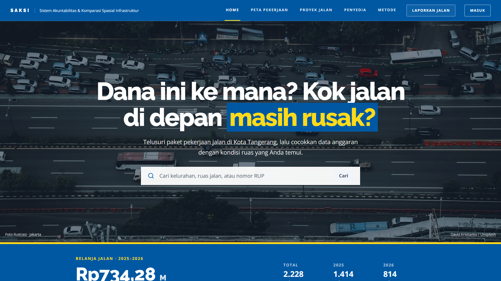
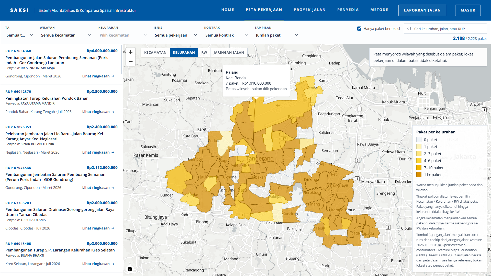
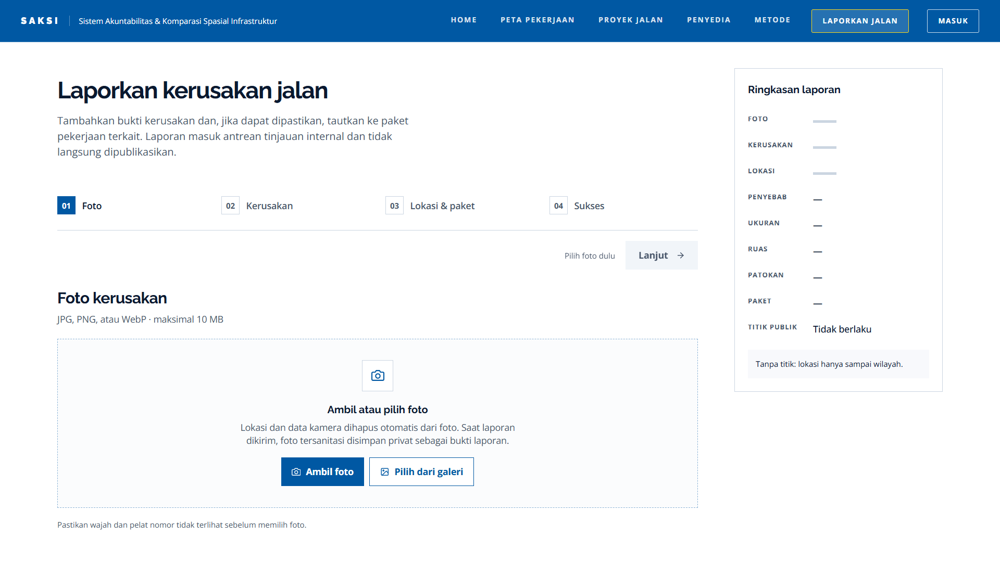
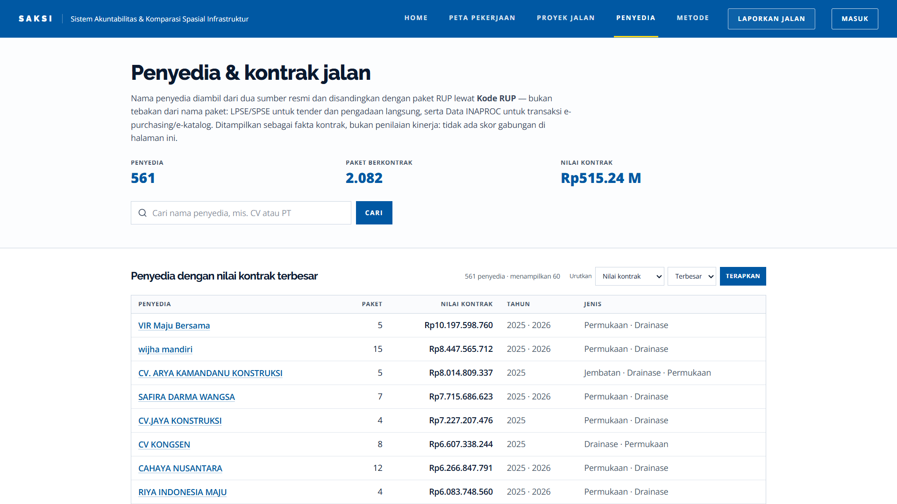
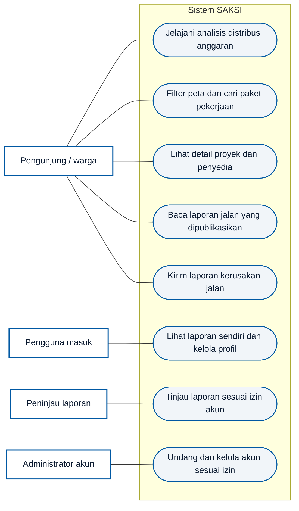
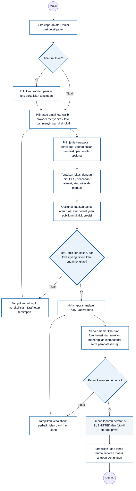
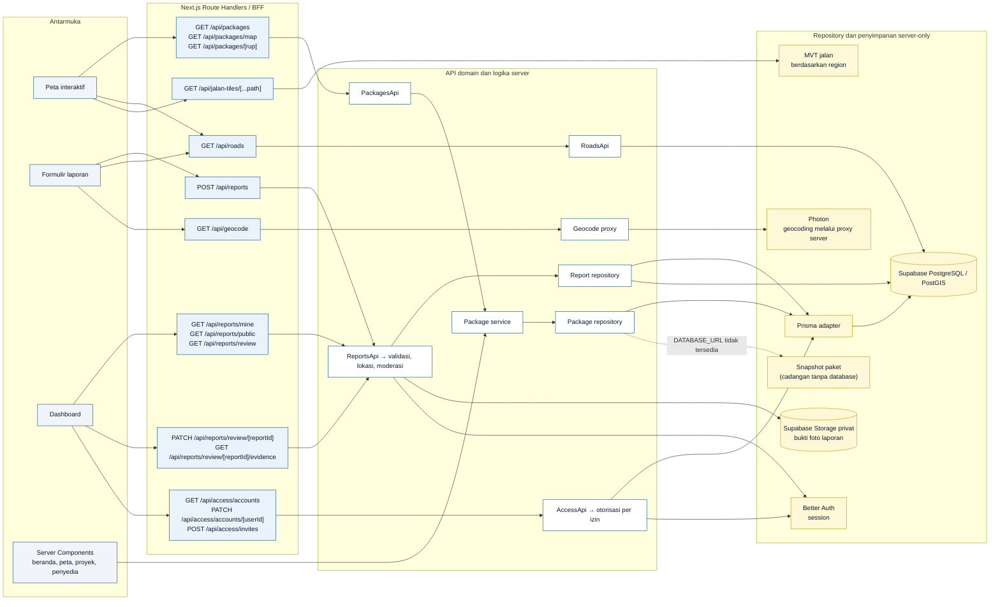
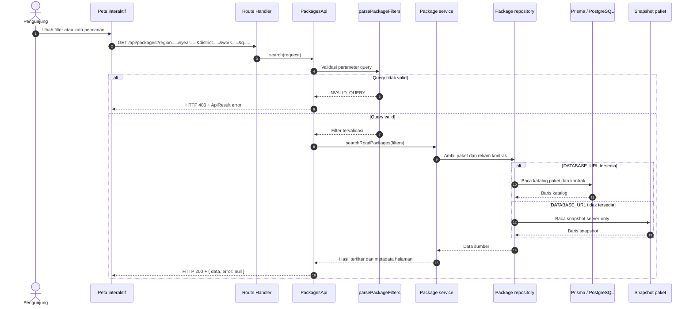

<div align="center">

# SAKSI

**Sistem Akuntabilitas & Komparasi Spasial Infrastruktur**

Telusuri paket pekerjaan jalan di Kota Tangerang, pahami wilayah yang disebut dalam data, lalu bandingkan dengan laporan kondisi jalan dari warga.

<a href="https://saksi.repyh.my.id"><strong>Buka SAKSI</strong></a> · <a href="https://saksi.repyh.my.id/peta-pekerjaan">Peta Pekerjaan</a> · <a href="#panduan-penggunaan">Panduan Penggunaan</a>


</div>

> SAKSI menampilkan wilayah administratif yang disebut dalam data paket. Sorotan wilayah bukan titik atau ruas pekerjaan. Data pengadaan dan laporan warga dapat membantu penelusuran, tetapi tidak dengan sendirinya membuktikan pelanggaran atau memastikan tindakan pemerintah.

## Daftar Isi

- [SAKSI](#saksi)
  - [Daftar Isi](#daftar-isi)
  - [Tentang SAKSI](#tentang-saksi)
  - [Screenshot Aplikasi](#screenshot-aplikasi)
  - [Fitur](#fitur)
  - [Diagram Sistem](#diagram-sistem)
    - [Use case diagram](#use-case-diagram)
    - [Activity diagram](#activity-diagram)
  - [Panduan Penggunaan](#panduan-penggunaan)
    - [Menelusuri paket pekerjaan](#menelusuri-paket-pekerjaan)
    - [Membaca detail proyek](#membaca-detail-proyek)
    - [Menelusuri penyedia dan kontrak](#menelusuri-penyedia-dan-kontrak)
    - [Mengirim laporan jalan](#mengirim-laporan-jalan)
    - [Menggunakan dashboard](#menggunakan-dashboard)
      - [Akun Admin demo](#akun-admin-demo)
      - [Bagian dashboard](#bagian-dashboard)
      - [Meninjau laporan](#meninjau-laporan)
      - [Mengelola akun](#mengelola-akun)
  - [Data dan Batas Interpretasi](#data-dan-batas-interpretasi)
  - [Menjalankan Secara Lokal](#menjalankan-secara-lokal)
    - [Prasyarat](#prasyarat)
    - [Mode snapshot](#mode-snapshot)
    - [Mengaktifkan database dan fitur laporan](#mengaktifkan-database-dan-fitur-laporan)
    - [Pemeriksaan](#pemeriksaan)
  - [Arsitektur Backend](#arsitektur-backend)
    - [Diagram API dan alur backend](#diagram-api-dan-alur-backend)
      - [Request data paket](#request-data-paket)
      - [Pengiriman dan moderasi laporan](#pengiriman-dan-moderasi-laporan)
  - [Keamanan](#keamanan)
  - [Teknologi](#teknologi)
  - [Privasi dan Lisensi Data](#privasi-dan-lisensi-data)
  - [Dokumentasi](#dokumentasi)

## Tentang SAKSI

SAKSI membantu warga menelusuri rencana pekerjaan jalan dan rekam kontrak publik di Kota Tangerang. Peta menghubungkan paket Rencana Umum Pengadaan (RUP) dengan batas kecamatan, kelurahan, dan RW yang dapat dikenali dari informasi lokasi pada paket. Warga juga dapat mengirim laporan kondisi jalan beserta foto dan lokasi untuk ditinjau.

Situs ini berfokus pada jalan, jembatan, drainase atau saluran, trotoar, serta turap. Cakupan data paket saat ini adalah Kota Tangerang dan tahun anggaran 2025–2026. Jumlah paket, nilai anggaran, cakupan wilayah, dan rekam penyedia berubah mengikuti pembaruan data; angka terkini tidak disalin ke README ini.

## Screenshot Aplikasi

<p align="center">
  
  <br><em>Beranda — temukan paket melalui pencarian atau lanjutkan ke peta pekerjaan.</em>
</p>

<p align="center">
  
  <br><em>Peta pekerjaan — filter, daftar paket, serta koroplet wilayah. Poligon menunjukkan wilayah yang dirujuk, bukan koordinat pekerjaan.</em>
</p>

<p align="center">
  
  <br><em>Pelaporan jalan — formulir bertahap dengan ringkasan laporan.</em>
</p>

<p align="center">
  
  <br><em>Penyedia dan kontrak — telusuri rekam publik berdasarkan nama penyedia.</em>
</p>

Foto latar beranda pada cuplikan berasal dari David Kristianto melalui Unsplash.
Cuplikan menampilkan data pada waktu pengambilan; jumlah dan daftar paket dapat berubah setelah pembaruan data.

## Fitur

- **Peta pekerjaan** dengan filter tahun, kecamatan, kelurahan, jenis pekerjaan, rekam kontrak, dan pencarian paket.
- **Peta gradasi wilayah (koroplet)** untuk membandingkan jumlah paket di tingkat kecamatan, kelurahan, atau RW. Peta menggunakan batas administratif; tidak ada pin yang mengesankan koordinat pekerjaan.
- **Daftar dan detail paket** untuk meninjau nama paket, kode RUP, pagu, wilayah yang dikenali, serta informasi terkait.
- **Direktori penyedia dan kontrak** yang menggabungkan rekam LPSE/SPSE dan Data INAPROC. Halaman menampilkan fakta kontrak, bukan skor gabungan kinerja penyedia.
- **Analisis anggaran** untuk membandingkan pola distribusi dan membuka kelompok paket terkait di peta.
- **Pelaporan kondisi jalan** dengan pilihan kategori dari pelapor, lokasi, foto, serta tautan paket rujukan bila relevan.
- **Dashboard akun** untuk melihat laporan sendiri, memperbarui profil, meninjau laporan, dan mengelola akun sesuai izin.
- **PWA** dengan halaman offline untuk membantu akses ketika koneksi terputus. Peta dan respons API tidak disimpan oleh service worker.

## Diagram Sistem

Diagram berikut merangkum kemampuan aplikasi dan alur utama yang tersedia. Diagram dirender langsung oleh GitHub dari Mermaid.

### Use case diagram



Pengguna masuk tetap dapat memakai fitur publik. Pengiriman laporan tidak mewajibkan akun; tab dashboard dan tindakan staf mengikuti sesi serta izin akun.

### Activity diagram

Activity diagram ini mengikuti pengiriman laporan sampai tanda terima. Peninjauan dan keputusan publikasi dilakukan kemudian oleh staf.



Laporan berstatus `SUBMITTED` belum tampil ke publik. Laporan baru tersedia setelah ditinjau dan dipublikasikan; titik presisi hanya ditampilkan bila pelapor menyetujuinya.

## Panduan Penggunaan

### Menelusuri paket pekerjaan

1. Buka [Peta Pekerjaan](https://saksi.repyh.my.id/peta-pekerjaan) dari navigasi atau tombol pencarian di beranda.
2. Gunakan filter **TA**, **Wilayah**, **Kelurahan**, **Jenis**, **Kontrak**, dan **Tampilan** untuk mempersempit daftar. Pilih kecamatan sebelum memilih kelurahan.
3. Gunakan kontrol **Kecamatan / Kelurahan / RW** di atas peta untuk mengganti tingkat poligon yang ditampilkan. Pilihan tingkat peta tidak mengikuti zoom secara otomatis.
4. Cari nama jalan atau kelurahan, atau masukkan kode RUP pada kotak pencarian. Daftar paket di sisi peta menampilkan hasil yang cocok.
5. Pilih poligon untuk melihat ringkasan agregat wilayah, atau pilih paket pada daftar untuk membuka rincian dan informasi penyedia yang tersedia.
6. Gunakan **Jaringan Jalan** untuk menampilkan layer referensi ruas dan informasinya. Layer ini tidak menghubungkan ruas ke paket atau mengubah lokasi paket.

Centang **Hanya paket berlokasi** untuk menyaring paket yang memiliki rujukan lokasi administratif. Paket yang hanya dapat dikenali sampai tingkat kota tetap tersedia di daftar sebagai lokasi umum saat filter tersebut dimatikan.

### Membaca detail proyek

Buka [Proyek Jalan](https://saksi.repyh.my.id/project) untuk mencari dan membandingkan paket dalam bentuk daftar. Pilih nama atau kode RUP untuk membaca halaman detail proyek. Halaman ini berguna ketika Anda ingin memeriksa informasi satu paket tanpa menjelajahi peta terlebih dahulu.

### Menelusuri penyedia dan kontrak

Buka [Penyedia](https://saksi.repyh.my.id/penyedia), cari nama penyedia, lalu gunakan pilihan urutan untuk menata hasil. Buka halaman penyedia untuk melihat paket dan rekam kontrak yang terhubung.

SAKSI memakai LPSE/SPSE untuk rekam tender dan pengadaan langsung, serta Data INAPROC untuk transaksi e-purchasing atau e-katalog. Sebagian paket belum memiliki rekam penyedia publik yang dapat dihubungkan. Ketiadaan rekam tersebut tidak membuktikan bahwa paket tidak memiliki penyedia.

### Mengirim laporan jalan

1. Pilih **Laporkan Jalan** pada navigasi atau buka [formulir laporan](https://saksi.repyh.my.id/laporan).
2. Tambahkan foto kerusakan. Sistem menormalisasi foto dan membuang metadata lokasi kamera; periksa agar wajah dan pelat nomor tidak terlihat sebelum mengirim.
3. Pilih jenis kerusakan dan isi keterangan yang membantu menjelaskan kondisi.
4. Tentukan lokasi menggunakan titik pada peta atau wilayah administratif. Ruas jalan dan paket pekerjaan bersifat opsional; tambahkan hanya jika dapat dikenali.
5. Tinjau ringkasan, lalu kirim. Laporan masuk ke antrean peninjauan dan tidak langsung tampil di halaman publik.

> Kategori kerusakan, penyebab yang diamati, dan ukuran kasar berasal dari pelapor. SAKSI tidak menggunakan computer vision untuk menentukan jenis atau luas kerusakan.

### Menggunakan dashboard

Dashboard memerlukan akun. Untuk melihatnya, pilih **Masuk** pada navigasi dan gunakan akun yang telah diberi akses. Setelah masuk, buka **Dashboard**.

#### Akun Admin demo

Gunakan akun berikut pada [halaman masuk](https://saksi.repyh.my.id/login?returnTo=%2Fdashboard):

| Kolom | Nilai |
|---|---|
| Email | `admin@admin.com` |
| Kata sandi | `adminadminadmin` |

Akun ini digunakan bersama untuk demonstrasi. Perubahan yang disimpan—termasuk perubahan profil, keputusan moderasi, dan perubahan akun—dapat memengaruhi tampilan bagi pengguna demo lain. Untuk penilaian, tinjau fitur terlebih dahulu dan hindari menghapus akun atau mengubah izin tanpa kebutuhan.

#### Bagian dashboard

| Bagian | Kegunaan |
|---|---|
| **Telusuri** | Pintasan ke peta pekerjaan, direktori penyedia, dan formulir laporan. |
| **Laporan Saya** | Melihat laporan yang dikirim melalui akun tersebut dan statusnya. |
| **Akun Saya** | Memperbarui nama atau email dan melihat izin akun yang tersedia. Perubahan email memerlukan verifikasi. |
| **Review Laporan** | Antrean peninjauan. Buka detail untuk memeriksa ringkasan; akses bukti, publikasi, atau penolakan bergantung pada izin akun. Penolakan memerlukan alasan. |
| **Manajemen akun** | Mengundang akun, mengatur akses, memperbarui akun, atau menonaktifkan dan menghapusnya sesuai izin. |

Tab **Review Laporan** dan **Manajemen akun** hanya muncul jika akun memiliki izin yang sesuai. URL tab dapat dibagikan atau dibuka langsung, misalnya `/dashboard?tab=report-moderation` dan `/dashboard?tab=account-management`; akses tetap diperiksa oleh server.

#### Meninjau laporan

1. Buka tab **Review Laporan**, lalu pilih status dan urutan untuk menyaring antrean.
2. Pilih **Detail** untuk membaca ringkasan, wilayah, dan paket rujukan bila ada. Bukti foto hanya tersedia bagi akun yang memiliki izin membaca bukti.
3. Jika memiliki izin mengubah status, pilih tindakan publikasi atau penolakan. Penolakan memerlukan alasan moderasi. Periksa kembali detail sebelum menyimpan keputusan.

#### Mengelola akun

1. Buka tab **Manajemen akun** dan cari akun berdasarkan nama atau email.
2. Gunakan **Undang akun** untuk membuat tautan undangan. Pilih akses yang diperlukan dan bagikan tautan melalui saluran yang sesuai.
3. Gunakan tombol aksi pada baris akun untuk mengubah nama atau izin, menonaktifkan akun, atau menghapusnya jika izin Anda mengizinkan.
4. Tindakan yang menonaktifkan atau menghapus akun meminta alasan. Penghapusan akun tidak menghapus laporan warga yang sudah tersimpan.

Gunakan tombol keluar pada panel **Aksi cepat** setelah selesai.

## Data dan Batas Interpretasi

- Data paket bersumber dari RUP pada Data INAPROC dan diperbarui melalui proses pembaruan data. Detail kontrak dan penyedia berasal dari LPSE/SPSE serta data realisasi Data INAPROC.
- Rujukan lokasi diturunkan dari informasi yang tersedia pada paket: RW, kelurahan, kecamatan, atau lokasi umum. Tidak semua paket menyebut lokasi dengan tingkat presisi yang sama.
- Poligon berwarna menunjukkan jumlah atau ringkasan paket di dalam wilayah administratif. Poligon tidak menunjukkan titik, ruas, atau bagian jalan yang dikerjakan.
- Layer ruas jalan adalah referensi peta. Sorotan ruas dan nama jalan tidak menjadi penghubung otomatis ke suatu paket.
- Rekam penyedia yang tidak ditemukan bukan bukti ketiadaan kontrak atau penyedia.
- Laporan warga merupakan informasi untuk ditinjau. Laporan tidak langsung menetapkan status pekerjaan atau kesimpulan atas suatu pihak.
- Indikator analisis memakai bahasa netral, seperti **Diduga Tidak Sesuai**, dan tidak dimaksudkan sebagai tuduhan.

> Hindari membandingkan nilai paket tanpa memperhatikan tahun, jenis pekerjaan, wilayah, dan sumber kontraknya. Baca halaman [Metode](https://saksi.repyh.my.id/metode) untuk penjelasan sumber dan batas analisis.

README ini tidak menyimpan angka dataset. Untuk metrik terkini, periksa `data/regions/kota-tangerang/manifest.json` atau jalankan `bun run db:verify -- --region kota-tangerang` pada lingkungan yang terhubung ke database.

## Menjalankan Secara Lokal

### Prasyarat

- Node.js **24** (lihat `.nvmrc`).
- Bun **1.4.2** untuk memasang dependensi dari `bun.lock`.
- Database tidak diperlukan untuk menjelajahi peta dan membaca snapshot paket.

### Mode snapshot

```bash
git clone https://github.com/repyh/saksi.git
cd saksi
bun install --frozen-lockfile
bun run dev
```

Buka [http://localhost:3000](http://localhost:3000). Mode ini memakai snapshot paket yang ada di repository. Fitur yang membutuhkan autentikasi, penyimpanan laporan, atau katalog database memerlukan konfigurasi layanan terkait.

### Mengaktifkan database dan fitur laporan

Salin `.env.example` ke `.env.local`, kemudian isi kredensial yang sesuai untuk Supabase dan Better Auth. Jangan menaruh nilai rahasia di kode atau mengunggahnya ke repository.

```bash
# macOS / Linux / Git Bash
cp .env.example .env.local

# Windows PowerShell
Copy-Item .env.example .env.local
```

Konfigurasikan variabel sesuai kebutuhan fitur, termasuk `DATABASE_URL`, `DIRECT_URL`, `BETTER_AUTH_URL`, `BETTER_AUTH_SECRET`, `SUPABASE_URL`, dan `SUPABASE_SERVICE_ROLE_KEY`. Service role key hanya boleh digunakan di server. Set `SITE_URL` ke origin publik saat deployment, dan isi `CATALOG_REVALIDATE_TOKEN` agar worker ingestion dapat menyegarkan cache katalog lewat `POST /api/internal/catalog/revalidate`.

`DATABASE_URL` adalah satu-satunya penanda fitur database aktif (autentikasi, laporan, katalog database); `DIRECT_URL` hanya dipakai Prisma CLI untuk migrasi. Bila pooler Supavisor bermasalah saat pengembangan lokal, arahkan `DATABASE_URL` ke koneksi session mode yang sama dengan `DIRECT_URL` alih-alih mengosongkannya.

Terapkan migrasi dan siapkan penyimpanan privat hanya pada environment database yang memang Anda kelola:

```bash
bun run db:deploy
bun run storage:reports:ensure
```

### Pemeriksaan

```bash
bun run lint
bun run build
bun run test:e2e
```

Build menghasilkan Prisma Client melalui `prebuild` dan dirancang tetap dapat berjalan tanpa `DATABASE_URL`. Tes end-to-end menjalankan aplikasi lokal dengan mode snapshot dan memakai proyek browser ponsel serta desktop.

## Arsitektur Backend

Next.js menangani halaman, autentikasi, dan Route Handler yang menjadi perantara antara browser dan layanan aplikasi. Logika pencarian dan laporan berada di modul server; browser tidak mengakses Prisma atau database secara langsung.

### Diagram API dan alur backend



Diagram tersebut memisahkan request interaktif browser yang melalui Route Handler dari halaman Server Component yang memanggil package service di server. Browser tidak mengakses database atau Supabase Storage secara langsung. `GET /api/packages/map` memakai jalur BFF yang sama, lalu menjalankan agregasi peta.

#### Request data paket

Route paket memvalidasi query sebelum memanggil use case. `PackagesApi` memakai pembungkus respons bersama agar respons sukses dan kesalahan mengikuti bentuk API yang sama.



`GET /api/packages/map` menjalankan `aggregateRoadPackages()` untuk ringkasan wilayah, sedangkan `GET /api/packages/[rup]` menjalankan `getRoadPackage()` untuk satu paket. Ketiganya memakai validasi query atau parameter serta respons kesalahan terstruktur.

#### Pengiriman dan moderasi laporan

```mermaid
sequenceDiagram
  autonumber
  actor Reporter as Pelapor
  participant Form as Form laporan
  participant SubmitRoute as POST /api/reports
  participant API as ReportsApi
  participant Location as Resolver lokasi
  participant Access as Idempotensi dan rate limit
  participant Storage as Supabase Storage privat
  participant DB as Prisma / PostgreSQL
  participant Dashboard as Dashboard staf
  participant ReviewRoute as API review laporan
  participant Authority as Authorization authority
  participant Public as Halaman laporan publik

  Reporter->>Form: Kirim foto, kategori, dan lokasi
  Form->>SubmitRoute: Multipart + Idempotency-Key
  alt Origin tidak diizinkan
    SubmitRoute-->>Form: Tolak request melalui CORS
  else Origin diizinkan
    SubmitRoute->>API: Teruskan multipart
    API->>API: Validasi field, jumlah, tipe, dan ukuran file
    API->>Location: Validasi titik/wilayah dan rujukan paket/ruas
    Location-->>API: Hasil validasi lokasi
    opt Sesi Better Auth tersedia
      API->>API: Kaitkan laporan dengan akun aktif
    end
    API->>Access: Periksa Idempotency-Key dan batas pengiriman
    alt Validasi gagal atau batas pengiriman tercapai
      API-->>Form: Respons kesalahan; tidak membuat laporan baru
      Form-->>Reporter: Tampilkan pesan dan pertahankan draf lokal
    else Request baru valid
      API->>Storage: Simpan WebP yang disanitasi
      API->>DB: Simpan laporan, media, tautan, dan event awal
      DB-->>API: Transaksi berhasil; status SUBMITTED
      API-->>Form: HTTP 201 + kode tanda terima
      Form-->>Reporter: Tampilkan tanda terima
    end
  end

  Note over Dashboard,ReviewRoute: Peninjauan adalah proses terpisah setelah laporan masuk antrean.
  Dashboard->>ReviewRoute: GET /api/reports/review
  ReviewRoute->>Authority: Periksa reports.read_queue
  alt Tidak memiliki reports.read_queue
    Authority-->>ReviewRoute: Tolak akses
    ReviewRoute-->>Dashboard: HTTP 403
  else Izin antrean tersedia
    Authority-->>ReviewRoute: Izinkan
    ReviewRoute-->>Dashboard: Ringkasan antrean tanpa identitas pelapor
  end
  Dashboard->>ReviewRoute: GET /api/reports/review/[reportId]
  ReviewRoute->>Authority: Periksa reports.read_queue + reports.read_deidentified
  Authority-->>ReviewRoute: Izinkan detail dan catat akses
  ReviewRoute-->>Dashboard: Detail laporan yang telah dideidentifikasi
  opt Izin reports.read_precise_location tersedia
    ReviewRoute->>Authority: Catat akses lokasi presisi
    ReviewRoute-->>Dashboard: Tambahkan titik dan geometri ruas
  end
  opt Izin reports.read_queue dan reports.read_sensitive_evidence tersedia
    Dashboard->>ReviewRoute: GET /api/reports/review/[reportId]/evidence
    ReviewRoute->>Authority: Periksa izin bukti dan catat akses
    ReviewRoute-->>Dashboard: Alirkan foto dari storage privat
  end
  Dashboard->>ReviewRoute: PATCH /api/reports/review/[reportId] + status + alasan
  ReviewRoute->>Authority: Periksa reports.change_status + reports.read_deidentified
  alt Status dan alasan valid; izin tersedia
    ReviewRoute->>DB: Catat status baru dan alasan moderasi
    DB-->>ReviewRoute: Status tersimpan
    ReviewRoute->>ReviewRoute: Revalidasi cache laporan publik
    ReviewRoute-->>Dashboard: Keputusan berhasil
  else Izin atau validasi gagal
    ReviewRoute-->>Dashboard: Respons kesalahan; status tidak berubah
  end
  Note over ReviewRoute,Public: Hanya status PUBLISHED masuk proyeksi publik; titik presisi hanya disertakan bila ada persetujuan pelapor.
```

Pengiriman dapat dilakukan tanpa akun; jika sesi tersedia, API mengaitkan laporan dengan akun tersebut. Akses detail, foto bukti, dan lokasi presisi memerlukan izin terpisah. Penolakan memerlukan alasan, dan laporan `REJECTED` tidak masuk ke tampilan publik.

Saat `DATABASE_URL` tersedia, repository membaca katalog Supabase. Tanpanya, paket dibaca dari snapshot agar peta dan build tetap dapat digunakan. Worker ingest berjalan terpisah dari permintaan halaman untuk memperbarui katalog.

## Keamanan

- Dashboard menggunakan Better Auth. Akun dibuat melalui undangan; fitur staf dan administrasi hanya tersedia sesuai izin akun.
- Izin diperiksa pada server untuk setiap operasi terlindungi. Tab yang disembunyikan di antarmuka bukan satu-satunya pembatas akses.
- Identitas pelapor tidak ditampilkan sebagai data publik. Titik lokasi hanya ditampilkan jika pelapor menyetujuinya; foto bukti tetap privat. Akses staf ke lokasi presisi dan bukti memerlukan izin khusus serta dicatat.
- Foto laporan divalidasi dan di-encode ulang oleh server sebelum masuk ke bucket privat. Metadata foto dihapus; pelapor tetap perlu memastikan wajah dan pelat nomor tidak terlihat.
- Database, Better Auth, dan Supabase service-role key hanya digunakan di sisi server melalui variabel lingkungan. Jangan memakai kredensial demo sebagai rahasia deployment.

Akun demo pada [panduan dashboard](#akun-admin-demo) ditujukan untuk melihat fitur pada lingkungan demonstrasi bersama, bukan untuk deployment pribadi atau produksi.

## Teknologi

- **Aplikasi:** Next.js App Router, React, TypeScript
- **Antarmuka:** Tailwind CSS, shadcn/ui, Base UI, React Icons
- **Peta:** MapLibre GL JS dan OpenFreeMap Positron
- **Server dan data:** Route Handlers, Prisma, Supabase PostgreSQL/PostGIS, Supabase Storage privat
- **Autentikasi dan akses:** Better Auth dengan izin per akun
- **PWA:** Progressive Web App dengan manifest, service worker, dan halaman offline
- **Runtime:** Node.js 24 dan Bun 1.4.2

## Privasi dan Lisensi Data

- Foto laporan disanitasi sebelum disimpan. Pelapor tetap bertanggung jawab memastikan wajah dan pelat nomor tidak tampak.
- Foto bukti berada di bucket privat; aksesnya dibatasi menurut izin akun.
- Informasi lokasi presisi laporan hanya dapat dibaca oleh akun dengan izin khusus dan aksesnya dicatat.
- Layer jalan mengacu pada Overture Maps dan OpenStreetMap dengan lisensi ODbL-1.0. Atribusi yang ditampilkan di peta: **© OpenStreetMap contributors, Overture Maps Foundation (ODbL)**.
- Data paket, kontrak, dan batas wilayah tunduk pada ketentuan sumber masing-masing. Lihat [Lisensi Data](docs/DATA-LICENSE.md) dan [Kebijakan Privasi](src/content/legal/privacy.md).

## Dokumentasi

- [Arsitektur aplikasi](docs/ARCHITECTURE.md)
- [Status dan keputusan proyek](docs/STATE.md)
- [Metode dan interpretasi produk](docs/PRODUCT.md)
- [Desain antarmuka](docs/DESIGN.md)
- [Model laporan](docs/REPORTS.md)
- [Keamanan](docs/SECURITY.md)
- [Lisensi data](docs/DATA-LICENSE.md)
- [Kebijakan privasi](src/content/legal/privacy.md)
- [Syarat dan ketentuan](src/content/legal/terms.md)
