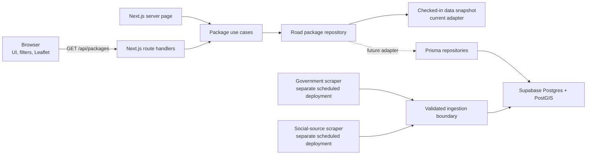

# SAKSI Architecture

**Status:** The frontend/backend boundary is implemented for road-package search. The current data adapter reads the checked-in Tangerang snapshot; Supabase domain queries and scraper workers remain the next implementation stages.

## Decision

SAKSI uses one repository with two deployment boundaries:

1. **Web application:** Next.js App Router provides the user interface, server-rendered initial data, API routes, authentication, and application use cases.
2. **Scraper workers:** Government-site and public social-source collectors run as separately deployed scheduled processes. They do not run in the user's browser or as part of a web request.

The Next.js server is the web app's backend-for-frontend (BFF). The browser calls application APIs for interactive queries. Only server modules may access Prisma, database credentials, or ingestion interfaces. The map remains a client-side component because Leaflet requires browser interaction.

This decision supersedes the older FDS instruction to load the JSON directly from the browser. The existing snapshot remains the current source; no package or report tables have been invented as part of this boundary refactor.

## System context



The dotted Supabase path is planned. The current package search does not query Supabase. Prisma and Better Auth are present, and PostGIS is enabled, but the Prisma schema currently contains only Better Auth's models.

## Boundaries and ownership

| Layer | Owns | Must not own |
|---|---|---|
| `src/features/**` | Presentation, map interaction, filter controls, browser-only draft storage | Prisma, database URLs, scraper scheduling, source parsing |
| `src/app/api/**` | HTTP parsing, request validation, status codes, API envelopes | SQL, source-specific scraping, UI state |
| `src/server/**` | Use cases, domain filtering, repository interfaces and implementations | React components or browser APIs |
| `src/contracts/**` | Shared request/response and domain DTO types | Runtime secrets or persistence logic |
| `prisma/**` | Database schema and migrations | Scraper schedules or UI behavior |
| `workers/**` | Source adapters, schedules, parsing, normalization, validation, ingestion | Browser UI, public web request handling |

Allowed dependency direction:

```text
Browser UI -> API contract -> Next.js route -> server use case -> repository -> data source
Scraper schedule -> source adapter -> normalize/validate -> ingestion -> restricted persistence access
```

Client components must never import from `src/server` or `src/lib/prisma`. Server-only modules use the `server-only` marker to make that boundary enforceable during builds.

## Current implementation

### Package search

- `src/app/page.tsx` is a Server Component. It calls `searchRoadPackages()` and passes the initial result to the interactive map dashboard.
- `src/features/map/map-dashboard.tsx` owns only filter and selection state, plus rendering the list and map.
- Changes to year, district, work type, or search text call `GET /api/packages`.
- `src/app/api/packages/route.ts` parses and validates query parameters, calls the package use case, and returns the shared `ApiResult<T>` envelope.
- `src/server/packages/service.ts` owns filtering and result counts. It depends on `RoadPackageRepository`, not on a UI component or Prisma directly.
- `src/server/packages/snapshot-repository.ts` implements that interface from `data/saksi_tangerang_2025_2026.json`. It keeps only the road sector and is marked server-only.
- Shared package DTOs live in `src/contracts/packages/road-package.contract.ts`.

The endpoint returns all matching package rows because the current map and list operate on the same set; the list displays at most 120 rows while the map renders the matching coordinates. This establishes the boundary but is not yet a payload or map-rendering optimization. The next scale step is separate list pagination from a compact map-feature query, ideally bounded by map viewport.

### Database and authentication

- Supabase is the managed PostgreSQL host. PostGIS is enabled in the `extensions` schema.
- Prisma is the intended ORM and is currently used by Better Auth.
- The Prisma schema does not yet define road packages, provenance, official measurements, reports, moderation, or ingestion-run records.
- Browser code must not connect directly to Postgres or receive database credentials or a Supabase service-role key.
- Use Prisma for ordinary reads/writes. Put complex spatial operations behind named repository methods and parameterized SQL; do not spread raw GIS SQL across route handlers or UI code.

### Reports

The report draft contract and IndexedDB store are browser-side foundations. They deliberately omit photo bytes. A report submission API, persistent report model, moderation states, and retention policy are not implemented yet. Keep image metadata removal and manual privacy redaction on-device before any future submission.

### Scrapers

Neither scraper is implemented in this repository. They are planned as separate deployments with independent schedules, credentials, logs, retries, and failure alerts. A worker should:

1. Fetch only the source data it is permitted to access.
2. Preserve source URL, retrieval time, source period, checksum, and parser version.
3. Normalize and validate a complete batch before applying it.
4. Upsert idempotently and record a run outcome, including rejected records.

The government-site and social-source pipelines should remain separate adapters because their rate limits, formats, provenance, and failure modes differ. Do not treat an X post as an official record or as proof of an allegation. Decide and document the permitted access method for X before implementing that worker.

## API contract

### `GET /api/packages`

Optional query parameters:

| Parameter | Accepted values | Meaning |
|---|---|---|
| `year` | `2025`, `2026` | Fiscal year |
| `district` | Kecamatan name, up to 100 characters | Exact kecamatan filter |
| `work` | `SEMUA`, `PERMUKAAN`, `DRAINASE`, `JEMBATAN` | Work classification |
| `q` | Up to 120 characters | Search package name, RUP, village, or district |

Successful responses use `{ "data": ..., "error": null }`. Invalid filters return HTTP 400 with `INVALID_QUERY`; unavailable package data returns HTTP 500 with a generic message. Internal exception details are not sent to the browser.

The contract types are shared across the UI and route. Query parameters are validated at the HTTP boundary; TypeScript types alone do not validate user input.

## Data and privacy principles

- Keep the 271 packages without a micro-location in the register; do not create map points for them.
- Preserve location precision (`Desa/Kelurahan`, `Garis Koridor`, `Kecamatan`, or general/unmapped) in all API and database projections.
- Keep source and retrieval metadata attached to official figures so values can be traced and reprocessed.
- Reports are signals for review, not accusations. Include status and uncertainty in public views.
- Do not collect reporter identity as a prerequisite. Apply rate limits without requiring a real-world identity.
- Do not upload photos that the product promises to keep on-device.

## Proposed evolution

1. **Now — snapshot-backed BFF:** Keep the existing dataset unchanged; all package access goes through the server repository and API contract.
2. **Supabase domain model:** Define source provenance, normalized road packages and location precision first; then migrate the repository from the snapshot adapter to Prisma/PostGIS. Keep the contract stable where possible.
3. **Independent ingestion:** Add the two scheduled workers and an ingestion boundary with restricted credentials, idempotency, validation, and run history.
4. **Reports:** Finalize privacy, moderation, abuse controls, and retention before adding report persistence.
5. **Scale map queries:** Separate paginated register results from minimal map features and query spatial features by viewport.

Each stage should be independently deployable and should not require UI components to know which repository implementation supplies the data.
