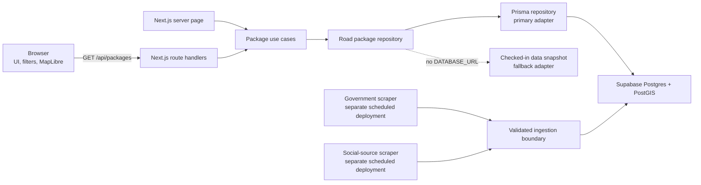

# SAKSI Architecture

**Status:** The frontend/backend boundary is implemented for road-package search. Package search, contracts, vendors, and audit metrics now read the Supabase catalog through Prisma; the checked-in snapshot remains the no-database fallback. Scraper workers and remaining provenance pages are the next implementation stages.

## Decision

SAKSI uses one repository with two deployment boundaries:

1. **Web application:** Next.js App Router provides the user interface, server-rendered initial data, API routes, authentication, and application use cases.
2. **Scraper workers:** Government-site and public social-source collectors run as separately deployed scheduled processes. They do not run in the user's browser or as part of a web request.

The Next.js server is the web app's backend-for-frontend (BFF). The browser calls application APIs for interactive queries. Only server modules may access Prisma, database credentials, or ingestion interfaces. The map remains a client-side component because MapLibre GL JS requires browser interaction.

This decision supersedes the older FDS instruction to load the JSON directly from the browser. Prisma defines the ingestion, package, administrative-area, and report persistence models; migrations are deployed, and the Kota Tangerang catalog is populated by `workers/ingest.mjs`. When `DATABASE_URL` is set, package search and contract/vendor reads use that catalog; without it, the repository falls back to the checked-in snapshot so `next build` and database-less environments keep working.

## System context



Prisma, Better Auth, and PostGIS are present. Authentication, authorization, registration-invitation, and report migrations have been deployed to the configured Supabase project, and the Kota Tangerang package, RUP, contract, realization, and administrative-area catalogs are populated. The application queries the package catalog when `DATABASE_URL` is set and otherwise falls back to the snapshot adapter.

## Boundaries and ownership

| Layer | Owns | Must not own |
|---|---|---|
| `src/features/**` | Presentation, map interaction, filter controls, browser-only draft storage | Prisma, database URLs, scraper scheduling, source parsing |
| `src/app/api/**` | Next.js HTTP adapter functions that delegate to a domain API class | Request business logic, SQL, source parsing, UI state |
| `src/server/api/**` | Domain API classes, HTTP input validation, authorization checks, response/error mapping | React components, browser APIs, direct domain persistence |
| `src/server/**` (outside `api/`) | Use cases, domain filtering, repository interfaces and implementations | HTTP transport concerns, React components or browser APIs |
| `src/contracts/**` | Shared request/response and domain DTO types | Runtime secrets or persistence logic |
| `prisma/**` | Database schema and migrations | Scraper schedules or UI behavior |
| `workers/**` | Source adapters, schedules, parsing, normalization, validation, ingestion, run history | Browser UI, public web request handling |

Allowed dependency direction:

```text
Browser UI -> API contract -> Next.js route adapter -> domain API class -> use case -> repository -> data source
Scraper schedule -> source adapter -> normalize/validate -> ingestion -> restricted persistence access
```

Client components must never import from `src/server` or `src/lib/prisma`. Server-only modules use the `server-only` marker to make that boundary enforceable during builds.

## Current implementation

### Package search

- `src/app/page.tsx` is a Server Component. It resolves `?region=` (default `kota-tangerang`), calls `searchRoadPackages({ region })`, and passes the initial result to the interactive map dashboard.
- `src/features/map/map-dashboard.tsx` owns only filter and selection state, plus rendering the list and map.
- Changes to region, year, district, work type, or search text call `GET /api/packages?region=<id>`.
- `src/app/api/packages/route.ts` delegates `GET` to `src/server/api/packages/packages.api.ts`. `PackagesApi` validates query parameters, calls the package use case, and returns the shared `ApiResult<T>` envelope through shared HTTP response handling.
- `src/server/packages/service.ts` owns filtering and result counts. It depends on `RoadPackageRepository`, not on a UI component or Prisma directly.
- `src/server/packages/source.ts` selects the repository per region: `database-repository.ts` queries Prisma when `DATABASE_URL` is set, while `snapshot-repository.ts` reads `data/regions/<id>/region.json` as the fallback. Both are server-only.
- `src/server/packages/lpse-repository.ts` builds the contract and vendor index from `lpse_contracts` and `realization_transactions` in database mode, and from the checked-in LPSE/realization JSON in fallback mode.
- `src/server/regions/region-registry.ts` discovers region configs from `data/regions/*/region.json` and exposes the region summary used by the API, audit metrics, and map (boundary URLs, GeoJSON property names, centre, environment label).
- Shared package DTOs live in `src/contracts/packages/road-package.contract.ts`; region DTOs live in `src/contracts/regions/region.contract.ts`.
- `scripts/check-region.mjs` is the per-region quality gate (structure, road object, anchor consistency, provider coverage) and writes an optional provenance manifest. `scripts/ingest.mjs` runs one job per region with a delay between commands.
- `src/server/api/shared/` contains transport errors, response helpers, and the request-context shape. Each domain API owns its endpoint policy. `AccessApi` handles invite issuance and revocation; `ReportsApi` implements submission, account history, the staff review queue, public published-report queries, and Publish/Reject moderation. Better Auth's catch-all route continues to delegate directly to Better Auth.

The register is paginated (`page`/`limit`, 50 rows by default, 300 maximum) and the map reads a separate compact aggregate endpoint (`GET /api/packages/map`) bounded by the current viewport (`bbox`), so the browser no longer downloads every matching row. A selected package is fetched on demand from `GET /api/packages/[rup]`. The package list and contract index are cached per server process; the aggregate is recomputed per request. Moving filtering into SQL and precomputing the aggregate are the next scale steps.

### Database and authentication

- Supabase is the managed PostgreSQL host. PostGIS is enabled in the `extensions` schema.
- Prisma is the application ORM and is used by Better Auth, the authorization foundation, reports, and the database-backed package/contract repositories. The multi-region ingestion worker uses parameterized `pg` SQL for large batches against the same schema.
- The Prisma schema defines Better Auth, authorization, registration-invitation, ingestion provenance, road-package, administrative-area, and report tables. The migrations are deployed; the Kota Tangerang RUP, detail, contract, realization, and boundary catalogs are populated. Official measurement series remain undefined.
- Browser code must not connect directly to Postgres or receive database credentials or a Supabase service-role key.
- Use Prisma for ordinary reads/writes. Put complex spatial operations behind named repository methods and parameterized SQL; do not spread raw GIS SQL across route handlers or UI code.

### Authorization authority

`src/server/authorization/authority.ts` is the server-only decision entry point. It resolves active individual permission-grant rows and dispatches each permission to a domain strategy registered in `registry.ts`; Better Auth supplies identity and sessions. Domain policy lives in `strategies/reports.ts`, `analytics.ts`, `access.ts`, and `sources.ts`. The central authority owns authentication, deny-by-default behavior, and consistent denials. Strategies own domain prerequisites and transactional permission-grant operations. No account has an implicit role or preset assignment. Permission grants and revocations are persisted per code and audited. Source-controlled access presets are expanded into individual bits before persistence. The invite issue/revoke endpoints consume `access.users.invite`; broader staff routes remain unimplemented. The permission-bit flattening migration is prepared but not deployed. See [AUTHORIZATION.md](./AUTHORIZATION.md) for the permission catalog, preset boundaries, and rollout status.

Better Auth applies a database-backed IP rate limit to email/password sign-in and sign-up: at most five requests per minute per client IP. This is shared across web instances through the deployed `rateLimit` table. Ensure the hosting proxy supplies a sanitized client IP header; without one, requests share a per-route bucket and can throttle unrelated users together.

`/register` is invite-gated by a Better Auth user-creation hook. Tokens are random, email-bound, hashed at rest, single-use, and consumed in the same transaction as account creation. Permission-checked issuance and revocation are exposed through `AccessApi`. Migration `20261104130000_registration_invites` is deployed. See [SECURITY.md](./SECURITY.md) for the security behavior and rollout gaps.

### Reports

The report form keeps state in the page until submission. Local image sanitation is used for preview; on submit, `POST /api/reports` rechecks the multipart image, re-encodes it server-side, stores it in the private `report-evidence` Supabase Storage bucket, and transactionally persists the report, media metadata, package reference, status event, and idempotency result. The API supports an exact-origin CORS allowlist. `GET /api/reports/mine` uses the Better Auth session to return only the signed-in user's coarse report summaries. `GET /api/reports/review` requires `reports.read_queue` and returns a paginated staff queue without reporter identity, private text, or media references. `GET /api/reports/public` exposes only `PUBLISHED` reports with damage type, coarse size, area, dates, and package reference; it never returns reporter identity, description, location hint, precise location, or media. `PATCH /api/reports/review/[publicCode]` requires `reports.change_status` (and `reports.read_deidentified`), accepts `PUBLISHED` or `REJECTED` with a mandatory reason, and appends a `ReportStatusEvent`. Submission and moderation were verified end to end on 8–9 November 2026; see [REPORTS.md](./REPORTS.md). Evidence review, public-photo policy, and retention cleanup remain unimplemented. Faces and plates require a manual reporter check.

### Ingestion worker

`workers/ingest.mjs` is the standalone government-data worker for one region. It runs RUP → detail → realization → LPSE → normalize → validate → database upsert → snapshot rebuild → `region:check`. It supports `--region`, `--dry-run`, `--sources`, `--refresh`, a database lock, retries with backoff, rate-limited source commands, structured JSON logs, run history, and atomic failure behavior: the normalized batch is one transaction, and the snapshot is only published after the temporary snapshot passes the gate. See [INGESTION.md](./INGESTION.md).

The worker preserves every source row as a checksummed artifact plus `raw_records`, including rows that do not match a RUP, package, or boundary. It populates the same catalog the application repository reads; the snapshot it publishes remains the fallback and the provenance artifact.

A social-source scraper is not implemented. Do not treat an X post as an official record or as proof of an allegation. Decide and document the permitted access method for X before implementing that worker.

## API contract

### `GET /api/packages`

Optional query parameters:

| Parameter | Accepted values | Meaning |
|---|---|---|
| `region` | Region id, default `kota-tangerang` | Snapshot and boundary configuration |
| `year` | `2025`, `2026` | Fiscal year |
| `district` | Kecamatan name, up to 100 characters | Exact kecamatan filter |
| `desa` | Repeatable kelurahan names, up to 60 | Kelurahan subset inside the chosen kecamatan |
| `work` | `SEMUA`, `PERMUKAAN`, `DRAINASE`, `JEMBATAN` | Work classification |
| `kontrak` | `ADA`, `TANPA` | Contract-record presence |
| `lokasi` | `0`, `1` | `1` hides packages without a derived area |
| `q` | Up to 120 characters | Search package name, RUP, village, or district |
| `page` | Integer 1–10,000, default 1 | Register page |
| `limit` | Integer 1–300, default 50 | Register rows per page |

Successful responses use `{ "data": ..., "error": null }`. Invalid filters return HTTP 400 with `INVALID_QUERY`; unavailable package data returns HTTP 500 with a generic message. Internal exception details are not sent to the browser.

`GET /api/packages/map` accepts the same filters (page/limit are ignored) and returns compact per-RW/kelurahan/kecamatan counts, budgets, work counts, and a sample RUP. `GET /api/packages/[rup]` returns one package including its contract record, or 404 `PACKAGE_NOT_FOUND`.

`GET /api/reports/public` accepts `region`, `paket`, `kecamatan`, `kelurahan`, `page`, and `limit`; it returns only `PUBLISHED` reports. `PATCH /api/reports/review/[publicCode]` accepts `{ status: "PUBLISHED" | "REJECTED", reason: string }`, requires `reports.change_status`, and appends a `ReportStatusEvent`.

The contract types are shared across the UI and route. Query parameters are validated at the HTTP boundary; TypeScript types alone do not validate user input.

## Data and privacy principles

- Keep the 271 packages without a micro-location in the register; do not create map points for them.
- Preserve location precision (`Desa/Kelurahan`, `Garis Koridor`, `Kecamatan`, or general/unmapped) in all API and database projections.
- Keep source and retrieval metadata attached to official figures so values can be traced and reprocessed.
- Reports are signals for review, not accusations. Include status and uncertainty in public views.
- Do not collect reporter identity as a prerequisite. Apply rate limits without requiring a real-world identity.
- Do not upload photos that the product promises to keep on-device.

## Proposed evolution

1. **Database-backed BFF (done):** All package, contract, vendor, and audit-metric access goes through the server repository and API contract. Prisma is the primary adapter; the snapshot is the fallback when `DATABASE_URL` is unset.
2. **Spatial queries:** Move package filtering and map aggregation into PostGIS so the register no longer loads the full region catalog per request, and decide whether report area lookup should read `administrative_areas` instead of the boundary GeoJSON.
3. **Independent ingestion:** Add the two scheduled workers and an ingestion boundary with restricted credentials, idempotency, validation, and run history.
4. **Reports:** Apply the report migration, create the private bucket, then complete privacy, moderation, abuse-control, and retention decisions in [REPORTS.md](./REPORTS.md) before enabling public report access or publication.
5. **Scale map queries:** Separate paginated register results from minimal map features, query spatial features by viewport (implemented with `bbox`), and cache or precompute the aggregate.

Each stage should be independently deployable and should not require UI components to know which repository implementation supplies the data.
