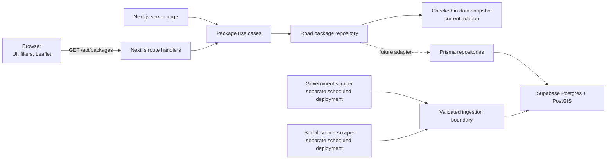

# SAKSI Architecture

**Status:** The frontend/backend boundary is implemented for road-package search. The current data adapter reads the checked-in Tangerang snapshot; Supabase domain queries and scraper workers remain the next implementation stages.

## Decision

SAKSI uses one repository with two deployment boundaries:

1. **Web application:** Next.js App Router provides the user interface, server-rendered initial data, API routes, authentication, and application use cases.
2. **Scraper workers:** Government-site and public social-source collectors run as separately deployed scheduled processes. They do not run in the user's browser or as part of a web request.

The Next.js server is the web app's backend-for-frontend (BFF). The browser calls application APIs for interactive queries. Only server modules may access Prisma, database credentials, or ingestion interfaces. The map remains a client-side component because Leaflet requires browser interaction.

This decision supersedes the older FDS instruction to load the JSON directly from the browser. The checked-in snapshot remains the current package source. Prisma defines package, administrative-area, and report persistence models; the database migrations are deployed, but package/area catalogs are not populated and package search does not yet query those tables.

## System context



The dotted Supabase package-search path is planned. The current package search does not query Supabase. Prisma and Better Auth are present, and PostGIS is enabled. Authentication, authorization, registration-invitation, and report migrations have been deployed to the configured Supabase project; package and administrative-area catalogs are not yet populated.

## Boundaries and ownership

| Layer | Owns | Must not own |
|---|---|---|
| `src/features/**` | Presentation, map interaction, filter controls, browser-only draft storage | Prisma, database URLs, scraper scheduling, source parsing |
| `src/app/api/**` | Next.js HTTP adapter functions that delegate to a domain API class | Request business logic, SQL, source parsing, UI state |
| `src/server/api/**` | Domain API classes, HTTP input validation, authorization checks, response/error mapping | React components, browser APIs, direct domain persistence |
| `src/server/**` (outside `api/`) | Use cases, domain filtering, repository interfaces and implementations | HTTP transport concerns, React components or browser APIs |
| `src/contracts/**` | Shared request/response and domain DTO types | Runtime secrets or persistence logic |
| `prisma/**` | Database schema and migrations | Scraper schedules or UI behavior |
| `workers/**` | Source adapters, schedules, parsing, normalization, validation, ingestion | Browser UI, public web request handling |

Allowed dependency direction:

```text
Browser UI -> API contract -> Next.js route adapter -> domain API class -> use case -> repository -> data source
Scraper schedule -> source adapter -> normalize/validate -> ingestion -> restricted persistence access
```

Client components must never import from `src/server` or `src/lib/prisma`. Server-only modules use the `server-only` marker to make that boundary enforceable during builds.

## Current implementation

### Package search

- `src/app/page.tsx` is a Server Component. It calls `searchRoadPackages()` and passes the initial result to the interactive map dashboard.
- `src/features/map/map-dashboard.tsx` owns only filter and selection state, plus rendering the list and map.
- Changes to year, district, work type, or search text call `GET /api/packages`.
- `src/app/api/packages/route.ts` delegates `GET` to `src/server/api/packages/packages.api.ts`. `PackagesApi` validates query parameters, calls the package use case, and returns the shared `ApiResult<T>` envelope through shared HTTP response handling.
- `src/server/packages/service.ts` owns filtering and result counts. It depends on `RoadPackageRepository`, not on a UI component or Prisma directly.
- `src/server/packages/snapshot-repository.ts` implements that interface from `data/saksi_tangerang_2025_2026.json`. It keeps only the road sector and is marked server-only.
- Shared package DTOs live in `src/contracts/packages/road-package.contract.ts`.
- `src/server/api/shared/` contains transport errors, response helpers, and the request-context shape. Each domain API owns its endpoint policy. `AccessApi` handles invite issuance and revocation; `ReportsApi` remains a scaffold. Better Auth's catch-all route continues to delegate directly to Better Auth.

The endpoint returns all matching package rows because the current map and list operate on the same set; the list displays at most 120 rows while the map renders the matching coordinates. This establishes the boundary but is not yet a payload or map-rendering optimization. The next scale step is separate list pagination from a compact map-feature query, ideally bounded by map viewport.

### Database and authentication

- Supabase is the managed PostgreSQL host. PostGIS is enabled in the `extensions` schema.
- Prisma is the intended ORM and is currently used by Better Auth and the authorization foundation.
- The Prisma schema defines Better Auth, authorization, registration-invitation, road-package, administrative-area, and report tables. The migrations are deployed; provenance fields exist on package/area models, while ingestion-run records and official measurement series remain undefined.
- Browser code must not connect directly to Postgres or receive database credentials or a Supabase service-role key.
- Use Prisma for ordinary reads/writes. Put complex spatial operations behind named repository methods and parameterized SQL; do not spread raw GIS SQL across route handlers or UI code.

### Authorization authority

`src/server/authorization/authority.ts` is the server-only decision entry point. It resolves active grants and dispatches each permission to a domain strategy registered in `registry.ts`; Better Auth supplies identity and sessions, while SAKSI bundle grants determine staff access. Domain policy lives in `strategies/reports.ts`, `analytics.ts`, `access.ts`, and `sources.ts`. The central authority owns authentication, deny-by-default behavior, and consistent denials. Strategies own domain prerequisites and access-specific grant/revoke operations. No account has an implicit role or permissions. Grants and revocations are persisted and audited, while permission definitions and built-in bundle membership remain source controlled. The invite issue/revoke endpoints consume `access.users.invite`; broader staff routes remain unimplemented. Migrations are deployed, but authorization catalog seeding should be verified. See [AUTHORIZATION.md](./AUTHORIZATION.md) for the permission catalog, bundle boundaries, and rollout status.

Better Auth applies a database-backed IP rate limit to email/password sign-in and sign-up: at most five requests per minute per client IP. This is shared across web instances through the deployed `rateLimit` table. Ensure the hosting proxy supplies a sanitized client IP header; without one, requests share a per-route bucket and can throttle unrelated users together.

`/register` is invite-gated by a Better Auth user-creation hook. Tokens are random, email-bound, hashed at rest, single-use, and consumed in the same transaction as account creation. Permission-checked issuance and revocation are exposed through `AccessApi`. Migration `20261104130000_registration_invites` is deployed. See [SECURITY.md](./SECURITY.md) for the security behavior and rollout gaps.

### Reports

The report form keeps state in the page until submission. Local image sanitation is used for preview; on submit, `POST /api/reports` rechecks the multipart image, re-encodes it server-side, stores it in the private `report-evidence` Supabase Storage bucket, and transactionally persists the report, media metadata, package reference, status event, and idempotency result. The API supports an exact-origin CORS allowlist. `GET /api/reports/mine` uses the Better Auth session to return only the signed-in user's coarse report summaries for the dashboard; it omits private media references, exact coordinates, location hints, descriptions, and moderation notes. The migration and bucket are configured in Supabase; an end-to-end submission from the browser remains unconfirmed. Moderation, retention cleanup, and public report queries are not implemented. Faces and plates require a manual reporter check. See [REPORTS.md](./REPORTS.md) for setup and remaining decisions.

### Scrapers

Neither scraper is implemented in this repository. They are planned as separate deployments with independent schedules, credentials, logs, retries, and failure alerts. A worker should:

1. Fetch only the source data it is permitted to access.
2. Preserve source URL, retrieval time, source period, checksum, and parser version.
3. Normalize and validate a complete batch before applying it.
4. Upsert idempotently and record a run outcome, including rejected records.

The government-site and social-source pipelines should remain separate adapters because their rate limits, formats, provenance, and failure modes differ. Do not treat an X post as an official record or as proof of an allegation. Decide and document the permitted access method for X before implementing that worker.

## API contract

### `GET /api/packages`

Optional query parameters:

| Parameter | Accepted values | Meaning |
|---|---|---|
| `year` | `2025`, `2026` | Fiscal year |
| `district` | Kecamatan name, up to 100 characters | Exact kecamatan filter |
| `work` | `SEMUA`, `PERMUKAAN`, `DRAINASE`, `JEMBATAN` | Work classification |
| `q` | Up to 120 characters | Search package name, RUP, village, or district |

Successful responses use `{ "data": ..., "error": null }`. Invalid filters return HTTP 400 with `INVALID_QUERY`; unavailable package data returns HTTP 500 with a generic message. Internal exception details are not sent to the browser.

The contract types are shared across the UI and route. Query parameters are validated at the HTTP boundary; TypeScript types alone do not validate user input.

## Data and privacy principles

- Keep the 271 packages without a micro-location in the register; do not create map points for them.
- Preserve location precision (`Desa/Kelurahan`, `Garis Koridor`, `Kecamatan`, or general/unmapped) in all API and database projections.
- Keep source and retrieval metadata attached to official figures so values can be traced and reprocessed.
- Reports are signals for review, not accusations. Include status and uncertainty in public views.
- Do not collect reporter identity as a prerequisite. Apply rate limits without requiring a real-world identity.
- Do not upload photos that the product promises to keep on-device.

## Proposed evolution

1. **Now — snapshot-backed BFF:** Keep the existing dataset unchanged; all package access goes through the server repository and API contract.
2. **Supabase domain model:** Review and deploy the checked-in PostGIS/report-domain migration to the intended Supabase project, import source-aware package and boundary catalogs, then migrate the repository from the snapshot adapter to Prisma/PostGIS. Keep the contract stable where possible.
3. **Independent ingestion:** Add the two scheduled workers and an ingestion boundary with restricted credentials, idempotency, validation, and run history.
4. **Reports:** Apply the report migration, create the private bucket, then complete privacy, moderation, abuse-control, and retention decisions in [REPORTS.md](./REPORTS.md) before enabling public report access or publication.
5. **Scale map queries:** Separate paginated register results from minimal map features and query spatial features by viewport.

Each stage should be independently deployable and should not require UI components to know which repository implementation supplies the data.
