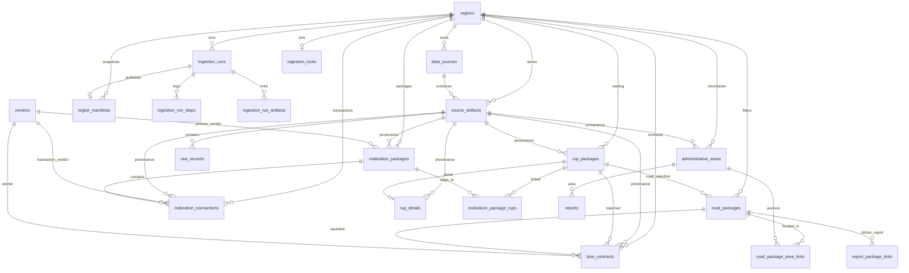

# DATABASE — Model Data Ingestion Multi-Region

Status: migrasi diterapkan 8 November 2026 pada database di `.env.local` (Postgres 17 + PostGIS).
Skema kanonik ada di `prisma/schema.prisma`; dokumen ini menjelaskan ERD, kunci, foreign key,
index, provenance, dan retensi. Worker tidak memakai Prisma Client (batch 50 ribu baris), tetapi
memakai SQL parameterized pada kolom dan tabel yang sama.

## 1. Prinsip

1. **Tidak menduplikasi tabel report/auth.** Model `User`, `Session`, `Report*`, dan permission
   tetap seperti sebelumnya. `road_packages` dan `administrative_areas` hanya ditambah `region_id`
   serta relasi provenance.
2. **Mentah dulu, baru domain.** Setiap berkas sumber disimpan sebagai artefak ber-checksum dan
   setiap barisnya masuk `raw_records`. Baris yang tidak punya pasangan RUP/paket tetap di raw.
   Tabel domain hanya berisi hasil normalisasi yang lolos validasi.
3. **Idempotensi lewat kunci natural + checksum.** Menjalankan worker berulang tidak menambah baris;
   artefak dengan isi sama dipakai ulang, raw record memakai `(artifact_id, row_index)`.
4. **Satu region, satu kunci.** Semua kunci unik domain memakai `region_id` di depan, sehingga dua
   daerah boleh memiliki kode RUP atau `stable_key` yang sama.
5. **Geometri resmi, tanpa titik paket.** `administrative_areas.geometry` tetap
   `geometry(MultiPolygon, 4326)`; paket tidak pernah mendapat koordinat. Sumber GeoJSON tidak
   diubah; poligon yang tidak valid diperbaiki saat insert dengan
   `ST_MakeValid` + `ST_CollectionExtract(..., 3)` (8 dari 1.137 fitur).

## 2. ERD



Tabel report/auth (`User`, `Session`, `Account`, `Verification`, `rateLimit`, `Permission`,
`UserPermissionGrant`, `AuthorizationAuditEvent`, `RegistrationInvite`, `Report`,
`ReportMedia`, `ReportPackageLink`, `ReportStatusEvent`, `ReportIdempotencyKey`) tidak berubah.

## 3. Tabel Domain

| Tabel | Isi | Kunci natural |
|---|---|---|
| `regions` | identitas daerah, tahun, konfigurasi+checksum | `id` |
| `data_sources` | registry sumber per region (RUP, realisasi, LPSE, batas) | `(region_id, kind, name)` |
| `ingestion_runs` | satu eksekusi worker: status, trigger, stats, error | `id` |
| `ingestion_run_steps` | stage `fetch`/`upsert`/`snapshot`, attempt, jumlah | `(run_id, step, attempt)` |
| `source_artifacts` | berkas sumber/geojson/snapshot + SHA-256 + ukuran + jumlah baris | `(source_id, checksum_sha256)` |
| `ingestion_run_artifacts` | relasi run ↔ artefak | `(run_id, artifact_id)` |
| `raw_records` | baris mentah JSONB, termasuk baris tanpa pasangan | `(artifact_id, row_index)` |
| `rup_packages` | seluruh RUP instansi (bukan hanya jalan) | `(region_id, kode_rup)` |
| `rup_details` | jadwal, lokasi mentah, MAK, volume (hanya RUP yang ada) | `rup_package_id` |
| `road_packages` | 2.552 paket jalan hasil filter snapshot | `(region_id, rup)` |
| `administrative_areas` | poligon kecamatan/kelurahan/RW | `(region_id, stable_key)` |
| `lpse_contracts` | kontrak SPSE/LPSE yang tercocok ke RUP | `(region_id, lpse_id)` |
| `vendors` | penyedia global, nama ternormalisasi | `normalized_name` |
| `realization_packages` | agregat paket realisasi INAPROC | `(region_id, kode_paket, tahun)` |
| `realization_transactions` | 50.836 baris transaksi realisasi | `(region_id, checksum_sha256)` |
| `realization_package_rups` | relasi paket realisasi ↔ RUP (M–N) | `(package_id, rup_package_id)` |
| `road_package_area_links` | paket ↔ poligon, per peran RW/kelurahan/kecamatan | `(road_package_id, role)` |
| `region_manifests` | metrik + checksum snapshot tiap run sukses | `run_id` |
| `ingestion_locks` | lock anti-tumpang-tindih per region | `region_id` |

Catatan kunci:
- `road_packages.rup` **tidak lagi unik global**; unik per region. Ini perlu agar dua daerah bisa
  memakai kode RUP yang sama.
- `administrative_areas.stable_key` juga unik per region.
- `realization_transactions` memakai checksum baris mentah, karena satu paket realisasi bisa
  memiliki banyak transaksi dengan nilai berbeda; kode paket saja tidak unik.
- `realization_transactions.kode_rup` menyimpan nilai mentah (bisa `kode1;kode2`), sedangkan relasi
  yang sudah valid dipecah ke `realization_package_rups`.

## 4. Foreign Key

| Dari | Ke | Aksi |
|---|---|---|
| semua tabel domain `region_id` | `regions.id` | `RESTRICT` |
| `source_artifacts.source_id` | `data_sources.id` | `RESTRICT` |
| `raw_records.artifact_id` | `source_artifacts.id` | `CASCADE` |
| `rup_details.rup_package_id` | `rup_packages.id` | `CASCADE` |
| `road_packages.rup_package_id` | `rup_packages.id` | `SET NULL` |
| `lpse_contracts.road_package_id` | `road_packages.id` | `SET NULL` |
| `lpse_contracts.rup_package_id` | `rup_packages.id` | `SET NULL` |
| `lpse_contracts.vendor_id` | `vendors.id` | `SET NULL` |
| `realization_transactions.package_id` | `realization_packages.id` | `CASCADE` |
| `realization_package_rups.package_id` | `realization_packages.id` | `CASCADE` |
| `realization_package_rups.rup_package_id` | `rup_packages.id` | `CASCADE` |
| `road_package_area_links.road_package_id` | `road_packages.id` | `CASCADE` |
| `road_package_area_links.area_id` | `administrative_areas.id` | `CASCADE` |
| `administrative_areas.source_artifact_id` | `source_artifacts.id` | `SET NULL` |
| `ingestion_run_steps.run_id` | `ingestion_runs.id` | `CASCADE` |
| `region_manifests.run_id` | `ingestion_runs.id` | `CASCADE` |
| `ingestion_locks.region_id` | `regions.id` | `CASCADE` |

FK `road_packages`/`administrative_areas` ke `regions` memakai `RESTRICT`: daerah tidak bisa
dihapus selama katalognya ada.

## 5. Index

Selain index primary/unique di atas:

| Tabel | Index |
|---|---|
| `administrative_areas` | `(region_id, level, is_active)`, `(region_id, district_name, village_name, rw_code)` |
| `road_packages` | `(region_id, year)`, `(region_id, location_precision)`, `(region_id, official_district, official_village, rw_code)` |
| `rup_packages` | `(region_id, tahun)`, `(region_id, is_road)`, `(region_id, method)` |
| `rup_details` | `(region_id, tahun)`, `(kode_rup)` |
| `lpse_contracts` | `(region_id, kode_rup)`, `(region_id, tahun)`, `vendor_id`, `road_package_id` |
| `realization_packages` | `(region_id, tahun)`, `vendor_id` |
| `realization_transactions` | `(region_id, tahun)`, `(region_id, kode_rup)`, `package_id`, `vendor_id` |
| `realization_package_rups` | `(kode_rup)` |
| `road_package_area_links` | `(area_id, role)` |
| `raw_records` | `(source_kind, external_key)`, `(checksum_sha256)` |
| `source_artifacts` | `(region_id, kind, retrieved_at)` |
| `ingestion_runs` | `(region_id, started_at)`, `(status, started_at)` |
| `vendors` | `(display_name)` |

## 6. Migrasi

| Migrasi | Isi | Sifat |
|---|---|---|
| `20261108120000_ingestion_pipeline` | enum + 17 tabel + `region_id` pada `road_packages`/`administrative_areas` + index unik per region | aditif; backfill `kota-tangerang` lalu default dihapus |
| `20261108130000_realization_rup_multi` | `realization_transactions.kode_rup` → `VARCHAR(256)` | aditif, untuk baris multi-RUP (`kode1;kode2`) |

Tidak ada migrasi lama yang diedit. Migrasi pertama mengganti index unik global (`road_packages.rup`,
`administrative_areas.stable_key`) dengan index unik per region; tidak ada baris yang dihapus.
Tabel kosong saat migrasi diterapkan (0 paket, 0 area), sehingga `ADD COLUMN NOT NULL` aman.
Untuk database yang sudah berisi data, migrasi menyediakan default `kota-tangerang` sebelum
default dihapus.

Perintah:

```bash
npx prisma validate
npx prisma migrate deploy   # memakai DIRECT_URL dari .env.local
npx prisma generate
```

## 7. Provenance

Setiap baris domain menyimpan `source_artifact_id` (kecuali tabel penghubung). Artefak menyimpan:

- `artifact_key` — path sumber relatif repo atau snapshot;
- `checksum_sha256` — isi berkas;
- `byte_size`, `record_count`, `retrieved_at`;
- `parser_version`, `schema_version`;
- `metadata` — role, format, level batas, jumlah baris, tanggal snapshot sumber.

`raw_records.checksum_sha256` adalah checksum baris individual. `ingestion_run_artifacts`
menghubungkan artefak ke run sehingga riwayat “run X memakai isi Y” dapat direkonstruksi.
`region_manifests.metrics` dan `checksums` menyimpan angka snapshot + checksum semua artefak
pada run yang berhasil.

Aturan provenance:
1. Baris mentah tidak boleh diubah; koreksi dilakukan dengan run baru.
2. Artefak dengan checksum sama tidak digandakan (`UNIQUE (source_id, checksum_sha256)`).
3. Snapshot aplikasi hanya ditulis setelah normalisasi+validasi+gate lulus; checksum-nya dicatat
   di `region_manifests`.
4. URL bukti penyedia disimpan di `lpse_contracts.url`; paket realisasi memakai
   `https://data.inaproc.id/realisasi?kode=<kode_paket>` (bukan kode RUP).

## 8. Retensi

Belum ada job pembersihan otomatis. Kebijakan yang disarankan:

| Data | Retensi | Alasan |
|---|---|---|
| `raw_records` + `source_artifacts` | ≥ 24 bulan, dan minimal 12 run terakhir per sumber | audit dan reproduksi snapshot lama |
| `ingestion_runs` | 12 bulan (gagal: 90 hari) | diagnosa dan SLA |
| `ingestion_run_steps` | mengikuti run | detail kegagalan |
| `region_manifests` | permanen | bukti publikasi tiap snapshot |
| `rup_packages`, `road_packages`, kontrak, realisasi | data aktif; versi lama ada di raw | katalog saat ini |
| `vendors` | permanen | nama publik, tanpa data pribadi |
| `administrative_areas` | data aktif | batas resmi |

Contoh pembersihan (jalankan manual, bukan bagian worker):

```sql
DELETE FROM ingestion_runs r
WHERE r.started_at < now() - interval '12 months'
  AND r.status <> 'RUNNING'
  AND NOT EXISTS (SELECT 1 FROM region_manifests m WHERE m.run_id = r.id);

DELETE FROM source_artifacts a
WHERE a.retrieved_at < now() - interval '24 months'
  AND NOT EXISTS (SELECT 1 FROM ingestion_run_artifacts l WHERE l.artifact_id = a.id
                  AND l.run_id IN (SELECT id FROM ingestion_runs ORDER BY started_at DESC LIMIT 12))
  AND NOT EXISTS (SELECT 1 FROM region_manifests m WHERE m.checksums ? a.artifact_key);
```

`region_manifests` sengaja tidak dihapus agar checksum snapshot publik tetap dapat diverifikasi.

## 9. Rekonsiliasi 8 November 2026

Sumber: `data/regions/kota-tangerang/manifest.json` (gate `LULUS: 0 masalah`) dan
`npm run db:verify`.

| Metrik | Manifest | DB |
|---|---:|---:|
| Paket jalan | 2.552 | 2.552 |
| Pagu | Rp813.127.177.758 | Rp813.127.177.758 |
| Presisi RW / kelurahan / kecamatan / kabupaten | 1.612 / 517 / 79 / 344 | sama |
| Berlokus | 2.208 | 2.208 |
| Katalog RUP | 28.699 | 28.699 |
| Detail RUP (punya pasangan) | 2.553 sumber → 2.552 | 2.552 |
| Kontrak LPSE | 1.739 | 1.739 |
| LPSE dengan pemenang | 731 | 731 |
| Penyedia dari realisasi | 1.603 | 1.603 |
| Tanpa rekam | 218 | 218 |
| Pagu tanpa rekam | Rp132.343.800.219 | Rp132.343.800.219 |
| Penyedia unik | 633 | 633 |
| Baris realisasi | 50.836 | 50.836 |
| Paket realisasi | — | 37.427 |
| Batas RW / kelurahan / kecamatan | 1.020 / 104 / 13 | 1.020 / 104 / 13 |
| Raw record | 90.782 | 90.782 |

Raw record = RUP 28.699 + detail 2.553 + realisasi 50.836 + LPSE 7.557 (daftar 4.869 + detail 949
+ kontrak tercocok 1.739) + batas 1.137.
