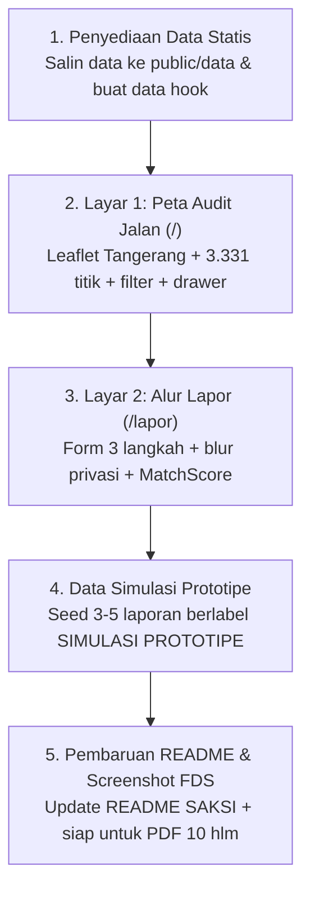

# HANDOFF — Panduan Operasional & Kontrak Pengembangan SAKSI

**Tanggal Serah Terima:** 31 Oktober 2026
**Tenggat Kritis:** First Draft Submission (FDS) — **1 November 2026 (Besok)**
**Target Pengguna Dokumen:** AI Agent / Developer yang melanjutkan implementasi kode repositori ini.

---

## 1. Konteks Utama & Keputusan Kunci (The Pivot)

Repositori ini awalnya diinisiasi pada 26 Oktober 2026 dengan nama kerja **RUAS** (berdasarkan brief lama: computer vision ONNX untuk lubang jalan, NLP ekstraksi patokan, dan komparasi IRI jalan nasional).

Berdasarkan evaluasi terukur dan arahan dosen pembimbing pada 29 Oktober 2026:
1. **Fokus Dipersempit:** Dari multi-infrastruktur menjadi **satu jenis: JALAN** (jalan, jembatan, drainase/saluran, trotoar, turap/TPT).
2. **Studi Kasus:** **Kabupaten Tangerang** (`idKldi=D50`, BPS `3603`) TA 2025–2026.
3. **Produk Diubah:** Menjadi **SAKSI** (*Sistem Akuntabilitas & Komparasi Spasial Infrastruktur*).
4. **Inti Inovasi:** Menautkan **3.602 paket pekerjaan jalan (Rp848,60 Miliar)** dengan **laporan berfoto warga di ruas yang sama** melalui jendela masa pemeliharaan (retensi 5%), sehingga laporan warga memiliki konsekuensi administratif langsung dan nomor RUP resmi.

---

## 2. Sepuluh Aturan Keras (JANGAN DILANGGAR)

1. **Fokus Jalan Saja:** Jangan menambahkan atau menampilkan filter 5 sektor di antarmuka pengguna. Filter yang diizinkan hanya: tahun (2025/2026), kecamatan/desa, dan jenis pekerjaan (`Permukaan Jalan`, `Drainase/Penahan`, `Jembatan`, `Trotoar`).
2. **Batas Frontend/Backend (keputusan 31 Okt 2026):** Next.js Route Handlers menjadi BFF. Halaman awal membaca snapshot melalui repository server-only dan filter interaktif memakai `GET /api/packages`. Supabase domain tables dan scraper workers belum diimplementasikan; model dan pipeline harus mengikuti provenance, validasi, serta presisi lokasi yang terdokumentasi. Keputusan ini menggantikan arahan lama untuk membaca snapshot langsung dari browser.
3. **Tanpa NLP/LLM untuk Lokasi:** Jangan pasang model LLM atau ekstraksi NLP untuk lokasi paket. Hasil pengujian membuktikan akurasi rendah dan rawan halusinasi titik. Lokasi 3.331 paket sudah dipetakan secara deterministik melalui gazetteer BPS di berkas data.
4. **Tanpa Computer Vision / Pengukuran Luas cm²:** Ditolak oleh dosen dan pengujian pengguna. Kerusakan dikategorikan langsung oleh warga pelapor (`jenis_kerusakan`, `penyebab`, `ukuran_kasar`).
5. **Jangan Memaksa Titik Koordinat:** Terdapat 271 paket (7,5%) tanpa lokus mikro yang spesifik. Paket ini tidak boleh ditaruh sembarangan di peta; tampilkan hanya di tabel/daftar dengan label `Lokasi: Kab. Tangerang (Umum)`.
6. **Bahasa Indikator Wajib Netral:** Gunakan frasa **"Diduga Tidak Sesuai"** (atau "Perlu Tinjauan Lapangan"). Dilarang keras menggunakan kata "korupsi", "fiktif", "digelapkan", atau tuduhan hukum lainnya.
7. **Penyedia Disebut Asli tapi Berimbang:** Nama kontraktor/penyedia diambil dari data publik LPSE apa adanya, tanpa skor gabungan sintetis, dan wajib menyertakan penyebut (jumlah paket total, kelas jalan, tahun).
8. **Badge Wajib:**
   - `DATA RESMI (SIRUP / BINA MARGA)` (badge hijau/biru) untuk paket anggaran asli.
   - `SIMULASI PROTOTIPE` (badge amber) untuk setiap contoh laporan warga di fase FDS.
   - Badge presisi marker peta: `Titik Desa`, `Garis Koridor`, atau `Kecamatan`.
9. **Privasi di Sisi Klien:** Foto wajib dibersihkan dari metadata EXIF dan fitur blur manual (wajah & plat kendaraan) wajib dieksekusi di canvas browser sebelum disimpan ke `localStorage`.
10. **Format Angka Indonesia:** Selalu format angka dengan titik ribuan dan koma desimal: `3.602 paket`, `92,5%`, `Rp848,60 Miliar`.

---

## 3. Konvensi Kode & Repositori

- **Komponen Baru:** Kode lama di `src/app/page.tsx` dan `src/features/map` adalah artefak RUAS lama. Jangan menambal artefak lama tersebut; tulis ulang komponen baru yang bersih sesuai spesifikasi SAKSI.
- **Komponen UI:** Gunakan `shadcn/ui` yang sudah terpasang di `src/components/ui/` (preset `base-nova`, CVA, Tailwind v4, Lucide Icons).
- **Bahasa Antarmuka:** Bahasa Indonesia untuk seluruh teks pengguna, dengan istilah teknis bahasa Inggris yang lazim (dashboard, layer, koridor, filter).
- **Format Commit Git:** Satu baris conventional commit tanpa pesan body: `feat: …`, `fix: …`, `docs: …`.
- **Komentar Kode:** Patuhi mentalitas *No-AI-Comment-Slop*; jangan menulis komentar yang menjelaskan apa/bagaimana hal yang sudah jelas terbaca dari kode, tulis hanya penjelasan "MENGAPA" bila ada keputusan penting.

---

## 4. Rencana Kerja Sprint FDS (Sisa Waktu < 24 Jam)

Berikut adalah urutan langkah yang wajib diselesaikan agar repositori dan aplikasi siap untuk FDS:

### Langkah 1: Penyajian Data Snapshot
- Snapshot paket jalan tetap di `data/saksi_tangerang_2025_2026.json` dan dibaca hanya dari kode server.
- `src/server/packages/` mengisolasi use case dan repository; `GET /api/packages` menjadi batas HTTP untuk filter interaktif.
- Jangan menyalin dataset ke `public/` atau mengimpor modul server ke komponen client.

### Langkah 2: Bangun Layar 1 (`/`) — Peta Audit Jalan
- **Header Metrik Utama:**
  - 3.602 paket jalan · Rp848,60 Miliar pagu · 251 desa tersentuh · 92,5% terpetakan (102 koridor).
- **Peta Interaktif (Leaflet):**
  - Bounding box Kabupaten Tangerang (koordinat pusat: `-6.22, 106.48`, zoom level ~11).
  - Tampilkan marker titik desa dan polyline koridor dengan popup ringkas (Nama paket, Pagu, Satker, Presisi).
- **Bilah Filter:**
  - Filter Tahun: Semua, 2025, 2026.
  - Filter Jenis Pekerjaan: Semua, Permukaan Jalan, Drainase/Penahan, Jembatan, Trotoar.
  - Filter Kecamatan: Dropdown 29 kecamatan.
- **Tabel / Register Paket (Sheet/Drawer):**
  - Menampilkan daftar paket hasil filter, termasuk 271 paket bertanda `Lokasi: Kab. Tangerang (Umum)`.

### Langkah 3: Bangun Layar 2 (`/lapor`) — Alur Lapor Warga
- **Langkah 1: Unggah Foto & Privasi**
  - Unggah foto dari perangkat / kamera.
  - Hapus metadata EXIF otomatis di browser via canvas.
  - Canvas interaktif untuk memburamkan area sensitif (wajah atau plat nomor kendaraan).
- **Langkah 2: Kategorisasi Kerusakan**
  - Pilih Jenis Kerusakan (enum: `Lubang`, `Retak`, `Amblas`, `Genangan`, `Drainase Mampet`, `Jembatan Rusak`, `Lainnya`).
  - Pilih Penyebab Terlihat (multi-select: `Kendaraan Berat`, `Drainase Tidak Ada`, `Genangan Berulang`, dll.).
  - Pilih Ukuran Kasar (`Setelapak Tangan`, `Sebesar Ban Mobil`, `Lebih dari 1 Meter Persegi`) — **tanpa klaim cm²**.
- **Langkah 3: Lokasi & Rekomendasi Paket (`MatchScore`)**
  - Deteksi lokasi GPS atau pilih desa manual.
  - Hitung `MatchScore` (0–100) di browser terhadap paket jalan di desa yang sama / radius ≤2 km.
  - Rekomendasikan 3 paket jalan terdekat yang masih dalam masa garansi/pemeliharaan.
  - Tombol simpan laporan ke `localStorage` dengan ID laporan unik.

### Langkah 4: Penyemaian Data Uji (Mock Prototipe)
- Tambahkan contoh laporan warga dengan badge wajib **`SIMULASI PROTOTIPE`** (warna amber) agar layar peta dan detail kasus memiliki visualisasi yang padat data saat di-screenshot untuk PDF FDS.

### Langkah 5: Finalisasi FDS
- Perbarui [README.md](file:///c:/Users/LENOVO/Documents/web/lomba-mia/README.md) dengan deskripsi resmi SAKSI.
- Jalankan verifikasi akhir: `bun run build` dan `bun run lint`.
- Ambil screenshot desktop 1440×900 dari Layar 1 dan Layar 2 untuk dimasukkan ke proposal PDF 10 halaman.
