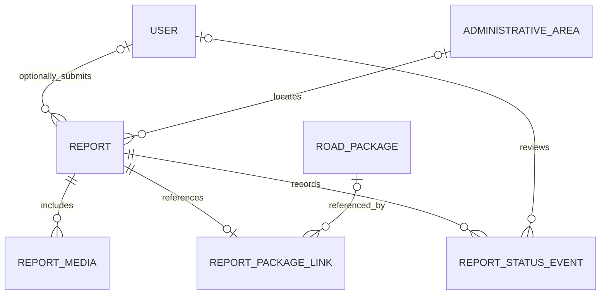

# Road damage reports

**Status (9 November 2026):** Prisma models, the report submission API, authenticated account history, and the `/laporan` submit interaction are implemented. Staff with `reports.read_queue` can view a paginated review queue at `/api/reports/review` and in Dashboard → Review Laporan. The queue omits report descriptions, location hints, media references, and reporter identity. Staff with `reports.change_status` can publish or reject a report with a mandatory reason; each change appends a `ReportStatusEvent`. `GET /api/reports/public` and `/laporan/publik` expose only `PUBLISHED` reports with damage type, coarse size, area, dates, and package reference — never identity, description, location hint, precise location, or photos. Evidence review is not implemented; public photo access is deliberately disabled. Report photos are retained for 365 days from submission (180 days after rejection/withdrawal/archive) and deleted by `npm run retention:reports`; the scheduler lives in `src/instrumentation.ts` (systemd timer remains an alternative). The report migration and private WebP-only `report-evidence` bucket are configured. Submission and moderation were verified end to end on 8–9 November 2026 (see the verification section below); the test account, report, and events were removed afterwards.

This document defines the report domain model for the four-step **Laporkan Jalan** flow. The schema and migration establish the persistence foundation for source-aware packages, administrative areas, reports, media metadata, package references, and moderation history. They do not authorize server upload or publication; the open decisions below must be settled before those features ship.

## Current form and behavior

The current form collects:

- One road-damage photo. The browser checks its JPEG/PNG/WebP signature and re-encodes it locally as WebP, up to 1024 px. The local object URL is a preview only; on submit, the sanitised WebP is uploaded to the private bucket as report evidence.
- One required damage category: pothole, crack, subsidence, standing water, blocked drainage, damaged bridge, or other.
- Optional observed causes (multiple choices), coarse size, and a description of up to 500 characters.
- An optional RW/kelurahan area, optionally determined from device location. Exact GPS coordinates are used to find the RW and then discarded.
- An optional location landmark of up to 180 characters.
- An optional RUP package reference. The current package candidate ranking is a UI aid, not proof of a contractual link.

Photo sanitation removes embedded metadata; face and plate redaction remains a manual reporter check. The form keeps its fields and sanitized preview in page memory until the user chooses **Kirim laporan**. The final step now appears only after the API returns a receipt. The IndexedDB draft helper remains unwired.

## Implemented schema and migration

`prisma/schema.prisma` now includes `AdministrativeArea`, `RoadPackage`, `Report`, `ReportMedia`, `ReportPackageLink`, and `ReportStatusEvent`, plus the enums described below. The migration is `prisma/migrations/20261104150000_report_domain/migration.sql`. It creates an SRID 4326 PostGIS `MultiPolygon` column and GIST index, foreign keys, uniqueness constraints, and an append-only trigger for status events. Media metadata checks restrict records to sanitized WebP, dimensions up to 1024 px, and a maximum of 5 MiB.

The API writes a package row on demand from the checked-in, server-only package snapshot when a RUP is selected. Area names are validated against the checked-in RW GeoJSON; until the area catalog is imported, the report stores validated area snapshots with a null area foreign key. The API, repository, photo sanitizer, and UI are implemented. On 4 November 2026, migrations `20261104130000_registration_invites` and `20261104150000_report_domain` were deployed to the configured Supabase project, and the report tables were verified as present. The private `report-evidence` bucket was also created and verified. On 8 November 2026 a complete submission transaction was verified end to end (below).

## End-to-end verification (8 November 2026)

A test administrator submitted one report through `POST /api/reports` with a real multipart JPEG, the
UUID v4 idempotency key, area `tangerang|sukarasa|5`, `POTHOLE`, and a location hint. The run used the
worktree `.env.local`, whose `DATABASE_URL` and `SUPABASE_SERVICE_ROLE_KEY` belong to the same Supabase
project that holds the report schema and the private bucket. The earlier copy pointed at a project
with only a publishable key and no bucket; it is backed up at
`~/.config/saksi/env.local.jdgu-20261108`.

| Check | Result |
|---|---|
| Response | `201` with receipt `vS-rLb_Fx7oAPlJWNc0P2niByVAzv2EA` and `status: SUBMITTED` |
| Retry with the same idempotency key | Same receipt; no second report |
| `GET /api/reports/mine` | Returned the receipt, `SUBMITTED`, `POTHOLE`, `Sukarasa, RW 5`, `Tangerang` |
| `GET /api/reports/review?status=active` | Returned the same report in the staff queue |
| Postgres | `reports` + `report_media` + one status event + one completed idempotency row; media `image/webp` |
| Private Storage | Object existed at `reports/<reportId>/<uuid>.webp`; downloaded as WebP with no EXIF |
| Cleanup | Storage object removed; report, media, status event, idempotency row, test user, sessions, and grants deleted; baseline counts restored |

The status-event table is append-only, so deleting the test report required temporarily disabling and
re-enabling the `report_status_events_append_only` trigger inside the cleanup transaction. The trigger
is enabled again.

## Moderation and public projection verification (9 November 2026)

One test report was inserted directly into the configured database with a package link, coarse area,
damage type, coarse size, a secret description, and a secret location hint. A temporary session for the
existing administrator (all report permissions) exercised the same HTTP routes the dashboard uses.

| Check | Result |
|---|---|
| Unpublished report | Hidden from `GET /api/reports/public` |
| Anonymous `PATCH /api/reports/review/[publicCode]` | `401` |
| Publish with `reports.change_status` | `200`, status `PUBLISHED` |
| Public API | Damage type, coarse size, `Sukarasa, RW 5`, district, submitted/published dates, and package RUP returned; description, location hint, media, reporter, and area id absent |
| Public page `/laporan/publik` | Renders damage/size labels, area, and package link; secret description and hint absent |
| Reject after publish | `200`; report disappears from the public API |
| Database | Status `REJECTED`; three ordered events (`SUBMITTED`, `PUBLISHED`, `REJECTED`), each with a reason |
| Cleanup | Events (trigger temporarily disabled and re-enabled), package link, report, and session deleted; 0 reports/0 events/0 links restored |

## Logical model

Reports are created in the database only after an explicit submission. An unfinished draft stays on the device. Reports remain account-optional.



### `Report`

The submitted report and its current workflow state.

| Field | Type | Notes |
|---|---|---|
| `id` | UUID | Internal identifier; never expose as the public lookup code. |
| `publicCode` | random opaque string, unique | Unguessable receipt/reference; do not use a sequential database ID. |
| `reporterUserId` | nullable FK to `User` | Optional account association. Set null if the account is deleted; reporting must not require an account. |
| `status` | enum | `SUBMITTED`, `UNDER_REVIEW`, `NEEDS_MORE_INFO`, `PUBLISHED`, `REJECTED`, `WITHDRAWN`, `ARCHIVED`. No server-side `DRAFT` state in v1. |
| `damageType` | controlled code | One primary category selected by the reporter. Validate against a server-side allowlist. |
| `observedCauses` | array of controlled codes | Zero or more reporter observations, not verified causes. |
| `coarseSize` | nullable controlled code | `PALM`, `TIRE`, `OVER_1M2`; no inferred measurements. |
| `description` | nullable text, max 500 chars | User-provided context. Treat as untrusted and potentially identifying. |
| `areaId` | nullable FK to `AdministrativeArea` | Selected RW/kelurahan, if available. Null when only a package is referenced or location is unknown. |
| `areaNameSnapshot` | nullable string | Preserve the displayed area label at submission time. |
| `districtNameSnapshot` | nullable string | Preserve the displayed kecamatan. |
| `rwCodeSnapshot` | nullable string | Preserve RW code where applicable. |
| `areaDatasetVersion` | nullable string | Boundary dataset/version used to resolve the area. |
| `locationSource` | enum | `MANUAL_AREA`, `DEVICE_RESOLVED_AREA`, `PACKAGE_REFERENCE_ONLY`, `UNKNOWN`. Never means exact GPS was saved. |
| `locationHint` | nullable string, max 180 chars | Optional road/landmark text. Keep private until moderation; do not publish raw by default. |
| `submittedAt` | timestamp | Submission time, separate from local draft timestamps. |
| `createdAt`, `updatedAt` | timestamps | Database-managed. |

Device coordinates are not part of this model. If a future product version supports a precise map pin, it needs a separate, explicit consent decision and a distinct sensitive-location permission.

### `ReportMedia`

Stores metadata and a private object-storage reference, never image bytes in Postgres.

| Field | Proposed type | Notes |
|---|---|---|
| `id` | UUID | Internal media reference. |
| `reportId` | unique FK to `Report` | One media record per report in v1. Report deletion is restricted while media metadata exists. |
| `objectPath` | string, unique | Random object name in a private Supabase Storage bucket. Never derive it from the user filename or expose a public URL. |
| `mediaType` | string | Server-detected normalized type; v1 accepts sanitized WebP only. |
| `byteSize`, `width`, `height` | integer | Server-measured values, not client claims. |
| `sanitizerVersion` | string | Identifies the server sanitation pipeline. |
| `createdAt`, `retainedUntil`, `deletedAt` | timestamps | `retainedUntil` is set to 365 days from submission; 180 days after rejection/withdrawal/archive. `deletedAt` marks a removed private object. |

V1 accepts at most one photo per report. Keep media in a separate table so a future increase does not change the report record. Store only the server-sanitized asset; discard the original. A client-sanitized image is still untrusted input and must be rechecked and re-encoded on the server.

### `ReportPackageLink`

An optional, user-selected reference to one package in v1. Use a separate relation so later linking multiple related packages does not require changing `Report`.

| Field | Type | Notes |
|---|---|---|
| `id` | UUID | Internal relation identifier. |
| `reportId` | unique FK to `Report` | Enforces a maximum of one selected package for v1. |
| `roadPackageId` | FK to `RoadPackage` | Stable internal package identifier. |
| `rupSnapshot`, `packageNameSnapshot` | strings | Preserve what the reporter saw when selecting the package. |
| `selectionSource` | enum | `PACKAGE_PAGE` or `CANDIDATE_LIST`; records how the user selected it, not match certainty. |
| `createdAt` | timestamp | Link creation time. |

The link means “used as a reference by the reporter.” It must not be presented as proof that the package caused, repaired, or is responsible for the reported condition.

### `ReportStatusEvent`

An append-only moderation history for staff actions and system transitions.

| Field | Type | Notes |
|---|---|---|
| `id` | UUID | Event identifier. |
| `reportId` | FK to `Report` | Report whose status changed. |
| `actorUserId` | nullable FK to `User` | Null for an automated transition; staff actions require a signed-in account and permission. |
| `fromStatus`, `toStatus` | enum | Record every transition; never overwrite history. |
| `reason` | nullable text | Internal moderation note, never copied into public output automatically. |
| `createdAt` | timestamp | Event time. |

Community confirmations, contact details, and repair-outcome evidence are deliberately out of v1. They require separate privacy, abuse, and verification decisions rather than extra fields on `Report`.

## Catalog prerequisites and limitations

The models now exist, but their tables are empty and the application does not query them. Package search still reads a checked-in JSON snapshot, and RW boundaries come from static GeoJSON. Before reports can use these foreign keys:

1. Create source-aware `RoadPackage` and `AdministrativeArea` catalogs in Supabase Postgres.
2. Store administrative boundary geometry as PostGIS geometry with an explicit SRID and dataset provenance.
3. Give packages and areas stable internal IDs; retain source identifiers and retrieval/version metadata.
4. Use Prisma for ordinary fields and named, parameterized SQL/repository methods for PostGIS operations. Do not spread spatial SQL through route handlers.

## Submission and upload boundary

The implemented server-side flow is:

```text
POST /api/reports
  -> route adapter parses bounded multipart input
  -> ReportsApi validates the report and rate limits anonymous submissions
  -> UploadController dispatches fixed purpose `report.photo`
  -> server checks byte signature, limits, decodes and re-encodes
  -> ReportPhotoHandler writes only sanitized WebP to private storage
  -> report repository persists report, media metadata, package link, and status event
  -> response returns an opaque receipt code
```

The browser must not choose a class/function to execute, write to Postgres, or receive a Supabase service-role key. The server derives the purpose handler from a fixed registry. Do not pass a raw Next.js `Request` into domain handlers. Multipart data is streamed through bounded parsing, with one image up to 10 MiB. The server checks decoded format/pixel limits, re-encodes to WebP at no more than 1024 px and 5 MiB, then writes to the configured private bucket. The request does not include exact coordinates.

`GET /api/reports/mine` requires a valid Better Auth session and queries only rows whose `reporterUserId` equals that session's user ID. It returns the reporter's opaque receipt code, workflow status, damage category, submission time, coarse area snapshot, and optional RUP/package-name snapshot. It never returns media paths, image data, exact coordinates, location hints, report descriptions, or internal moderation notes. Responses use `Cache-Control: private, no-store`. Anonymous submissions remain unlinked and do not appear in an account's history.

`GET /api/reports/review` requires `reports.read_queue` through the central authorization authority. It supports active/all/single-status filters and keyset pagination. It returns only report status, damage category, submitted time, coarse area name, and optional package reference. It does not return reporter identity, description, observed causes, landmark hint, media path, or photo. The Dashboard review tab is read-only; status transitions, assignment, internal notes, and evidence access remain unimplemented and must use their distinct permission checks when added.

`Idempotency-Key` is required and must be a UUID v4. The database stores its SHA-256 hash, a canonical payload hash including the image bytes, and a five-minute processing lease. A matching retry returns the original receipt; a key reused with different content receives 409. Completed keys are retained for 24 hours. If storage succeeds but the report transaction fails, the server removes the staged object; failed cleanup leaves its private object path on the idempotency row for a later retry to clean up. There is not yet a scheduled orphan-cleanup job.

`POST /api/reports` supports credentialed CORS only for exact origins in `CORS_ALLOWED_ORIGINS` (with `BETTER_AUTH_URL` as a fallback). `OPTIONS` handles preflight. Origins not on the allowlist are rejected. CORS is not authentication or CSRF protection; keep the allowlist narrow and hosting proxy IP headers sanitized. The API rate-limits all submissions to three per hour per hashed client IP using the existing database-backed `rateLimit` table. The authenticated user association is derived from the session; anonymous submission remains supported.

The Supabase service-role key is server-only. Create/verify the dedicated private bucket with `bun run storage:reports:ensure`; this sets a 5 MiB object limit and allows only WebP. Keep the bucket private and do not add public/client read policies. Environment variables are listed in `.env.example`.

Anonymous submissions need rate limits that do not require a real-world identity. Do not make raw IP addresses part of the report record. Use a short-lived, appropriately keyed abuse-control signal and document its retention separately.

## Status and publication semantics

- `SUBMITTED` means received by the system, not verified.
- `UNDER_REVIEW` and `NEEDS_MORE_INFO` describe review workflow only.
- `PUBLISHED` means a moderator approved the display of the report. It does not establish the claim as fact or guarantee government action.
- `REJECTED`, `WITHDRAWN`, and `ARCHIVED` are not public by default.
- “Resolved” should not be a report status until there is separate, sourced evidence of repair; track that as a future outcome record.

Staff review, sensitive media access, publishing, and export must be separate permissions routed through `src/server/authorization/authority.ts`. Public report queries should expose only approved fields and coarse locations. Never publish storage object paths or private moderation notes.

## Photo and retention policy (decided 9 November 2026)

- **Photos are never public in v1.** The public projection and `/laporan/publik` do not include media, storage paths, or signed URLs. Staff evidence review still requires a separate permission and is not implemented.
- **Initial retention:** 365 days from submission. `persistSubmittedReport` writes `retainedUntil` for every media row. Override with `REPORT_MEDIA_RETENTION_DAYS`.
- **Shortened retention:** a report whose latest status is `REJECTED`, `WITHDRAWN`, or `ARCHIVED` keeps its photo for at most 180 days from that status event. Override with `REPORT_MEDIA_REJECTED_RETENTION_DAYS`.
- **Deletion:** `npm run retention:reports` removes expired objects from the private bucket and sets `deleted_at`. `npm run retention:reports:dry` prints candidates without deleting. The job is idempotent and safe to rerun.
- **Schedule:** penjadwal di dalam Next menjalankan retensi 03:15 Asia/Jakarta (`INGEST_SCHEDULER_RETENTION`, lihat `docs/INGESTION.md`); alternatifnya `deploy/systemd/saksi-report-retention.timer`. Pakai env server yang sama dengan ingestion (`/etc/saksi/ingestion.env`) agar kredensial database dan service role tetap server-only.
- **Audit:** report rows, status events, and moderation reasons remain after photo deletion; only the private object and its `deleted_at` marker change.

## Decisions still required before deployment or submission

1. Account deletion and withdrawal behavior for report text (media retention is decided above).
2. Whether a reporter receives only a one-time receipt code or can later retrieve a report; define protection against code guessing and leakage.
3. Exact permission bits and source-controlled presets for evidence review and export (Publish/Reject already uses `reports.change_status`).
4. Anonymous submission quotas beyond the current three-per-hour database-backed limit.

The application accepts private submissions, authenticated reporter history, a staff review queue, Publish/Reject moderation with reasons, a public text-only projection of `PUBLISHED` reports, and scheduled private-photo deletion. Evidence review and public receipt-code lookup are not implemented. See [SECURITY.md](./SECURITY.md) for security controls and [ARCHITECTURE.md](./ARCHITECTURE.md) for system boundaries.
