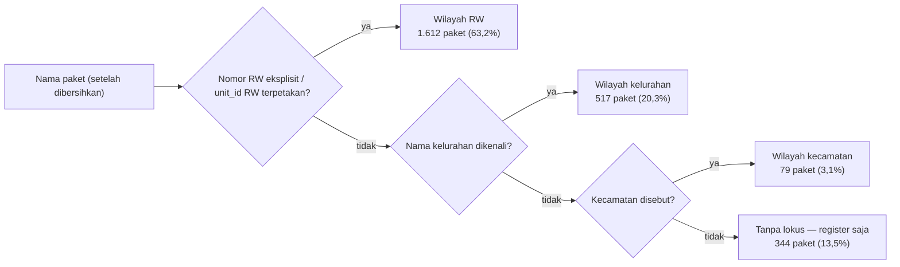

# SPESIFIKASI TEKNIS & FUNGSIONAL (SPEC) — Codename: **SAKSI**
*Sistem Akuntabilitas & Komparasi Spasial Infrastruktur*

**Disusun:** 29 Oktober 2026 (v4 — fokus **jalan**, Kota Tangerang; snapshot aktif **5 November 2026**
dari `data.inaproc.id`; angka 31 Oktober/3 November adalah riwayat pipeline)
**Target dokumen lomba:** FDS (1 November 2026) & Proposal Penyisihan (11 November 2026)
**Subtema:** *Civic Reporting & Accountability*
**Studi kasus:** Jalan di Kota Tangerang (`idKldi=D44`, BPS `3671`), TA 2025–2026
**Replikasi:** Kabupaten Bandung (`idKldi=D107`, BPS `3204`) — arsip pipeline, bukan produk

**Ruang lingkup:** jalan, jembatan, drainase/saluran, trotoar, TPT/turap. Sektor lain (pendidikan,
permukiman/air, PJU, fasilitas publik) **tidak** ditampilkan di produk dan tidak masuk snapshot yang
dibaca aplikasi; hanya tersimpan di arsip pipeline sebagai kapabilitas.

**Verifikasi build (8 November 2026):** `tsc` 0 error, `eslint` 0 temuan, `next build` hijau tanpa
`DATABASE_URL`.

---

## 1. Arsitektur Data

| Kode | Sumber | Cakupan & volume | Atribut kunci | Berkas |
|---|---|---|---|---|
| **D1** | **Data INAPROC — ekspor RUP** (`data.inaproc.id/rup`, `idKldi=D44`, TA 2025 & 2026; sumber utama sejak 5 Nov 2026) | 28.699 baris RUP → **2.552 paket sektor jalan** (1.592 TA2025, 960 TA2026), pagu **Rp813,13 M** | `kode_rup`, `tahun`, `satker`, `nama`, `pagu`, `metode`, `sumber`, `bulan`, `sektor` | `data/rup_kota_tangerang_2025_2026.json` (28.699 baris) → `scripts/build-snapshot.mjs` → `data/saksi_kota_tangerang_2025_2026.json` |
| **D2** | **Batas administrasi Kota Tangerang** (ArcGIS Pemkot) + kode wilayah BPS `3671` | **13 kecamatan · 104 kelurahan · 1.020 RW**; 87 kelurahan dan 585 RW terisi paket | `wadmkc`, `wadmkd`, `rw`, geometri | `public/data/kec.geojson`, `kel.geojson`, `rw.geojson` |
| **D3** | **LPSE / SPSE Kota Tangerang** (`spse.inaproc.id/tangerangkota`) | 4.869 baris pengumuman → **1.739 paket RUP tercocokkan** (943 lewat kode RUP · 796 lewat nama persis yang unik dan setahun), 731 dengan pelaksana | `id_lpse`, `hps`, `nilai_kontrak`, `pemenang` (sumber), `npwp`, `status` | `data/lpse_kota_tangerang_2025_2026.json` |
| **D4** | **Data INAPROC realisasi** (`data.inaproc.id/realisasi`) | **50.836 baris** (snapshot 6 Nov 2026), **1.603 paket** dengan transaksi realisasi — menutup celah e-purchasing yang tidak muncul di LPSE | `penyedia`, `nilai_transaksi`, `sumber_transaksi` | `data/realisasi_kota_tangerang.json` |
| **D5** | **Laporan warga & moderasi** | Foto kerusakan (webp tersanitasi, EXIF dibuang), jenis & penyebab kerusakan, ukuran kasar, wilayah RW, tautan paket opsional | `publicCode`, `damageType`, `observedCauses[]`, `coarseSize`, `areaId`, `locationSource`, `packageLink`, `status` | PostgreSQL/PostGIS (`Report`, `ReportMedia`, `ReportPackageLink`, `ReportStatusEvent`) + Supabase Storage |

**Yang tidak dimiliki data Indonesia:** koordinat paket. Record SIRUP hanya memuat `lokasi` teks
(`"Banten, Tangerang (Kota)"`), halaman LPSE hanya `Lokasi Pekerjaan` teks. Karena itu SAKSI **tidak**
menaruh pin, titik, atau jitter per paket: peta mewarnai batas wilayah, dan panel paket menyebut
presisi lokusnya (`RW`, `Kelurahan`, `Kecamatan`, atau tanpa lokus). (Bandingkan: DPWH Filipina
menerbitkan `latitude`/`longitude` per kontrak.)

### 1.1 Batas frontend/backend

- Snapshot dibaca **server-only** dari `data/` oleh repository di `src/server/packages/`; browser tidak
  pernah mengambil berkas snapshot langsung.
- Route Handler `GET /api/packages` adalah BFF: menerima `year`, `district`, `desa` (berulang),
  `lokasi=1`, `work`, `kontrak`, `q`; mengembalikan `items`, `districts`, `villagesByDistrict`,
  `totalCount`, `filteredCount`, `withContractCount`, `vendorCount`.
- Prisma + Better Auth **opsional**: build dan halaman publik berjalan tanpa `DATABASE_URL`; jalur
  laporan (`POST /api/reports`), undangan, dan dashboard memerlukan database.
- Bukti foto disanitasi di klien (diburing wajah/plat, EXIF dibuang, dikonversi webp) sebelum diunggah
  ke Supabase Storage.

---

## 2. Pipeline (deterministik, tanpa NLP di lapisan lokasi)

### 2.1 Pembersihan nama
1. Hapus kode rekening di depan (`1598.25.397.`).
2. Decode entity HTML (`&#x27;`, `&amp;`).
3. Buka pembungkus `Belanja Modal Jalan Desa - …`.
4. Normalisasi singkatan: `Ds./Desa/Kel.` sebagai penanda kelurahan, `Kp.`, `Jl.`, `Gg.`, `tj` → `tanjung`.
5. Samakan spasi: `Situgadung` ≡ `Situ Gadang`.

### 2.2 Penyaringan & kelas pekerjaan
1. **Sektor**: snapshot hanya memuat `sektor = "Jalan, Jembatan & Drainase"`. Penyaringan sektor
   dilakukan saat membangun snapshot, bukan di klien.
2. **Inklusi**: awalan kata kerja fisik (`pembangunan`, `peningkatan`, `rehabilitasi`, `perbaikan`,
   `pemeliharaan`, `renovasi`, `penggantian`, `penataan`, `normalisasi`, `penyediaan`, `lanjutan`,
   `pemasangan`, `pengadaan`, `pembuatan`, `pengerukan`, `pengaspalan`); tidak didahului `Belanja …`.
3. **Eksklusi**: alat, kantor, listrik, kendaraan, ATK, konsumsi, pakaian, sewa, tagihan, honor, jasa
   konsultansi, pengawasan, perencanaan, survei, DED, aplikasi, obat/bahan kimia.
4. **Kelas pekerjaan** (dipakai filter `Jenis`; urutan penting — drainase diuji lebih dulu supaya
   `turap`/`TPT`/`gorong-gorong` tidak jatuh ke permukaan): `drainase`, `saluran`, `u-ditch`/`uditch`,
   `spal`, `turap`, `talud`, `tpt`, `bronjong`, `gorong`, `culvert` → **drainase**; `jembatan` →
   **jembatan**; sisanya (paving, beton, hotmix, aspal, rabat, **trotoar**) → **permukaan**.
5. Hasil snapshot 5 November 2026 (rebuild 8 November 2026): **2.552 paket · Rp813,13 M** (drainase
   1.303 · permukaan 1.205 · jembatan 44).

### 2.3 Pemetaan lokus wilayah (bukan titik)

Aturan yang menjaga presisi:
- **Tidak ada pin, titik, atau jitter per paket.** Peta hanya mewarnai poligon batas resmi.
- RW hanya diterima bila nomornya eksplisit atau `unit_id` RW terpetakan; paket berpresisi kelurahan
  **tidak** dipecah ke RW.
- Nama kelurahan yang sama dengan nama kecamatan hanya diterima lewat penanda `Kel./Desa/Ds.`.
- Kecamatan dipakai hanya bila tidak ada RW/kelurahan.
- **Paket tanpa penanda tempat tidak dipetakan.** Hasil: 2.208 dari 2.552 (**86,5%**) punya lokus
  turunan; 344 paket (13,5%) tetap ada di register dengan label wilayah umum.
- Jangkauan: 87 dari 104 kelurahan, 585 dari 1.020 RW, seluruh 13 kecamatan.
- Angka kecamatan = agregasi **semua** paket di dalamnya, termasuk yang presisi RW/kelurahan.

### 2.4 Keputusan yang sudah diuji (jangan diulang)

| Keputusan | Alasan terukur |
|---|---|
| **Tanpa NLP/LLM di ekstraksi lokasi** | Diuji 29 Okt pada 982 paket sisa Kab. Bandung: fuzzy 0/100, LLM+gazetteer 0/38 baris, LLM+Nominatim 4/23 token (2–3 realistis, 1 salah). Regex menemukan nama tempat di 12/40 baris, LLM 15/40 (tambahan berupa `RT. 001`, `Kabupaten Bandung`). Plafon ~+1,5 poin, risiko titik palsu. |
| **Tanpa computer vision pengukuran kerusakan** | Pengukuran luas menambah metrik tanpa menambah urgensi laporan; CV tidak mencakup semua jenis kerusakan. Diganti kategorisasi oleh pelapor (lihat 2.5). |
| **Tanpa titik paksa untuk paket tanpa lokus** | 344 paket (13,5%) lebih baik tetap di register daripada diberi wilayah salah — bertentangan dengan postur "diduga, bukan tuduhan". |
| **Tanpa pin per paket** | Data resmi tidak memuat koordinat pekerjaan; pin akan menampilkan presisi yang tidak ada. Peta memakai koroplet batas. |
| **Tanpa pemilih basemap** | Satu variabel `NEXT_PUBLIC_BASEMAP_URL` (URL style JSON, default OpenFreeMap Positron) dan atribusi OpenStreetMap/OpenFreeMap; menghindari ToS tile berlapis. |

### 2.5 Model data laporan warga (D5)

| Field | Tipe | Nilai |
|---|---|---|
| `damageType` | enum, wajib | `POTHOLE`, `CRACK`, `SUBSIDENCE`, `STANDING_WATER`, `BLOCKED_DRAINAGE`, `DAMAGED_BRIDGE`, `OTHER` |
| `observedCauses[]` | enum array, opsional | `HEAVY_VEHICLE`, `NO_DRAINAGE`, `RECURRING_FLOODING`, `HEAVY_TRAFFIC`, `UNSUITABLE_MATERIAL`, `UNKNOWN` |
| `coarseSize` | enum, opsional | `PALM`, `TIRE`, `OVER_1M2` — **tanpa** klaim cm² |
| `areaId` + `locationSource` | relasi, wajib untuk laporan bertaut | Wilayah RW (`MANUAL_AREA`, `DEVICE_RESOLVED_AREA`) atau hanya rujukan paket (`PACKAGE_REFERENCE_ONLY`) |
| `locationHint` | teks ≤180, opsional | Patokan nama jalan/kampung/RT-RW; dipakai membandingkan nama lokasi paket dan disimpan privat, tidak ditampilkan publik |
| `status` | enum | `SUBMITTED`, `UNDER_REVIEW`, `NEEDS_MORE_INFO`, `PUBLISHED`, `REJECTED`, `WITHDRAWN`, `ARCHIVED` |
| `ReportMedia` | 1:1 | webp tersanitasi, `objectPath` di Supabase Storage, ukuran & dimensi tercatat |
| `ReportPackageLink` | 1:0..1 | `rupSnapshot` + `packageNameSnapshot`; `selectionSource` = `PACKAGE_PAGE` atau `CANDIDATE_LIST`; boleh kosong |

---

## 3. Penautan Laporan ke Paket

Warga memilih wilayah RW (manual atau dari GPS yang diuji *point-in-polygon*), bukan menaruh titik
kerusakan di peta:

1. **Kandidat**: paket di kecamatan wilayah laporan, diambil lewat `GET /api/packages?district=…`.
2. **Urutan tampilan** (bukan skor yang dipublikasikan): RW sama → kelurahan sama → nama lokasi
   memuat patokan warga (frasa ≥4 karakter) → sisanya. Kandidat di luar RW tetap ditampilkan dengan
   peringatan eksplisit bila tidak ada paket yang menyebut RW tersebut.
3. **Pemilihan manual**: warga memilih satu paket atau mengirim laporan **tanpa** tautan paket.
   Tidak ada klaim kecocokan otomatis; tautan menyimpan snapshot RUP dan nama paket.
4. **Konsistensi wilayah**: paket rujukan dilepas otomatis bila wilayahnya berbeda dari lokasi
   laporan (mis. GPS berada di RW lain).
5. **Moderasi**: laporan masuk sebagai `SUBMITTED` → `UNDER_REVIEW`. Moderator memutuskan
   `PUBLISHED`, `NEEDS_MORE_INFO`, `REJECTED`, `WITHDRAWN`, atau `ARCHIVED` lewat antrean dashboard;
   hanya laporan `PUBLISHED` yang tampil sebagai bukti warga.

---

## 4. Spesifikasi Fungsional (FR)

| Kode | Modul | Deskripsi | Nilai rubrik |
|---|---|---|---|
| **FR-01** | **Peta audit jalan** | Koroplet batas resmi Kota Tangerang pada tiga tingkat — kecamatan (13), kelurahan (104), RW (1.020) — dipilih lewat *segmented control* di peta, bukan dari tingkat perbesaran. Filter tahun, kecamatan, kelurahan (checkbox), jenis pekerjaan, status kontrak, pencarian; panel detail paket; tanpa pin/titik per paket. | Fungsionalitas 25%, Desain 20%, Tema 15% |
| **FR-02** | **Pencarian paket "Jalan mana yang dibangun di dekat saya?"** | Pencarian desa/ruas/RUP di hero dan di peta → daftar paket (nama, pagu, wilayah, bulan), klik → panel detail. Default "Hanya paket berlokasi" aktif (2.208 dari 2.552). | Konten 20% |
| **FR-03** | **Form lapor 4 langkah** | (1) foto + pemeriksaan manual wajah/plat + pembersihan EXIF; (2) kategorisasi jenis kerusakan, penyebab, ukuran kasar; (3) lokasi kelurahan/RW (manual atau GPS *point-in-polygon*) + pilih paket rujukan opsional; (4) sukses dengan kode laporan. Tanpa CV, tanpa klaim cm². | Fungsionalitas 25%, Orisinalitas 20% |
| **FR-04** | **Sandingan data resmi vs kontrak** | Panel paket: pagu RUP, jadwal/bulan, sumber dana, metode; bila ada rekam LPSE/INAPROC — HPS, nilai kontrak, pelaksana (pemenang bila tender; penyedia bila bukan), selisih pagu, dan sumber transaksi. Badge sumber melekat pada angka. | Orisinalitas 20% |
| **FR-05** | **Moderasi laporan & bukti warga** | Laporan warga (`SUBMITTED`) masuk antrean tinjauan dashboard; antrean saat ini **ringkasan baca-saja** (status, jenis kerusakan, waktu, wilayah kasar, paket rujukan) tanpa identitas pelapor, deskripsi, atau media. Melihat foto tersanitasi dan menetapkan `PUBLISHED`/`NEEDS_MORE_INFO`/`REJECTED`/`WITHDRAWN`/`ARCHIVED` belum diimplementasikan. | Civic Reporting |
| **FR-06** | **Agregasi kecamatan** | Tiga belas poligon kecamatan diwarnai dengan kelas **kuantil** jumlah paket; tooltip menyebut jumlah paket, total pagu, dan (pada tampilan jenis) kelas pekerjaan. Klik wilayah → filter daftar paket. | Decision Support, Konten 20% |
| **FR-07** | **Rekam jejak penyedia (berimbang)** | 633 entri penyedia unik pada manifest (630 setelah normalisasi nama gabungan) dari LPSE/SPSE + Data INAPROC: 2.334 dari 2.552 paket (91,5%) punya rekam kontrak; 218 paket (Rp132,34 M, 16,3% pagu) belum. Halaman penyedia: jumlah paket, nilai, tahun, kategori; tanpa skor gabungan. Rasio kontrak/pagu median 0,99. | Orisinalitas, Akuntabilitas |

---

## 5. Layar & Aturan UI

### Daftar layar
1. **`/` — Beranda & peta audit jalan.** Metrik: **2.552 paket jalan · Rp813,13 M · 87 kelurahan ·
   2.208 (86,5%) berlokus**. Hero + pencarian, diikuti peta dan panel detail paket.
2. **`/peta-pekerjaan` dan `/peta-pekerjaan/kota-tangerang/…` — Peta pekerjaan.** Peta koroplet tiga
   tingkat dengan *segmented control* Kecamatan / Kelurahan / RW; filter tahun, kecamatan, kelurahan,
   jenis, kontrak, pencarian; register paket di samping peta. Segmen URL menyimpan wilayah
   (`<kecamatan>/<kelurahan>/rw-<n>`) dan paket terpilih (`rup-<kode>/<slug>`) agar bisa dibagikan.
3. **`/laporan` dan `/laporan/paket/:rup` — Lapor & tautkan paket.** 4 langkah seperti FR-03; membuka
   dari paket mengisi paket rujukan lebih dulu.
4. **`/penyedia` dan `/penyedia/:slug` — Rekam jejak penyedia.** Daftar 633 entri penyedia (630 nama setelah normalisasi) dengan
   pengurutan nilai/paket/nama/tahun; halaman penyedia memuat paket yang tercatat.
5. **`/dashboard` — Akun, laporan saya, antrean tinjauan.** Perlu login; memuat profil, riwayat
   laporan, moderasi (sesuai izin), dan undangan.
6. **`/login`, `/register`, `/offline`** — Autentikasi Better Auth dan fallback PWA.

### Cakupan FDS (1 November 2026)
Screenshot wajib: **landing page + minimal satu halaman fitur**. Yang dibangun lebih dulu:
**peta audit jalan (`/` + `/peta-pekerjaan`)** dan **alur lapor (`/laporan`)** — peta untuk kekuatan tema,
alur lapor untuk "inti proyek = sistem pelaporan masyarakat" versi dosen.

### Aturan tampilan
- Format angka Indonesia: `2.552`, `86,5%`, `Rp813,13 Miliar`.
- Badge sumber: **`Data resmi (LPSE)`** / **`Data resmi (INAPROC)`** melekat pada angka kontrak yang
  ditampilkan; tidak ada badge pada data yang tidak punya sumber.
- Presisi lokus ditulis sebagai label (`RW`, `Kelurahan`, `Kecamatan`, atau
  `Lokasi: Kota Tangerang (Umum)`) di panel/daftar — bukan sebagai marker.
- Nama penyedia **ditampilkan asli** di modul rekam jejak (data publik LPSE), tanpa skor gabungan,
  selalu dengan penyebut jumlah paket dan tahun.
- Paket tanpa lokus tampil di register dengan label `Lokasi: Kota Tangerang (Umum)` — tidak
  diwarnai sebagai wilayah dan tidak dipetakan.
- Pilih satu kecamatan lebih dulu; kelurahan berupa checkbox dengan **default semua**. Bila semua
  kelurahan dilepas, tampil peringatan merah dan tidak ada request API — bukan daftar kosong.
- **Tidak ada filter sektor** di UI: produk adalah jalan. Jenis pekerjaan (permukaan/drainase/
  jembatan) yang menjadi filter, bukan 5 sektor.
- Peta dasar tunggal dari `NEXT_PUBLIC_BASEMAP_URL` (URL style JSON, default OpenFreeMap Positron)
  dengan atribusi OpenStreetMap/OpenFreeMap; tidak ada pemilih basemap.
- Kecamatan memakai kelas **kuantil**; kelurahan/RW memakai kelas 0 / 1 / 2–3 / 4–6 / 7–10 / 11+.
  Angka kecamatan menjumlahkan semua paket di dalamnya, termasuk presisi RW/kelurahan.
