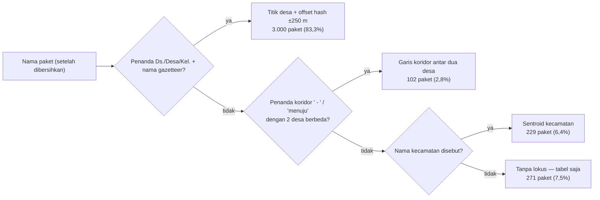

# SPESIFIKASI TEKNIS & FUNGSIONAL (SPEC) — Codename: **SAKSI**
*Sistem Akuntabilitas & Komparasi Spasial Infrastruktur*

**Disusun:** 29 Oktober 2026 (v3 — fokus **jalan**, Kab. Tangerang)
**Target dokumen lomba:** FDS (1 November 2026) & Proposal Penyisihan (11 November 2026)
**Subtema:** *Civic Reporting & Accountability*
**Studi kasus:** Jalan di Kabupaten Tangerang (`idKldi=D50`, BPS `3603`) + IRI Bina Marga (nasional)
**Replikasi:** Kabupaten Bandung (`idKldi=D107`, BPS `3204`) — dataset 5 sektor, arsip pipeline

**Ruang lingkup:** jalan, jembatan, drainase/saluran, trotoar, TPT/turap. Sektor lain (pendidikan,
permukiman/air, PJU, fasilitas publik) **tidak** ditampilkan di produk; hanya tersimpan di dataset
dan disebut satu paragraf sebagai kapabilitas pipeline.

---

## 1. Arsitektur Data

| Kode | Sumber | Cakupan & volume | Atribut kunci | Berkas |
|---|---|---|---|---|
| **D1** | **SIRUP Inaproc** (`idKldi=D50`, TA 2025 & 2026) | 51.322 baris RUP → **3.602 paket jalan**, pagu **Rp848,60 M** | `kode_rup`, `tahun`, `satker`, `nama`, `pagu`, `metode`, `sumber`, `bulan`, `sektor` | `data/saksi_tangerang_2025_2026.json` (2,9 MB, 5 sektor; filter jalan di klien) |
| **D2** | **Gazetteer desa/kelurahan BPS `3603`** + koordinat OSM | **29 kecamatan**, **274 desa/kelurahan** (245 presisi desa, 29 sentroid kecamatan) | `id_desa`, `desa`, `id_kec`, `kecamatan`, `lat`, `lon`, `presisi` | `data/tangerang_desa_coords.json` |
| **D3** | **GIS Ditjen Bina Marga** (`IRI_1_2026`) | 477.032 titik IRI (47.703 km jalan **nasional**) | `ruas`, `iri`, `status_kemantapan`, geometri | `data/jalan.json`, `data/provinsi.json` |
| **D4** | **LPSE / SPSE** halaman paket | Pagu, HPS, lokasi (teks), **pemenang** | `hps`, `nilai_kontrak`, `pemenang`, `id` | `data/vendor_jakarta.json` + tarikan per instansi |
| **D5** | **Laporan warga & verifikasi komunitas** | Foto ber-geotag, jenis & penyebab kerusakan, ukuran kasar, konfirmasi warga | `id_laporan`, `lat`, `lon`, `foto_blur`, `jenis_kerusakan`, `penyebab`, `ukuran_kasar`, `kode_rup_terkait`, `status_dua_kunci` | `localStorage` + skenario simulasi berlabel |

**Yang tidak dimiliki data Indonesia:** koordinat paket. Record SIRUP hanya memuat `lokasi` teks
(`"Banten, Tangerang (Kab.)"`), halaman LPSE hanya `Lokasi Pekerjaan` teks. Titik di SAKSI diturunkan
dari teks nama paket + gazetteer desa — bukan koordinat resmi. (Bandingkan: DPWH Filipina menerbitkan
`latitude`/`longitude` per kontrak.)

---

## 2. Pipeline (deterministik, tanpa NLP di lapisan lokasi)

### 2.1 Pembersihan nama
1. Hapus kode rekening di depan (`1598.25.397.` — 5,0% baris Tangerang).
2. Decode entity HTML (`&#x27;`, `&amp;` — 0,9%).
3. Buka pembungkus `Belanja Modal Jalan Desa - …`.
4. Normalisasi singkatan: `Ds./Desa/Kel.` sebagai penanda desa, `Kp.`, `Jl.`, `Gg.`, `tj` → `tanjung`.
5. Samakan spasi: `Situgadung` ≡ `Situ Gadang`.

### 2.2 Penyaringan paket jalan
1. **Inklusi**: awalan kata kerja fisik (`pembangunan`, `peningkatan`, `rehabilitasi`, `perbaikan`,
   `pemeliharaan`, `renovasi`, `penggantian`, `penataan`, `normalisasi`, `penyediaan`, `lanjutan`,
   `pemasangan`, `pengadaan`, `pembuatan`, `pengerukan`, `pengaspalan`); tidak didahului `Belanja …`.
2. **Eksklusi**: alat, kantor, listrik, kendaraan, ATK, konsumsi, pakaian, sewa, tagihan, honor, jasa
   konsultansi, pengawasan, perencanaan, survei, DED, aplikasi, obat/bahan kimia.
3. **Kelas jalan** (urutan penting — PJU diuji lebih dulu supaya `APJ`/`lampu jalan` tidak jatuh ke
   jalan): `jembatan`, `gorong-gorong`, `box culvert` → **jembatan**; `drainase`, `saluran`, `u-ditch`,
   `siring`, `turap`, `talud`, `TPT`, `bronjong` → **drainase/penahan**; `paving`, `beton`,
   `betonisasi`, `hotmix`, `aspal`, `rabat` → **permukaan jalan**; `trotoar` → **trotoar**.
4. Hasil pada Kab. Tangerang: **3.602 paket · Rp848,60 M** (paving/beton 1.186 · drainase/saluran 946
   · hotmix/aspal 560 · turap/talud/TPT 103 · jembatan 78).

### 2.3 Pemetaan berjenjang (4 tingkat, tanpa memaksa titik)

Aturan yang menjaga presisi:
- Nama desa yang **sama dengan nama kecamatan** hanya diterima lewat penanda `Ds./Desa/Kel.`
- Koridor hanya sah bila penandanya `" - "` ber-spasi atau `menuju/arah/s-d` — bukan sembarang tanda
  hubung (`"Tangerang- Banten"` bukan koridor).
- Kecamatan dipakai hanya bila tidak ada desa.
- **Paket tanpa penanda tempat tidak dipetakan.** Hasil: 3.331 dari 3.602 (**92,5%**).

### 2.4 Keputusan yang sudah diuji (jangan diulang)

| Keputusan | Alasan terukur |
|---|---|
| **Tanpa NLP/LLM di ekstraksi lokasi** | Diuji 29 Okt pada 982 paket sisa Kab. Bandung: fuzzy 0/100, LLM+gazetteer 0/38 baris, LLM+Nominatim 4/23 token (2–3 realistis, 1 salah). Regex menemukan nama tempat di 12/40 baris, LLM 15/40 (tambahan berupa `RT. 001`, `Kabupaten Bandung`). Plafon ~+1,5 poin, risiko titik palsu. |
| **Tanpa computer vision pengukuran kerusakan** | Pengukuran luas menambah metrik tanpa menambah urgensi laporan; CV tidak mencakup semua jenis kerusakan. Diganti kategorisasi oleh pelapor (lihat 2.5). |
| **Tanpa titik paksa untuk paket tanpa lokus** | Lebih baik kehilangan 7,5% cakupan daripada menaruh marker salah — bertentangan dengan postur "diduga, bukan tuduhan". |

### 2.5 Model data laporan warga (D5)

| Field | Tipe | Nilai |
|---|---|---|
| `jenis_kerusakan` | enum, wajib | `lubang`, `retak`, `amblas`, `genangan`, `drainase_mampet`, `jembatan_rusak`, `lainnya` |
| `penyebab` | enum multi, opsional | `dilalui_kendaraan_berat`, `drainase_tidak_ada`, `genangan_berulang`, `kepadatan_lalu_lintas`, `bahan_tidak_sesuai`, `tidak_tahu` |
| `ukuran_kasar` | enum, opsional | `setelapak`, `sebesar_ban`, `lebih_1_m2` — **tanpa** klaim cm² |
| `foto_blur` | gambar | wajah & plat diburamkan, EXIF dibersihkan |
| `waktu_lapor`, `lat`, `lon` | otomatis | tidak bisa diedit setelah kirim |
| `kode_rup_terkait` | hasil `MatchScore` | boleh kosong → status **"Tidak Dapat Ditautkan"** |

---

## 3. Algoritma Pencocokan (`MatchScore`)

Warga melapor pada $(lat_w, lon_w)$ dengan `jenis_kerusakan`:

1. **Desa terdekat** (Haversine sisi klien ke 274 titik desa) → $D^*$, $K^*$.
2. **Kandidat**: paket berkelas jalan **dan** (jarak $\le 2{,}0$ km **atau** $p.\text{desa\_resmi} = D^*$).
3. **Skor (0–100):**

$$\text{MatchScore}(p) = 50\max\left(0, 1-\frac{d(w,p)}{2000}\right) + 25\,\mathbb{I}(\text{desa sama}) + 15\,\mathbb{I}(\text{dalam jendela pasca-pelaksanaan}) + 10\,\text{kemiripan}(c_w, p.\text{lokasi\_mikro})$$

4. **Batas kejujuran**: bila tidak ada kandidat di desa yang sama, tampilkan **"Tidak Dapat
   Ditautkan"**. Laporan tetap tersimpan, tetapi tidak menandai paket mana pun — mencegah satu laporan
   menandai belasan paket di desa besar (median 10 paket/desa, maksimum 261 di Pasar Kemis).
5. **Status "Diduga Tidak Sesuai"**: paket berjalan/baru selesai ($\le 12$ bulan) **atau** ruas
   berstatus "Baik/Mantap" pada IRI, **dan** ada $\ge 1$ laporan berfoto yang dikonfirmasi $\ge 2$
   warga sekitar.

---

## 4. Spesifikasi Fungsional (FR)

| Kode | Modul | Deskripsi | Nilai rubrik |
|---|---|---|---|
| **FR-01** | **Peta audit jalan** | 3.331 titik/garis paket jalan Kab. Tangerang; filter tahun (2025/2026), kecamatan/desa, jenis pekerjaan; badge presisi per titik; layer IRI nasional; klik → tabel paket. | Fungsionalitas 25%, Desain 20%, Tema 15% |
| **FR-02** | **Pencari mikro "Jalan mana yang dibangun di dekat saya?"** | Ketik desa/kampung/nama jalan → kartu desa: total pagu jalan, daftar paket 2025–2026, bulan pelaksanaan, tombol "Laporkan Kerusakan". | Konten 20% |
| **FR-03** | **Form lapor** | 3 langkah: (1) foto + blur wajah/plat + pembersihan EXIF; (2) **kategorisasi jenis kerusakan & penyebab** oleh pelapor + ukuran kasar; (3) lokasi GPS/desa → rekomendasi paket dengan skor kecocokan yang ditampilkan apa adanya. Tanpa CV, tanpa klaim cm². | Fungsionalitas 25%, Orisinalitas 20% |
| **FR-04** | **Kartu sandingan (triangulasi)** | Kiri: data resmi (kode RUP, pagu, jadwal, status masa pemeliharaan, IRI bila berimpit ruas nasional). Kanan: bukti warga (foto, jenis/penyebab, ukuran kasar, waktu, konfirmasi). | Orisinalitas 20% |
| **FR-05** | **Verifikasi komunitas dua kunci** | Laporan atau klaim "sudah diperbaiki" menjadi `Terverifikasi Komunitas` setelah ≥2 warga sekitar mengonfirmasi. | Civic Reporting |
| **FR-06** | **Rapor kecamatan & jenis kerusakan** | Peringkat **29 kecamatan**: pagu jalan, jumlah paket, laporan per jenis kerusakan, penyebab dominan, dan paket dalam masa pemeliharaan yang perlu ditagih. | Decision Support, Konten 20% |
| **FR-07** | **Rekam jejak penyedia (berimbang)** | Per penyedia dari LPSE: jumlah paket, pagu, daftar paket dengan laporan kerusakan **dalam masa pemeliharaan**, beserta kelas jalan dan tahun sebagai penyebut. Tanpa skor gabungan. | Orisinalitas, Akuntabilitas |

---

## 5. Layar & Aturan UI

### Daftar layar
1. **`/` — Beranda & peta audit jalan.** Metrik: **3.602 paket jalan · Rp848,60 M · 251 desa ·
   92,5% bertitik · 102 koridor ruas**. Peta Kab. Tangerang + panel detail paket.
2. **`/jelajah` — Eksplorasi desa & paket.** Pencarian desa/kampung/jalan, filter tahun & jenis
   pekerjaan, badge presisi (`Titik Desa`, `Garis Koridor`, `Kecamatan`), unduh CSV/JSON.
3. **`/lapor` — Lapor & tautkan paket.** 3 langkah seperti FR-03.
4. **`/kasus/:id` — Detail kasus & verifikasi dua kunci.** Sandingan resmi vs warga, indikator masa
   pemeliharaan, lini masa, tombol konfirmasi.
5. **`/rapor` + `/metode` — Rapor wilayah & metodologi.** Agregasi 29 kecamatan, pipeline terbuka,
   rumus `MatchScore`, batasan data & etika.

### Cakupan FDS (1 November 2026)
Screenshot wajib: **landing page + minimal satu halaman fitur**. Yang dibangun lebih dulu:
**Layar 1 (peta audit jalan)** dan **Layar 3 (alur lapor)** — peta untuk kekuatan tema, alur lapor
untuk "inti proyek = sistem pelaporan masyarakat" versi dosen.

### Aturan tampilan
- Format angka Indonesia: `3.602`, `92,5%`, `Rp848,60 Miliar`.
- Badge **`SIMULASI PROTOTIPE`** (amber) untuk laporan warga; **`DATA RESMI (SIRUP / BINA MARGA)`**
  (hijau/biru) untuk data asli; badge presisi wajib melekat pada marker.
- Nama penyedia **ditampilkan asli** di modul rekam jejak (data publik LPSE), tanpa skor gabungan,
  selalu dengan penyebut; frasa tetap "paket dengan laporan kerusakan dalam masa pemeliharaan".
- Paket tanpa lokus tampil di tabel dengan label `Lokasi: Kab. Tangerang (Umum)` — tidak dipetakan.
- **Tidak ada filter sektor** di UI: produk adalah jalan. Kelas jalan (permukaan/drainase/jembatan)
  yang menjadi filter, bukan 5 sektor.
