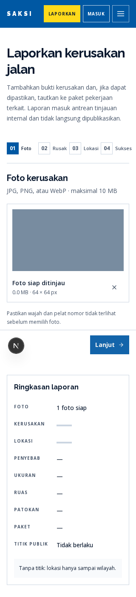
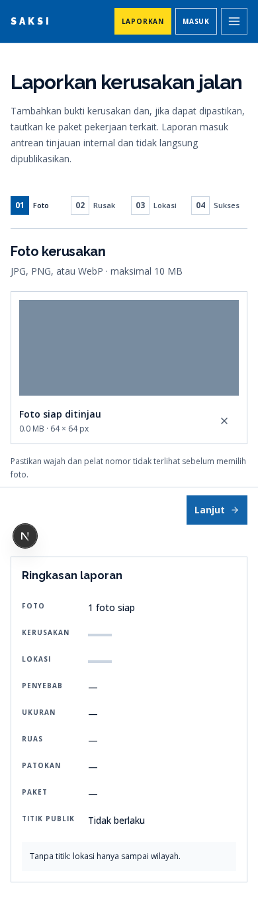
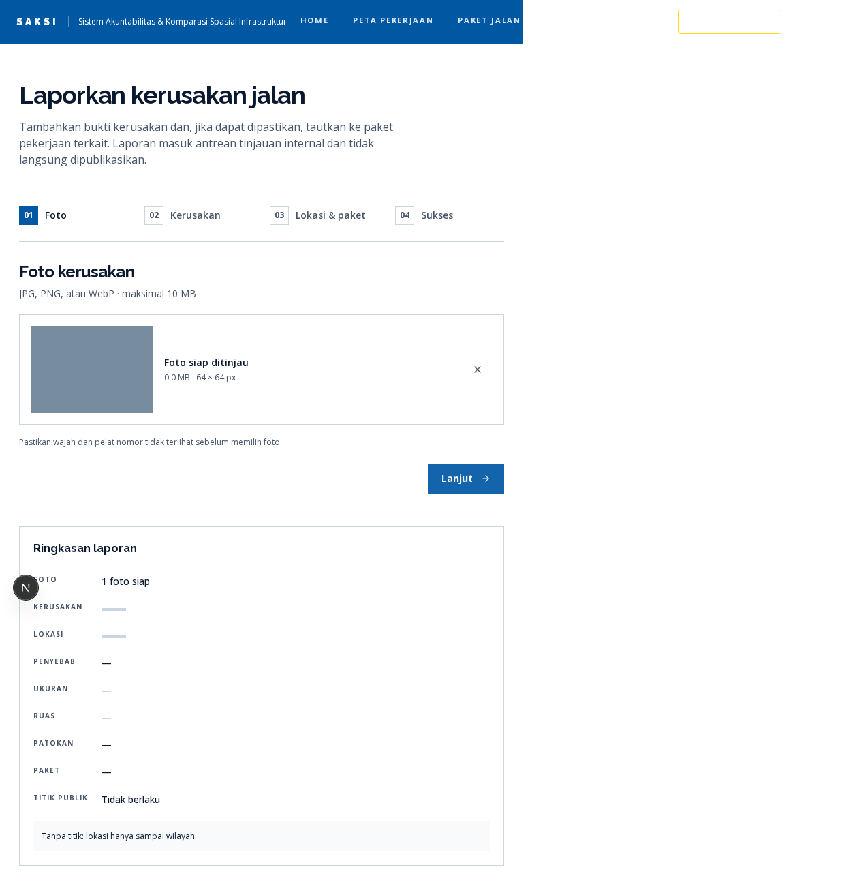
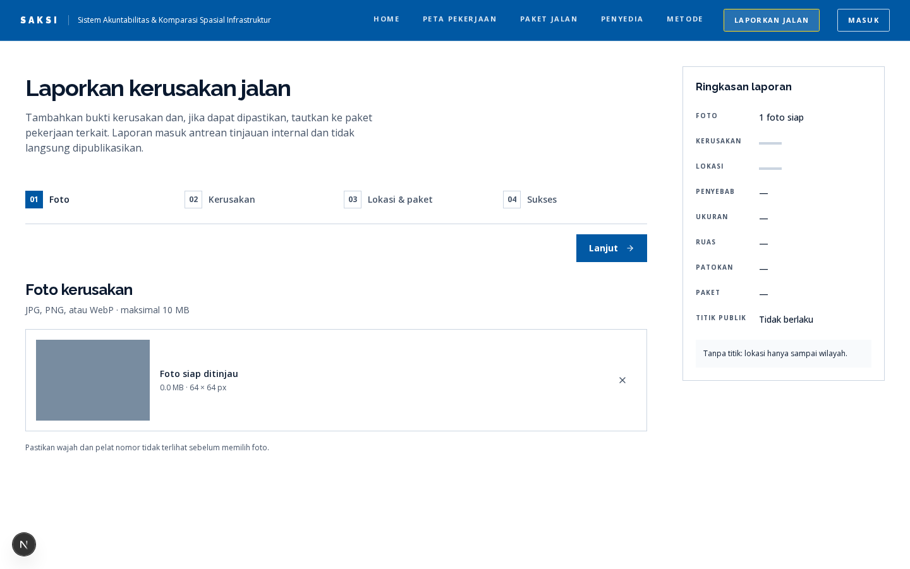
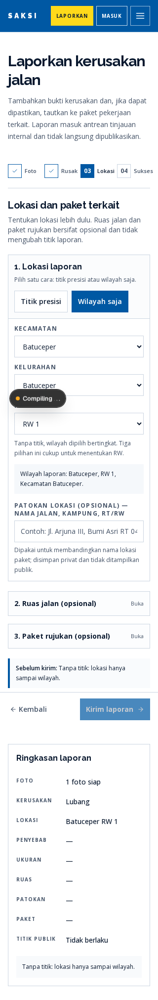
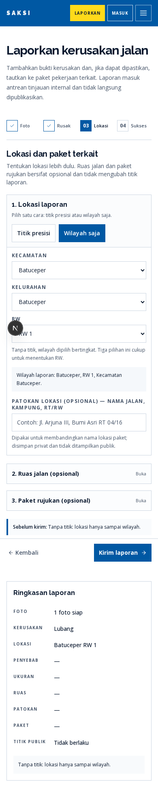
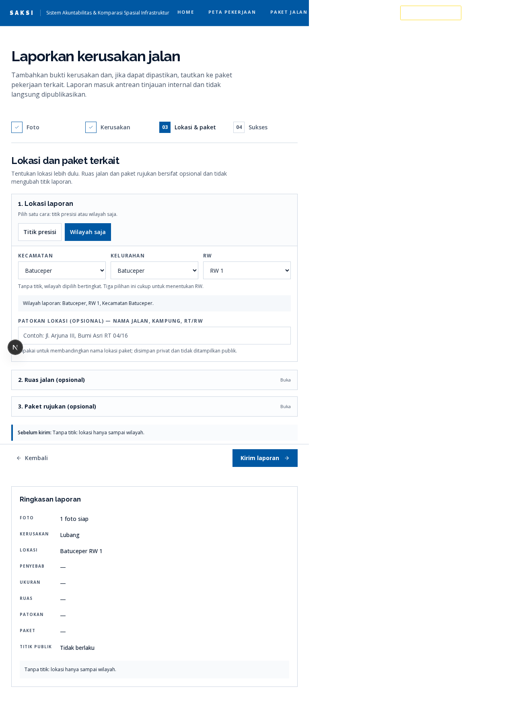
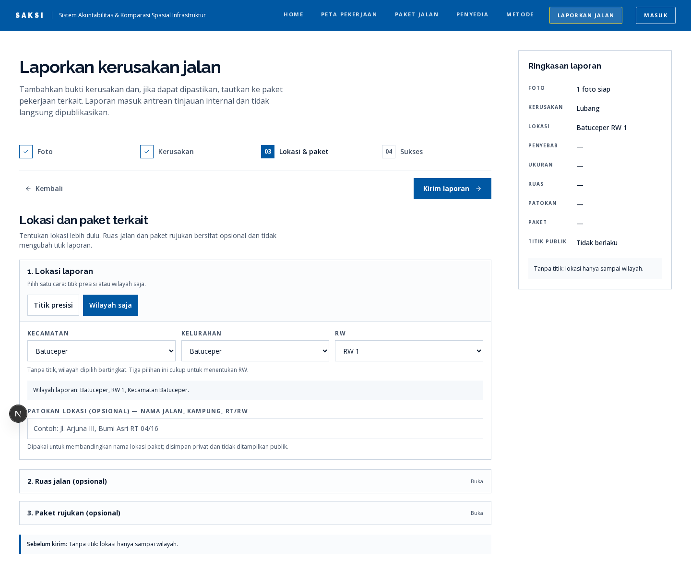
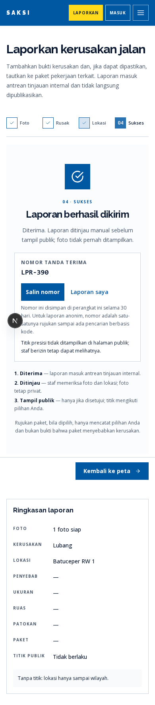
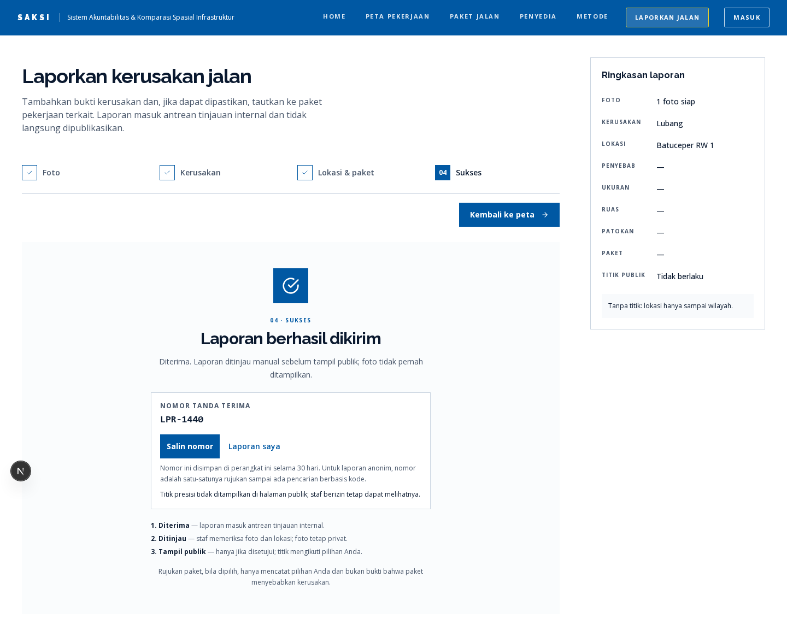

# Verifikasi UX Alur Pelaporan Warga SAKSI

**Tanggal:** 11 November 2026 · **Branch:** `feat/report-flow-ux-2` · **Acuan:** `docs/UX-REPORT-FLOW.md`

Dokumen ini mencatat perintah, hasil, tangkapan layar, dan batas verifikasi untuk paket perbaikan
P0/P1 alur pelaporan. Status tiap butir ada di `docs/UX-REPORT-FLOW.md` §11.

## 1. Lingkungan uji

| Hal | Nilai |
|---|---|
| Runtime | Node 24, Bun 1.4.0, Next.js 16.4.3 |
| Peramban uji | Chromium Playwright 1.65.0 (Chrome for Testing 158) |
| Proyek Playwright | `mobile-390` (390×844, `isMobile`) dan `desktop-1440` (1440×900) |
| Server uji | `next dev` pada `http://localhost:3100` |
| Basis data saat uji | `DATABASE_URL` dan `DIRECT_URL` dikosongkan lewat `webServer.env`; `POST /api/reports` di-mock per uji |
| Peta dasar | `https://tiles.openfreemap.org/styles/positron` dapat diakses (HTTP 200) |
| Tangkapan 320/390/768/1440 | `docs/assets/verifikasi/` |

`bun test` tidak menjalankan berkas Playwright karena uji E2E memakai akhiran `.e2e.ts`, sedangkan
`bun test` hanya memindai `*.test.*`/`*.spec.*`.

## 2. Perintah dan hasil

| Perintah | Hasil |
|---|---|
| `npm run lint` | Lulus, 0 temuan |
| `npm run build` dengan `.env.local` dipindahkan sementara dan `DATABASE_URL`/`DIRECT_URL` tidak diset | Lulus, exit 0, 30 halaman statis dibangkitkan tanpa basis data |
| `bun test` | 41 lulus, 0 gagal, 89 assertion, 6 berkas; tidak ada berkas E2E yang ikut |
| `bunx playwright test` | 38 lulus, 4 dilewati (lihat catatan), 2,4 menit |
| `bunx playwright test --project=mobile-390` | Mencakup navigasi, transisi langkah, draf, kaskade wilayah, pin, consent, kandidat paket, pasca-kirim, dan axe |
| `bunx playwright test --project=desktop-1440` | Sama pada 1440 px, termasuk tangkapan layar 320/390/768/1440 |

Empat uji dilewati adalah penglewatan yang disengaja per proyek: menu ringkas hanya diuji di
`mobile-390`, navigasi desktop hanya di `desktop-1440`, dan dua tangkapan layar hanya dijalankan
sekali pada `desktop-1440` (viewport diubah di dalam uji).

### Perintah lengkap

```bash
npm run lint
bun test
bunx playwright test
# build tanpa basis data:
mv .env.local /tmp/opencode/env.local.saksi.bak
env -u DATABASE_URL -u DIRECT_URL npm run build
mv /tmp/opencode/env.local.saksi.bak .env.local
```

## 3. Cakupan uji Playwright

Berkas uji:

- `e2e/navigation.e2e.ts` — menu ringkas ponsel (Esc mengembalikan fokus), navigasi desktop, CTA
  beranda, tidak ada tautan ganda di kepala alur, halaman offline, dan tidak ada gulir horizontal
  pada 320 px di `/`, `/laporan`, dan `/peta-pekerjaan`.
- `e2e/report-flow.e2e.ts` — alasan aksi terlihat, fokus dan `aria-live` antar-langkah, pemulihan draf
  setelah muat ulang, kaskade kecamatan→kelurahan→RW, satu model lokasi dengan konfirmasi hapus titik,
  perilaku pin (klik peta tanpa mode tidak memindahkan titik; kamera tidak bergeser saat mengetik
  patokan), consent bawaan aktif dan ringkasannya, kandidat paket 5 teratas + "Lihat semua" + kartu
  utuh + "Batalkan tautan", pasca-kirim (salin, tersimpan setelah halaman ditutup, draf dihapus), dan
  pemetaan galat 503.
- `e2e/axe.e2e.ts` — audit `@axe-core/playwright` pada Langkah 1, Langkah 3, dan layar sukses di kedua
  proyek; filter `impact` serious/critical. Hasil: tidak ada pelanggaran.
- `e2e/screenshots.e2e.ts` — tangkapan layar 320, 390, 768, 1440 px untuk Langkah 1 dan 3, serta layar
  sukses pada 390 dan 1440 px.

Endpoint `POST /api/reports` dimock pada uji transisi pasca-kirim dan layar sukses agar hasil
deterministik dan tidak menulis data.

## 4. Tangkapan layar

Langkah 1 pada 320, 390, 768, dan 1440 px:






Langkah 3 (pemilih wilayah bertingkat) pada 320, 390, 768, dan 1440 px:






Layar sukses pada 390 dan 1440 px:




Tangkapan dibuat dari server `next dev`, sehingga indikator dev Next.js terlihat di sebagian gambar.
Indikator itu tidak muncul pada build produksi.

## 5. Yang tidak dapat diverifikasi lokal

1. **Kiriman nyata ke `POST /api/reports` tidak dijalankan.** `.env.local` berisi `DATABASE_URL`
   terkonfigurasi (Supabase) dan kredensial storage. Menulis laporan uji berarti menulis ke lingkungan
   yang tidak dapat dipastikan bukan produksi, dan pembersihannya menuntut kredensial yang tidak
   tersedia untuk diperiksa. Semua uji pengiriman memakai mock; tidak ada data uji yang ditulis ke
   basis data atau storage.
2. **Perangkat fisik.** Kamera (`capture="environment"`), galeri Android, izin GPS nyata, dan
   perilaku ponsel sesungguhnya tidak diuji. Uji memakai input berkas, mock geolokasi tidak dipakai,
   dan pin diuji lewat klik kanvas peta.
3. **Pembaca layar manual.** Tidak ada uji NVDA/VoiceOver/TalkBack. Yang diperiksa: fokus judul
   langkah, `aria-live`, label kontrol, urutan tab, dan audit axe otomatis.
4. **Uji tugas dengan peserta.** Target keberhasilan di §7 dokumen review tetap target, bukan hasil
   pengukuran.
5. **Service worker/offline sungguhan.** Yang diuji hanya isi dan terjemahan halaman `/offline`; mode
   offline penuh (cache, antrean unggah) tidak disimulasikan.
6. **Peramban lain.** Hanya Chromium. Safari/iOS dan Firefox tidak diuji pada putaran ini.
7. **Peta pada GPU nyata.** Chromium headless memakai render WebGL perangkat lunak. Basemap berhasil
   dimuat dan pin dapat diklik, tetapi kualitas visual ubin di perangkat nyata belum dinilai.

## 6. Perbaikan kecil pendukung

- `src/features/audit/components/budget-concentration-chart.tsx`: `min-w-0` menghentikan grafik
  580 px memaksa halaman beranda melebar pada 320 px; `<title>` diubah menjadi template string untuk
  menghilangkan peringatan/hydration mismatch React pada anak `<title>` berbentuk array. Keduanya
  diperlukan agar gerbang "tanpa gulir horizontal 320 px" dan hidrasi beranda bersih.
