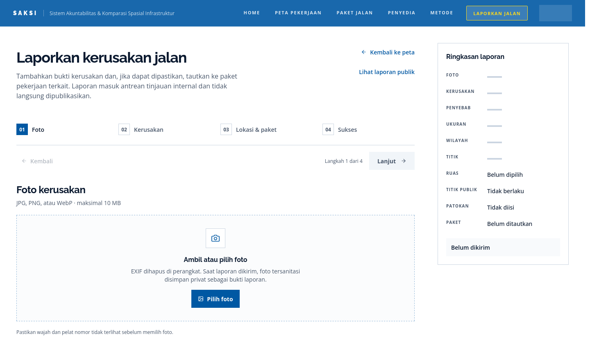
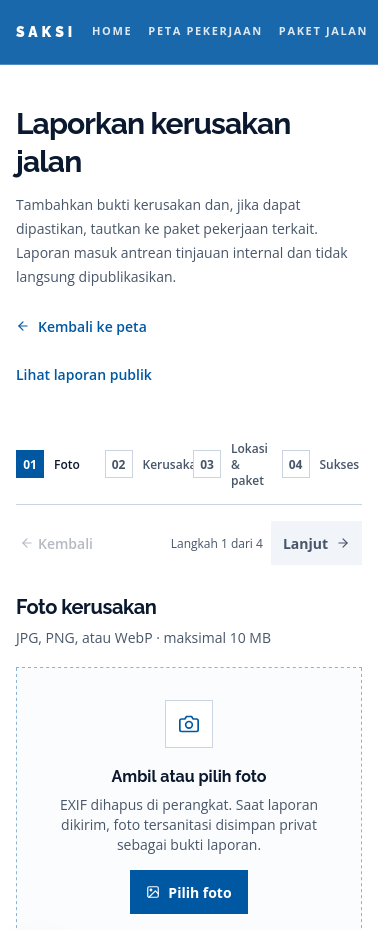
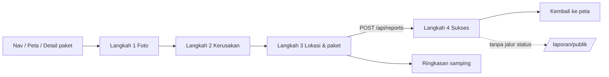

# UX REVIEW — Alur Pelaporan Warga SAKSI

**Tanggal:** 11 November 2026 · **Cakupan:** `/laporan`, `/laporan/paket/[rup]`, `/laporan/publik`,
`/laporan/publik/[publicCode]`, riwayat "Laporan saya" di `/dashboard`, dan titik masuknya dari
navigasi, peta, serta detail paket.
**Status:** review dan rencana. Tidak ada kode produk yang diubah oleh dokumen ini.

Antrean moderasi staf hanya diperiksa sebatas dampaknya pada janji yang dibuat kepada pelapor
(status, alasan penolakan, bukti foto); antarmuka moderasi bukan objek review ini.

---

## 0. Ringkasan

Alur laporan sudah punya kerangka yang benar: empat langkah yang jelas, sanitasi foto di perangkat,
bahasa ketidakpastian yang konsisten ("belum diverifikasi", "bukan bukti pelanggaran"), consent titik
presisi, dan API yang idempoten. Yang menghambat bukan konsepnya, melainkan **eksekusi antarmuka di
layar kecil, kontrol peta, dan titik-titik keputusannya**.

Tiga masalah terbesar, berurutan menurut risiko:

1. **Titik masuk hilang di ponsel.** Navigasi tidak punya menu ringkas dan meluber ke kanan; tombol
   **Laporkan Jalan** berada di luar layar pada 390 px. Produk pelaporan warga justru tidak dapat
   ditemukan dari ponsel tanpa menggeser halaman secara horizontal.
2. **Pengguna bisa mentok tanpa penjelasan.** "Lanjut" nonaktif dengan alasan hanya di `sr-only`
   (tidak terbaca dan tidak dapat difokuskan), tombol aksi berada **di atas** isi langkah sehingga
   harus digulir naik-turun, dan tidak ada pemulihan draf saat halaman disegarkan.
3. **Peta berkelahi dengan pengguna.** Klik di mana pun pada peta memindahkan pin — termasuk klik
   yang dimaksudkan membaca tooltip ruas — dan kamera mengulang `fitBounds`/`easeTo` setiap render,
   sehingga peta melompat saat pengguna mengetik patokan atau menempatkan pin.

Rekomendasi utama: satu paket perbaikan **P0** (navigasi mobile, kontrol langkah, kontrol peta,
pemilih wilayah, ketahanan draf, tanda terima) sebelum demo final, lalu **P1** untuk merapikan
kepadatan Langkah 3 dan pasca-kirim, dan **P2** untuk konsistensi desain serta aksesibilitas.

---

## 1. Lingkup, metode, dan batas

**Metode**

- Pembacaan kode alur lengkap: `src/features/reports/**`, `src/features/dashboard/components/dashboard-tabs.tsx`,
  `src/app/laporan/**`, `src/app/api/reports/**`, `src/components/navigation/**`.
- Pemeriksaan runtime `npm run dev` pada 1440×900 dan 390×900 (Firefox headless, tangkapan layar di
  `docs/assets/`). Endpoint `POST /api/reports` diuji langsung tanpa `DATABASE_URL`.
- Evaluasi heuristik (Nielsen) dan checklist aksesibilitas (label, fokus, target sentuh, `aria-*`,
  kontras), lalu dipetakan ke aturan `docs/DESIGN.md` dan `AGENTS.md`.

**Batas**

- WebGL tidak tersedia di peramban headless, sehingga peta tidak dapat dinilai secara visual. Temuan
  peta berasal dari kode `report-location-map.tsx` dan perlu dikonfirmasi sekali di peramban biasa.
- Tanpa `DATABASE_URL`, Langkah 4 (sukses) dan halaman publik tidak dapat dicapai; keduanya dinilai
  dari kode dan dari pesan galat API yang benar-benar diuji.
- Pengujian dengan peserta nyata belum dilakukan; seluruh angka keberhasilan di §7 adalah target,
  bukan hasil pengukuran.





---

## 2. Alur hari ini



Keadaan yang tersedia hari ini:

| Keadaan | Sumber | Catatan |
|---|---|---|
| Foto wajib, satu berkas | `report-prototype.tsx:551-599` | Pratinjau WebP lokal; EXIF dihapus sebelum unggah |
| Jenis kerusakan wajib | `:603-620` | 7 pilihan kartu radio |
| Penyebab, ukuran, keterangan opsional | `:621-654` | Semua pada langkah yang sama |
| Titik: GPS, alamat, pin | `:674-711` | Peta 360–420 px, boleh diklik di mana pun |
| Consent titik publik | `:713-730` | Aktif secara bawaan |
| Wilayah manual (fallback) | `:732-756` | Satu `<select>` berisi seluruh RW kota |
| Patokan lokasi | `:758-760` | Teks bebas ≤180 karakter |
| Kandidat paket | `:781-836` | Diambil per kecamatan, batas 300 baris |
| Sukses + nomor tanda terima | `:840-854` | Hanya tampil di layar |
| Ringkasan samping | `:859-895` | 10 baris, termasuk koordinat dan nama berkas |

---

## 3. Temuan

Severity: **P0** menghalangi penyelesaian atau berisiko menghasilkan data yang salah; **P1** friksi
berat atau masalah kepercayaan; **P2** pemolesan, konsistensi, dan aksesibilitas.

### 3.0 Titik masuk

| ID | Temuan | Bukti | Dampak | Perbaikan |
|---|---|---|---|---|
| E1 | **P1** Beranda menjelaskan "Rujuk nomor RUP — mulai laporan kerusakan" tetapi tidak punya tautan ke `/laporan` | `src/features/audit/components/package-journey-section.tsx:12`; `src/app/page.tsx:20-26` hanya header, eksplorasi anggaran, dan pencarian paket | Pelaporan adalah inti produk, tetapi hanya dapat dicapai lewat navigasi (yang terpotong di ponsel, N1) | Satu CTA utama setelah bagian perjalanan paket: **Laporkan kerusakan jalan** → `/laporan` |
| E2 | **P2** Detail laporan publik tidak menawarkan pelaporan di sekitar lokasi tersebut | `src/app/laporan/publik/[publicCode]/page.tsx:104-112` (catatan saja, tanpa aksi) | Pengguna yang baru melihat kerusakan serupa tidak punya langkah lanjutan | Tambahkan tautan "Laporkan kerusakan di wilayah ini" dengan `region` diteruskan; jangan membawa titik atau paket otomatis |
| — | **Baik:** CTA di detail paket dan panel peta konsisten (label, ikon, warna) dan membawa `rup` sebagai rujukan | `src/app/paket/[rup]/page.tsx:85-95`; `src/features/map/map-dashboard.tsx:890-901` | — | Pertahankan |

### 3.1 Navigasi dan penemuan

| ID | Temuan | Bukti | Dampak | Perbaikan |
|---|---|---|---|---|
| N1 | **P0** Navigasi 7 butir tanpa menu ringkas meluber horizontal di 390 px; **Laporkan Jalan** dan **Masuk** di luar layar | Tangkapan `assets/ux-laporan-mobile-390.png`; `src/components/navigation/nav-actions.tsx:15-52`, kontainer `src/components/navigation/navbar.tsx:17-24` tanpa `flex-wrap`/`overflow-x` | Titik masuk produk pelaporan tidak terlihat di ponsel | Menu ringkas (< `md`) dengan 2 aksi utama: **Laporkan** + **Masuk/Dashboard**; sisanya di panel |
| N2 | **P2** Seluruh header diganti bilah biru kosong selama sesi dimuat | `src/app/layout.tsx:31-33` (`Suspense fallback` setinggi 64 px) | Kehilangan brand dan navigasi sesaat; terlihat seperti halaman rusak di jaringan lambat | Fallback mempertahankan brand dan kerangka tombol (skeleton per item, bukan seluruh header) |
| N3 | **P1** Tautan "Kembali ke peta" dan "Lihat laporan publik" di kepala halaman menduplikasi navigasi | `report-prototype.tsx:488-496`; DESIGN §1.3 | Dua jalur keluar sebelum tugas dimulai; mengurangi fokus pada Langkah 1 | Pertahankan satu tautan kembali setelah Langkah 4; pada alur gunakan hanya bilah kemajuan |

### 3.2 Langkah 1 — foto

| ID | Temuan | Bukti | Dampak | Perbaikan |
|---|---|---|---|---|
| F1 | **P0** "Lanjut" nonaktif tanpa alasan yang terlihat; penjelasan hanya `sr-only` dan tombol `disabled` tidak dapat difokuskan | `:528-540`; perilaku `disabled` bawaan HTML | Pengguna berhenti di layar pertama tanpa tahu harus berbuat apa | Tampilkan syarat di samping tombol (mis. "Pilih foto dulu"); atau aktifkan tombol dan tampilkan galat saat diklik |
| F2 | **P1** `capture="environment"` memaksa kamera pada sebagian Android; tidak ada pilihan galeri | `:580-593` | Warga yang ingin memakai foto yang sudah ada tidak punya jalan | Dua aksi: **Ambil foto** (`capture`) dan **Pilih dari galeri** (tanpa atribut); tetap satu jalur sanitasi |
| F3 | **P2** Dua ajakan bersarang (judul "Ambil atau pilih foto" + kotak biru "Pilih foto") di dalam satu `<label>` | `:568-594` | Affordance ganda; area klik dan tampilan tombol tidak sepadan | Satu ajakan utama; ikon dan teks pendukung saja di sekitarnya |
| F4 | **P2** Copy teknis: "EXIF dihapus di perangkat…" | `:574` | Istilah EXIF tidak bermakna bagi warga | "Lokasi dan data kamera dihapus otomatis dari foto." |
| F5 | **P2** `aria-describedby` selalu menunjuk `photo-error` meski elemen itu belum ada | `:592` vs `:599` | IDREF menggantung; pembaca layar dapat mengabaikan seluruh deskripsi | Bangun `aria-describedby` secara kondisional |
| F6 | **P2** Umpan balik pemrosesan hanya mengganti teks kecil di dalam area unggah; tidak ada indikator terpisah dan tidak ada progres unggah | `:348-362`, `:574` | Foto besar di jaringan lambat terasa macet | Status "Memproses foto…" di luar area + progres unggah (§WP3) |

### 3.3 Langkah 2 — kerusakan

| ID | Temuan | Bukti | Dampak | Perbaikan |
|---|---|---|---|---|
| D1 | **P2** Tiga kelompok opsional + keterangan dalam satu layar panjang | `:603-655` | Pengguna mengira semua wajib diisi; menggulir panjang di ponsel | Kelompokkan penyebab/ukuran/keterangan dalam **"Detail tambahan (opsional)"** yang dapat dilipat |
| D2 | **P2** Kontrol tidak konsisten: kartu radio besar (jenis) vs chip kecil (penyebab/ukuran) dengan gaya terpilih yang sama | `:610-618` vs `:624-648` | Perbedaan tipe kontrol tidak terbaca dari tampilannya | Samakan pola (kartu kecil) atau bedakan bentuk chip secara eksplisit |
| D3 | **P2** Label penyebab "Bahan tidak sesuai" berpotensi terbaca sebagai tuduhan | `:33`, `:624-638` | Bertabrakan dengan bahasa "diduga, bukan tuduhan" | Tambahkan kalimat "Pengamatan Anda, bukan kesimpulan penyebab" dan pertimbangkan label "Material tampak tidak sesuai" |
| D4 | **P2** Satu layar memuat 7 + 6 + 3 + 1 kontrol tanpa ringkasan progres | `:603-655` | Beban kognitif tinggi pada langkah kedua | Pertahankan wajib di depan, opsional di lipatan |

### 3.4 Langkah 3 — lokasi dan paket (paling padat)

| ID | Temuan | Bukti | Dampak | Perbaikan |
|---|---|---|---|---|
| L1 | **P0** Klik di mana pun pada peta memindahkan pin, termasuk klik untuk membaca tooltip ruas; dua handler `click` aktif bersamaan | `report-location-map.tsx:332-334` dan `:430-437` | Titik laporan salah tanpa disadari; risiko data | Mode eksplisit: **"Tandai titik"** atau klik hanya menggeser penanda saat pin sudah ada; baca ruas di mode terpisah |
| L2 | **P0** Kamera mengulang `fitBounds`/`easeTo` setiap render karena objek `focus` dibuat ulang dan masuk daftar dependensi | `report-prototype.tsx:230-232`; `report-location-map.tsx:439-458` | Peta melompat saat mengetik patokan, mengubah consent, atau memuat kandidat; pin sulit ditempatkan | Kunci reaksi kamera pada identitas wilayah (kecamatan–kelurahan–RW) dan hanya pada perubahan eksplisit |
| L3 | **P1** Dua model lokasi tampil bersamaan: titik presisi dan `<select>` wilayah manual, tanpa hierarki "pilih salah satu" | `:674-756` | Pengguna bingung; memilih wilayah manual **menghapus titik** tanpa konfirmasi (`:738`) | Satu blok "Lokasi laporan" dengan dua tab/segmen: **Titik presisi** dan **Wilayah saja**; perpindahan meminta konfirmasi bila data akan hilang |
| L4 | **P0** Fallback wilayah berupa satu `<select>` berisi seluruh RW kota tanpa pencarian atau penyaringan kecamatan | `:735-751`; opsi dibangun dari `public/data/rw.geojson` (811 KB) | Jalur untuk pengguna tanpa GPS praktis tidak terpakai | Pemilih bertingkat **Kecamatan → Kelurahan → RW** dengan pencarian, mengikuti pola filter peta |
| L5 | **P1** Satu langkah memuat 4 pekerjaan berbeda (titik, wilayah, ruas, paket) dan 15+ kontrol | `:657-837` | Pengguna kehilangan urutan; puncak *drop-off* | Bagi menjadi sub-bagian bernomor dengan pengungkapan bertahap: **1 Lokasi → 2 Ruas (opsional) → 3 Paket rujukan (opsional)** |
| L6 | **P1** Daftar kandidat memakai gulir dalam gulir (maks. 24 rem) dan tombol "Pilih/Dipilih" 36 px yang juga berfungsi membatalkan | `:811-833` | Jebakan gulir di ponsel; aksi tidak jelas | Tampilkan 5 teratas + "Lihat semua"; pilih lewat kartu (seluruh kartu dapat diklik) dan tombol "Batalkan tautan" terpisah |
| L7 | **P2** Memilih ruas dari pencarian tidak menggerakkan kamera bila titik sudah ada | `:450-457` (cabang `point` mendahului `selectedRoad`) | Tidak ada umpan balik visual bahwa ruas terpilih | Arahkan kamera ke ruas saat ruas dipilih, atau tampilkan peta mini ruas |
| L8 | **P2** Tombol **Jaringan jalan** menempati sudut yang sama dengan kontrol zoom | `:189` (`top-left`) vs `:464-473` (`left-3 top-3 z-10`) | Kontrol zoom tertutup; klik toggle tak terduga | Pindahkan toggle ke kanan atas atau deretan kontrol kustom sendiri |
| L9 | **P2** Batas wilayah diunduh dua kali: sekali oleh formulir, sekali oleh peta | `report-prototype.tsx:234-320`; `report-location-map.tsx:216-233` | ±1 MB JSON ganda pada Langkah 3, terutama di seluler | Angkat pemuatan batas ke satu provider/konteks dan bagikan ke peta |
| L10 | **P2** Tidak ada penanganan kegagalan peta; `roadError` tidak pernah menjadi `true` | `:169`, `:466`, `:474-478` | Peta kosong tanpa penjelasan bila WebGL/gaya gagal | Tangani `map.on("error")`, tampilkan pesan + tombol "Muat ulang peta" dan arahkan ke pencarian alamat |
| L11 | **P2** Dua kotak teks menutupi peta (label kanan bawah, atribusi kanan atas) pada layar sempit | `:479-488` | Area peta efektif menyusut | Label ringkas satu baris + detail di balik tombol info |
| L12 | **P1** Consent publik aktif secara bawaan, tetapi konsekuensinya tidak diulang di titik keputusan maupun di layar sukses | `report-prototype.tsx:189`, `:713-730`, `:840-854`; `docs/REPORTS.md` §precise location | Pengguna dapat mempublikasikan titik rumah tanpa menyadari | Pertahankan default (sesuai keputusan produk), tetapi tampilkan satu baris konfirmasi "Titik ini akan tampil publik" sebelum kirim dan di tanda terima |
| L13 | **P2** Ringkasan menampilkan koordinat 6 desimal | `:869` | Tidak bermakna bagi warga dan terkesan teknis | Ganti dengan "RW 04, Kelurahan …" + status publik |
| L14 | **P2** Jargon di antarmuka: "fallback", "presisi_peta" mentah, "RUP", "Ruas" | `:734`, `:821`, `:784-792`, `road-search.tsx:110-134` | Warga tidak paham istilah pengadaan | "Cadangan", label presisi sebagai kalimat, "Nomor paket (RUP)" dengan penjelasan singkat |

### 3.5 Keputusan, transisi langkah, dan pengiriman

| ID | Temuan | Bukti | Dampak | Perbaikan |
|---|---|---|---|---|
| S1 | **P1** Tidak ada pemindahan fokus atau gulir ke atas saat langkah berganti; baris aksi berada **di atas** isi langkah | `:518-541`; tidak ada `focus()`/`scrollTo` di berkas | Pengguna mendarat di tengah/bawah langkah baru; pengguna pembaca layar tidak diberi tahu | Fokuskan judul langkah, gulir ke atas, umumkan "Langkah 2 dari 4" lewat `aria-live`; aksi pindah ke bilah lengket di bawah pada ponsel |
| S2 | **P0** Draf hilang saat halaman disegarkan/ditinggalkan; pembantu IndexedDB ada tetapi tidak dipakai | `report-draft-store.ts` tanpa satu pun impor | Kehilangan foto + isian pada alur lapangan; pemicu *drop-off* | Sambungkan draf (foto + field) dengan masa simpan 7 hari, hapus setelah kirim, pulihkan dengan tawaran "Lanjutkan draf" |
| S3 | **P0** Nomor tanda terima hanya ada di layar: tanpa tombol salin, tanpa penyimpanan, tanpa jalur pelacakan | `:840-854`, `:875-878` | Pengguna kehilangan satu-satunya bukti laporan; tidak bisa menindaklanjuti | Tombol **Salin**, simpan di perangkat, dan tautan "Laporan saya" (akun) atau penjelasan eksplisit bahwa nomor adalah satu-satunya rujukan |
| S4 | **P1** Pesan galat generik dan berorientasi sistem | `:457`; API menjawab `503 REPORTS_UNAVAILABLE` "Pengiriman laporan belum dikonfigurasi." (diuji) | Pengguna tidak tahu apakah harus mencoba lagi, memeriksa jaringan, atau menghubungi pengelola | Petakan kode galat → pesan dan langkah berikutnya (jaringan, batas 3/jam, validasi, layanan mati) |
| S5 | **P2** Tidak ada progres unggah untuk foto hingga 5 MB | `:412-465` | Ketidakpastian pada koneksi lambat; kiriman ganda | Progres unggah + tahan tombol sampai selesai |
| S6 | **P2** Layar sukses tidak menjelaskan apa yang terjadi selanjutnya | `:846-853` | Pengguna tidak tahu laporan ditinjau manual, kapan tampil, atau bahwa foto tidak pernah publik | Tiga baris status: diterima → ditinjau → tampil publik bila disetujui; sertakan visibilitas titik |
| S7 | **P2** "Sukses" dihitung sebagai langkah keempat | `:23`, `:500-514` | Menambah satu langkah mental yang bukan tugas pengguna | Tampilkan sukses sebagai keadaan akhir di luar deret 3 langkah |
| S8 | **P2** Riwayat akun tidak punya halaman detail, sehingga alasan penolakan tidak pernah terlihat | `src/features/dashboard/components/dashboard-tabs.tsx:26-34`; keputusan di `docs/REPORTS.md` | Pelapor tidak belajar dari penolakan | Tautan detail baca-saja yang aman (tanpa titik/foto/deskripsi) |

### 3.6 Ringkasan samping

| ID | Temuan | Bukti | Dampak | Perbaikan |
|---|---|---|---|---|
| R1 | **P1** Field **opsional** ditampilkan sebagai "pending" dengan garis putus-putus, sama seperti field wajib | `:864-873` (`pending={observedCauses.length === 0}` dst.) | Membaca sebagai daftar tugas yang belum selesai; mendorong pengisian tidak perlu | Tandai hanya wajib sebagai belum lengkap; opsional tampil "—" tanpa status pending |
| R2 | **P2** Ringkasan mengulang 10 baris dan berada **di bawah** formulir pada ponsel | `:859-879` | Duplikasi informasi; tidak terlihat saat dibutuhkan | Ringkas menjadi 3 baris status + "Tinjau isian" (dialog) sebelum kirim |
| R3 | **P2** Baris Foto menampilkan nama berkas teknis | `:864`; `src/features/reports/lib/report-photo.handler.ts:11` ("foto-kerusakan.webp") | Tidak informatif | "1 foto siap" + thumbnail |
| R4 | **P2** Kotak "Belum dikirim"/"Laporan diterima" menduplikasi status langkah | `:875-878` | Pengulangan status | Hapus; status sudah dibawa stepper dan layar sukses |

### 3.7 Aksesibilitas

| ID | Temuan | Bukti | Perbaikan |
|---|---|---|---|
| A1 | **P1** Perpindahan langkah tidak diumumkan dan fokus tidak dipindahkan | `report-prototype.tsx` tanpa manajemen fokus | Fokus ke `h2` langkah + `aria-live="polite"` untuk status langkah |
| A2 | **P1** Tombol nonaktif tidak dapat difokuskan, sehingga `aria-describedby` syarat tidak pernah terbaca | `:529-540` | Ganti dengan tombol aktif + validasi saat klik, atau teks syarat yang terlihat |
| A3 | **P2** Target sentuh di bawah 44 px: "Hapus tautan" 32 px, "Pilih" 36 px, toggle peta ±27 px, "Ganti nama" hanya teks | `:670`, `:824`, `report-location-map.tsx:469`, `road-search.tsx:179` | Naikkan ke ≥44×44 px (atau padding setara) |
| A4 | **P2** Peta tidak dapat dioperasikan dengan papan ketik; tidak ada petunjuk alternatif | `report-location-map.tsx:462` | Dokumentasikan jalur alternatif (GPS/alamat) dan sediakan kontrol "pindahkan pin" berbasis tombol |
| A5 | **P2** Label 10–11 px berulang dan teks peta 10–11 px | `:734`, `:758`, `report-location-map.tsx:469`, `:480` | Naikkan minimum ke 12 px untuk teks baca; sisakan 10 px hanya untuk label teknis |
| A6 | **P2** Status terpilih pada kartu bergantung pada perubahan warna latar; radio aslinya kecil | kartu radio `:611` | Tambahkan ikon centang/penanda bentuk agar tetap jelas tanpa membedakan warna |

### 3.8 Konsistensi, kode mati, dan dokumentasi

| ID | Temuan | Bukti | Perbaikan |
|---|---|---|---|
| C1 | **P1** Halaman offline berbahasa Inggris, mengklaim draf tersimpan (padahal tidak), dan memakai warna font di luar token | `src/app/offline/page.tsx:12-25` | Terjemahkan, sesuaikan klaim dengan status draf, pakai token desain |
| C2 | **P2** Warna heksadesimal ditanam berulang (9 kemunculan di komponen laporan) | `report-prototype.tsx` (`#004682`, `#0058A3`, `#334155`) | Gunakan token `primary`/`accent-*` |
| C3 | **P2** Kode mati: `report-draft-store.ts` tidak dipakai; `roadError` tidak pernah diaktifkan | lihat S2/L10 | Pakai atau hapus dengan keputusan tercatat |
| C4 | **P2** Dokumentasi usang: `docs/REPORTS.md` dan `docs/SPEC.md` menyebut moderasi/eviden belum ada, padahal sudah | `REPORTS.md` pembuka; `SPEC.md` FR-05 | **Selesai 11 Nov 2026** pada review ini; jaga agar status tidak menyimpang lagi |
| C5 | **P2** Tanpa basis data, alur berhenti di Langkah 3 dengan pesan internal dan `/laporan/publik` menampilkan pesan konfigurasi | `src/server/api/reports/reports.api.ts:418`; `src/app/laporan/publik/page.tsx:143-150` | Sediakan mode demo eksplisit (badge + pesan) atau pastikan env demo selalu terisi |
| C6 | **P2** Detail laporan publik memakai `DEFAULT_REGION_ID`, sedangkan daftar mengikuti `?region=` | `src/app/laporan/publik/[publicCode]/page.tsx:47` vs daftar `:45-48` | Teruskan region lewat tautan dan `searchParams` |

### 3.9 Yang sudah baik (pertahankan)

- Model tiga tugas + hasil akhir mudah dipahami; stepper menunjukkan posisi.
- Bahasa ketidakpastian konsisten dan berimbang: "belum diverifikasi", "bukan bukti pelanggaran",
  "ruas hanya anotasi".
- Privasi ditulis di tempat keputusan (consent titik) dan didukung server (akses presisi berizin +
  audit).
- Foto disanitasi sebelum unggah, dengan pratinjau dan batas ukuran yang jelas.
- Semua kontrol punya label; kartu radio memakai `focus-within`; pesan lokasi memakai `role="status"`.
- Idempotensi, batas laju, dan penanganan galat jaringan di sisi API sudah ada.

---

## 4. Rencana perbaikan

Prinsip: **jangan menambah langkah atau bidang baru**; kurangi keputusan per layar, buat setiap aksi
punya umpan balik, dan pertahankan aturan produk (tanpa pin paket, tanpa CV, tanpa NLP, consent
eksplisit).

### WP1 — Navigasi mobile dan penemuan (P0)

- Menu ringkas < `md`: brand + **Laporkan** (tombol utama) + **Masuk/Dashboard**; tautan lain dalam
  panel yang dapat ditutup dengan Esc.
- Header minimal 56–64 px, tidak meluber; uji pada 320, 360, 390 px.
- Hapus tautan ganda di kepala `/laporan`; sediakan satu "Kembali" setelah kirim.
- Tambahkan CTA **Laporkan kerusakan jalan** di beranda setelah bagian perjalanan paket (E1).

**Selesai bila:** seluruh tujuan navigasi dapat dicapai tanpa gulir horizontal pada 320 px;
"Laporkan Jalan" terlihat tanpa membuka menu; header tidak pernah kosong saat sesi dimuat.

### WP2 — Kontrol langkah dan posisi aksi (P0)

- Baris aksi menjadi bilah lengket di bawah pada ponsel (dan tetap di atas pada desktop).
- Ganti tombol nonaktif tanpa alasan dengan tombol aktif + validasi saat klik, atau teks syarat yang
  terlihat di samping tombol.
- Pindahkan fokus ke judul langkah, gulir ke atas, umumkan progres.
- Ringkas stepper di ponsel menjadi nomor + label pendek (hindari tabrakan "Kerusakan03").

**Selesai bila:** pengguna dapat menyelesaikan alur hanya dengan papan ketik; setiap tombol yang
tidak dapat ditekan memiliki alasan tertulis dalam ≤8 kata; tidak ada label stepper yang bertumpuk
pada 360 px.

### WP3 — Ketahanan draf, pengiriman, dan galat (P0/P1)

- Sambungkan `report-draft-store.ts`: simpan foto tersanitasi + field, kedaluwarsa 7 hari, hapus
  setelah kirim, tawarkan "Lanjutkan draf" saat kembali.
- Petakan kode galat API → pesan + tindakan: jaringan, `429` (3 kiriman/jam), `422`, `503`.
- Progres unggah (XHR) di tombol kirim; cegah kiriman ganda.

**Selesai bila:** menyegarkan halaman pada Langkah 3 memulihkan draf; setiap galat menyebut satu
tindakan berikutnya; kiriman ganda tidak mungkin terjadi.

### WP4 — Peta lokasi yang tidak berkelahi (P0/P1)

- Pisahkan **menjelajah peta** dan **menandai titik**: tombol "Tandai titik" (atau klik hanya
  menggeser pin yang sudah ada); membaca tooltip ruas tidak pernah membuat titik.
- Kunci efek kamera pada identitas wilayah; jangan re-render kamera saat state lain berubah.
- Pindahkan toggle **Jaringan jalan** agar tidak menutupi kontrol zoom.
- Arahkan kamera ke ruas yang dipilih dari pencarian.
- Tangani kegagalan peta/gaya dengan pesan + alternatif alamat/GPS.
- Bagikan satu muatan batas wilayah antara formulir dan peta.

**Selesai bila:** klik pada ruas menampilkan tooltip tanpa memindahkan pin; mengetik patokan tidak
mengubah kamera; tidak ada kontrol yang bertumpuk; kegagalan peta menghasilkan pesan yang dapat
ditindaklanjuti.

### WP5 — Pemilih wilayah dan paket yang dapat ditelusuri (P0/P1)

- Ganti `<select>` RW tunggal dengan **Kecamatan → Kelurahan → RW** + pencarian; pertahankan
  kemampuan mengirim tanpa titik.
- Ubah Langkah 3 menjadi tiga sub-bagian bernomor dengan pengungkapan bertahap (Lokasi → Ruas →
  Paket); wajib hanya pada bagian pertama.
- Kandidat paket: 5 teratas + "Lihat semua", kartu dapat diklik, tombol "Batalkan tautan" terpisah.
- Tegaskan "RUP" sebagai nomor paket dan jelaskan tautan sebagai rujukan, bukan bukti.

**Selesai bila:** pengguna tanpa GPS dapat memilih RW dalam ≤3 interaksi; memilih paket tidak
memerlukan gulir dalam gulir; seluruh kartu kandidat memenuhi target sentuh.

### WP6 — Consent dan ketidakpastian (P1)

- Ringkas consent menjadi satu baris konfirmasi sebelum kirim dan satu baris di tanda terima.
- Tambahkan catatan "pengamatan Anda, bukan kesimpulan penyebab" pada kelompok penyebab.
- Ganti koordinat di ringkasan dengan wilayah + status tampil publik.

**Selesai bila:** sebelum menekan kirim, pengguna melihat satu pernyataan eksplisit tentang
visibilitas titik; status tersebut juga muncul setelah kirim.

### WP7 — Pasca-kirim (P1)

- Tanda terima: **Salin**, simpan lokal 30 hari, dan tautan ke "Laporan saya" bila sesi ada.
- Layar sukses: alur diterima → ditinjau → tampil publik (bila disetujui), foto tidak pernah publik.
- Untuk anonim: nyatakan bahwa nomor adalah satu-satunya rujukan (sampai ada pencarian berbasis kode).

**Selesai bila:** nomor tanda terima dapat disalin dan masih ada setelah halaman ditutup; pengguna
memahami bahwa publikasi tidak otomatis.

### WP8 — Ringkasan dan kepadatan (P1/P2)

- Ringkasan: 3 baris status (foto, kerusakan, lokasi) + "Tinjau isian"; tidak ada status pending
  untuk field opsional; nama berkas diganti thumbnail.
- Lipat detail opsional Langkah 2.
- Hapus kotak status ganda.

**Selesai bila:** ringkasan tidak menyiratkan kewajiban pada field opsional dan dapat dipakai untuk
memeriksa isian sebelum kirim pada satu layar ponsel.

### WP9 — Copy, konsistensi visual, dan kebersihan kode (P2)

- Terapkan copy deck §6; samakan chip/kartu; ganti heksadesimal dengan token.
- Terjemahkan halaman offline dan sesuaikan klaim draf; beri token desain.
- Pakai atau hapus `report-draft-store.ts`/`roadError`; perbaiki `aria-describedby` kondisional;
  teruskan `region` pada detail publik; jaga `REPORTS.md`/`SPEC.md` tetap sinkron (C4 sudah
  diperbaiki pada review ini).

### WP10 — Verifikasi dan pengukuran (P1)

- Uji interaksi (Playwright) untuk: aksesibilitas langkah, draf, pemilihan RW, kandidat paket, kirim,
  tanda terima, dan penolakan titik di luar wilayah.
- Audit `axe`/`pa11y` pada tiga keadaan (Langkah 1, 3, sukses) di 390 px dan 1440 px.
- Uji 5 tugas dengan 5–8 peserta (lihat §7).

### Quick win (≤1 hari, tanpa mengubah alur)

- Terjemahkan halaman offline dan sesuaikan klaim draf (C1).
- Hapus status "pending" pada field opsional dan ganti nama berkas dengan thumbnail (R1, R3).
- Hapus kotak status ganda dan dua tautan kepala halaman (R4, N3).
- Perbaiki `aria-describedby` kondisional dan target sentuh <44 px (F5, A3).
- Ganti copy EXIF/fallback/RUP sesuai §6 (F4, L14).
- Pindahkan toggle **Jaringan jalan** dari sudut kontrol zoom (L8).

---

## 5. Usulan susunan layar (ringkas)

**Langkah 3 sekarang:** peta + GPS + hapus titik + pencarian alamat + pencarian ruas + consent +
select RW + patokan + pesan + peringatan + kandidat paket.

**Usulan:**

```text
Langkah 3 · Lokasi dan paket
┌─────────────────────────────────────────────┐
│ ① Lokasi laporan                            │
│   [ Titik presisi ] [ Wilayah saja ]        │  ← segmen, satu model aktif
│   peta (Tandai titik) · Gunakan lokasi saya │
│   cari alamat · hasil: "RW 04, Sukarasa"    │
│   consent ringkas: titik tampil publik      │
│                                             │
│ ② Ruas jalan (opsional)             [buka]  │
│   cari nama ruas · ruas terpilih            │
│                                             │
│ ③ Paket rujukan (opsional)          [buka]  │
│   kandidat 5 teratas · "Lihat semua"        │
│   tautan = rujukan, bukan bukti             │
└─────────────────────────────────────────────┘
```

Bilah aksi lengket di ponsel: `[Kembali]              [Lanjut →]` dengan alasan syarat di atasnya.

---

## 6. Copy deck (sebelum → sesudah)

| Sebelum | Sesudah |
|---|---|
| "EXIF dihapus di perangkat…" | "Lokasi dan data kamera dihapus otomatis dari foto." |
| "Pilih foto" (di dalam "Ambil atau pilih foto") | Satu ajakan: **Ambil foto** + tautan **Pilih dari galeri** |
| "Kelurahan / RW manual (fallback)" | "Pilih wilayah tanpa titik" |
| "Kandidat paket di wilayah" + "Pilih"/"Dipilih" | "Paket yang mungkin terkait" + "Tautkan"/"Batalkan tautan" |
| "RUP 55981404" mentah | "Nomor paket RUP 55981404" |
| "Titik publik: Ditampilkan" | "Titik presisi tampil di halaman publik" |
| "Laporan belum dapat dikirim. Coba lagi." | "Koneksi terputus. Laporan belum terkirim — coba lagi; isian Anda tetap tersimpan." |
| "Pengiriman laporan belum dikonfigurasi." | "Layanan laporan sedang tidak tersedia. Coba lagi nanti atau kirim melalui kanal resmi." |
| "Laporan sudah diterima untuk ditinjau." | "Diterima. Ditinjau manual sebelum tampil publik; foto tidak pernah ditampilkan." |
| "Titik: -6.178, 106.631" | "RW 04, Sukarasa · titik tampil publik" |
| Offline: "You're offline… Drafts saved on this device remain here." | "Anda sedang offline. Draf di perangkat tidak hilang; kirim setelah koneksi kembali." |

---

## 7. Ukuran keberhasilan dan verifikasi

**Uji tugas (5–8 peserta, moderat, ponsel 390 px):**

1. Dari beranda, temukan cara melaporkan kerusakan tanpa bantuan.
2. Unggah foto dan lanjut ke langkah berikutnya.
3. Pilih jenis kerusakan dan selesaikan langkah itu.
4. Tandai titik di lokasi yang diminta, lalu tautkan paket rujukan.
5. Kirim dan tunjukkan kembali nomor tanda terima setelah menutup halaman.

**Target (bukan hasil pengukuran):** penyelesaian tanpa bantuan ≥70%; waktu ke aksi pertama ≤20 detik;
nol kesalahan "pin berpindah sendiri"; seluruh peserta dapat menemukan tanda terima kembali; SEQ ≥5,5/7.

**Metrik funnel yang layak dikumpulkan tanpa data pribadi:** jumlah tampilan Langkah 1/2/3, sumber
lokasi yang dipakai (GPS/alamat/pin/manual), tautan paket dipilih/tidak, hasil kirim (sukses/galat per
kode), dan waktu antar-langkah. Kumpulkan sebagai agregat server tanpa koordinat, IP, atau identitas;
jangan memakai analitik pihak ketiga pada alur ini.

**Gerbang teknis tiap paket kerja:** `npm run lint` 0 temuan, `npm run build` tanpa `DATABASE_URL`,
`bun test` hijau, plus uji Playwright baru untuk alur (WP10). Periksa juga 320/390/768/1440 px,
zoom 200%, dan navigasi papan ketik penuh.

---

## 8. Urutan kerja

| Tahap | Isi | Hasil yang dapat didemokan |
|---|---|---|
| 1 (P0, ±2–3 hari) | WP1 + WP2 + WP4 (tanpa L9) + WP5 (pemilih RW) | Alur selesai di ponsel, tanpa pin salah dan tanpa mentok |
| 2 (P0/P1, ±2–3 hari) | WP3 + WP7 + WP6 | Draf pulih, galat jelas, tanda terima aman, consent tampak |
| 3 (P1/P2, ±2 hari) | WP8 + WP9 + sisa WP4/WP5 | Kepadatan turun, copy dan konsistensi rapi |
| 4 (P1) | WP10 + uji tugas | Bukti perbaikan untuk proposal/video |

Tahap 1 dan 2 sudah cukup untuk demo final 28 November 2026; tahap 3–4 memperkuat penilaian desain
dan dapat dilakukan paralel dengan penyiapan proposal/video.

---

## 9. Keputusan yang perlu dikonfirmasi

1. **Jumlah langkah.** Spesifikasi (FR-03) menyebut 4 langkah. Rekomendasi: tetap 3 tugas + layar
   sukses (sukses bukan langkah), dengan sub-bagian di Langkah 3 — tidak mengubah cakupan fitur.
2. **Consent titik.** Tetap aktif secara bawaan sesuai keputusan produk; tambahkan pengulangan
   konsekuensi (WP6). Perubahan default adalah keputusan produk, bukan UX.
3. **Penyimpanan draf.** Rekomendasi IndexedDB yang sudah ada, kedaluwarsa 7 hari, dihapus setelah
   kirim. Alternatif `sessionStorage` lebih sederhana tetapi hilang saat tab ditutup.
4. **Pelacakan laporan anonim.** Rekomendasi: simpan tanda terima di perangkat + dorong akun; pencarian
   berbasis kode di server menuntut keputusan anti-tebakan dan retensi tersendiri (`docs/REPORTS.md`).
5. **Badge simulasi.** Nyalakan `NEXT_PUBLIC_SIMULATION_BADGE=1` untuk demo lomba agar status prototipe
   terbaca, lalu build ulang.
6. **Mode demo tanpa basis data.** Putuskan apakah demo selalu ber-`DATABASE_URL` atau alur diberi
   mode simulasi eksplisit; saat ini pengiriman berhenti dengan pesan internal.

---

## 10. Rujukan

- `docs/DESIGN.md` — palet, tipografi, aturan Zero-Exposition.
- `docs/REPORTS.md` — model laporan, consent, retensi, proyeksi publik.
- `docs/STATE.md` §2.3 dan §6 — status implementasi laporan dan layer jalan.
- `docs/SPEC.md` FR-03 dan §3 — penautan laporan ke paket.
- `AGENTS.md` — aturan keras produk (privasi, badge, tanpa pin paket, tanpa CV/NLP).
